# Épica 4 · Seguimiento de entrada y salida (Control de asistencia)

Documentación UML de la épica 4 del Sistema de RR.HH. del ERP de supermercado (**KAN-306**). Incluye una **vista general** con un diagrama de clases y uno de secuencia para toda la épica, y una **vista detallada** con el modelo de dominio y un diagrama de secuencia por cada flujo principal.

## Contenido

1. [Historias de la épica](#historias-de-la-épica)
2. [Vista general](#1-vista-general)
   - [Diagrama de clases de la épica](#11-diagrama-de-clases-de-la-épica)
   - [Diagrama de secuencia de la épica](#12-diagrama-de-secuencia-de-la-épica)
3. [Diagrama de clases detallado](#2-diagrama-de-clases-detallado)
4. [Diagramas de secuencia por flujo](#3-diagramas-de-secuencia-por-flujo)
5. [Notación](#notación)
6. [Trazabilidad con el código](#trazabilidad-con-el-código)

## Historias de la épica

| Historia | Requerimiento | Qué resuelve |
|---|---|---|
| **KAN-41** | RF-21 · Marcaje de entrada | Registro de la hora de ingreso por portal o reloj biométrico, solo para empleados activos y sin duplicados |
| **KAN-42** | RF-22 · Marcaje de salida | Cierre de la jornada con las horas trabajadas; una salida sin entrada queda pendiente de justificación |
| **KAN-43** | RF-23 · Turnos, refrigerios y tolerancias | Turnos diurnos, vespertinos y nocturnos con horas efectivas y margen de puntualidad |
| **KAN-44** | RF-24 · Turnos rotativos por sucursal | Rol semanal o mensual por área, descanso mínimo entre jornadas y aviso a Producción y Entregas por Pub/Sub |
| **KAN-45** | RF-25 · Atrasos e inasistencias | Contraste automático de turnos y marcajes, penalizaciones y aviso a compensaciones |
| **KAN-46** | RF-26 · Justificativos | Solicitud con comprobantes dentro del plazo, revisión de la jefatura y retiro de la penalización |
| **KAN-47** | RF-27 · Horas extra y recargo nocturno | Horas ordinarias, nocturnas y extra con tope legal, conciliación del supervisor y cierre del periodo para planillas |
| **KAN-48** | RF-28 · Historial de asistencia individual | Marcaciones, atrasos acumulados y horas computadas del colaborador *(borrador)* |
| **KAN-49** | RF-29 · Reportes de asistencia | Consolidado por sucursal o área exportable en PDF, Excel o CSV *(borrador)* |

> KAN-48 y KAN-49 están en desarrollo: sus partes se armaron con los criterios de aceptación y se ajustarán con la implementación.

## 1. Vista general

### 1.1 Diagrama de clases de la épica

Las entidades de la épica agrupadas por historia, con sus atributos clave y sus responsabilidades como operaciones. El `Empleado` vive en EmployeeService: AttendanceService guarda solo su UUID.

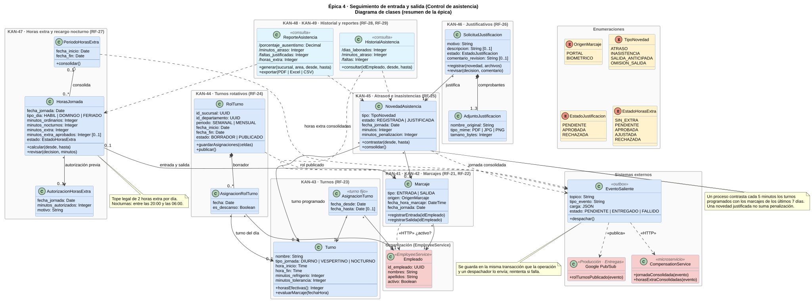

### 1.2 Diagrama de secuencia de la épica

Un recorrido de punta a punta en el orden en que se usa la asistencia:

1. **KAN-43** · RRHH configura los turnos.
2. **KAN-44** · el supervisor publica el rol rotativo y se avisa a Producción y Entregas.
3. **KAN-41 · KAN-42** · el colaborador marca su entrada y su salida.
4. **KAN-45 · KAN-47** · cada 5 minutos se detectan atrasos y faltas, se calculan las horas y se consolida la jornada para compensaciones.
5. **KAN-46** · el colaborador justifica y la jefatura aprueba.
6. **KAN-47** · el supervisor concilia las horas extra y se cierra el periodo.
7. **KAN-48 · KAN-49** · historial del colaborador y reportes.

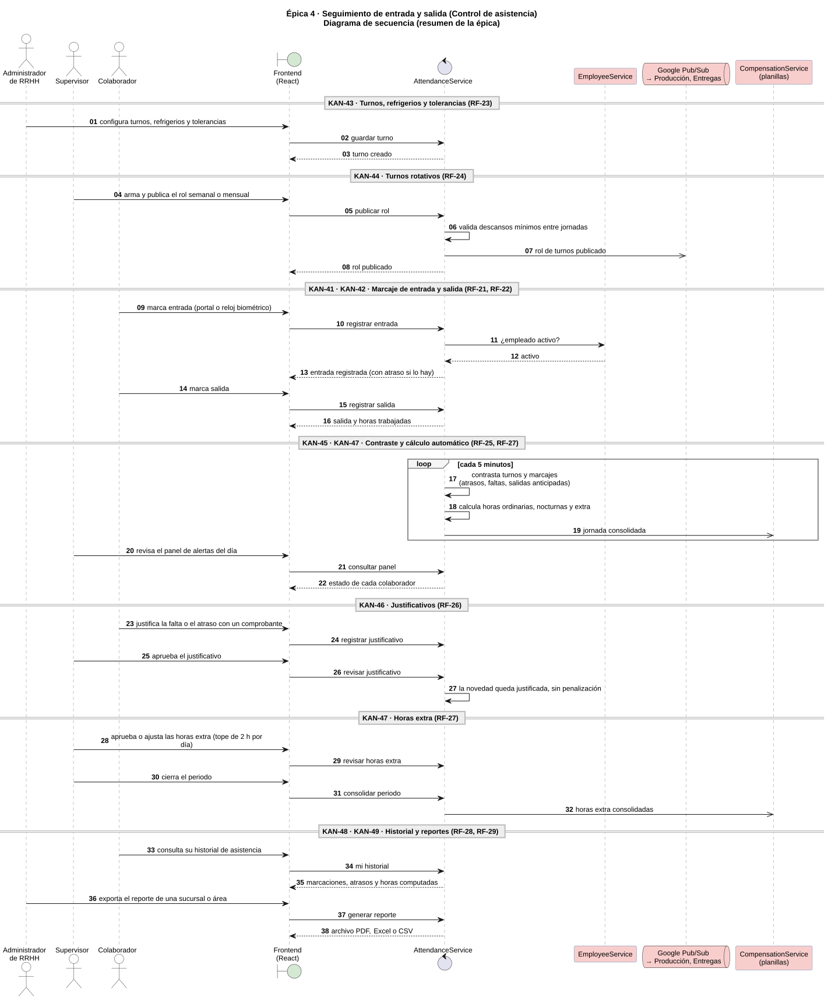

## 2. Diagrama de clases detallado

### 2.1 Modelo de dominio

Las 16 entidades de AttendanceDB con sus atributos reales, los atributos derivados (`/horas_efectivas`, `/cruza_medianoche`), los catálogos como enumeraciones, las multiplicidades y las referencias a EmployeeService (UUID sin clave foránea).

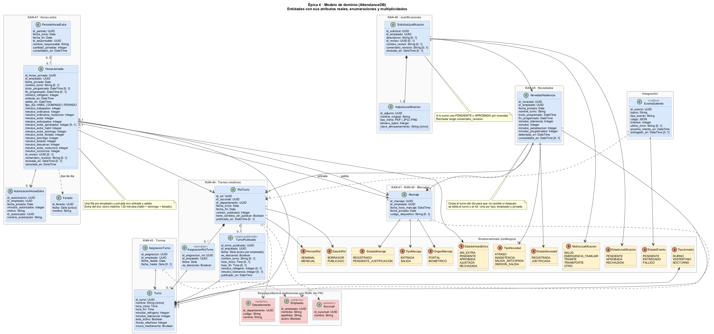

## 3. Diagramas de secuencia por flujo

Cada diagrama sigue las capas del servicio: pantalla → API Gateway → middleware → controlador → servicio → modelo → AttendanceDB, más los sistemas externos.

### 3.1 KAN-43 · Turnos, refrigerios y tolerancias

Validación del turno, horas efectivas (duración − refrigerio) y rechazo de la eliminación de un turno asignado.

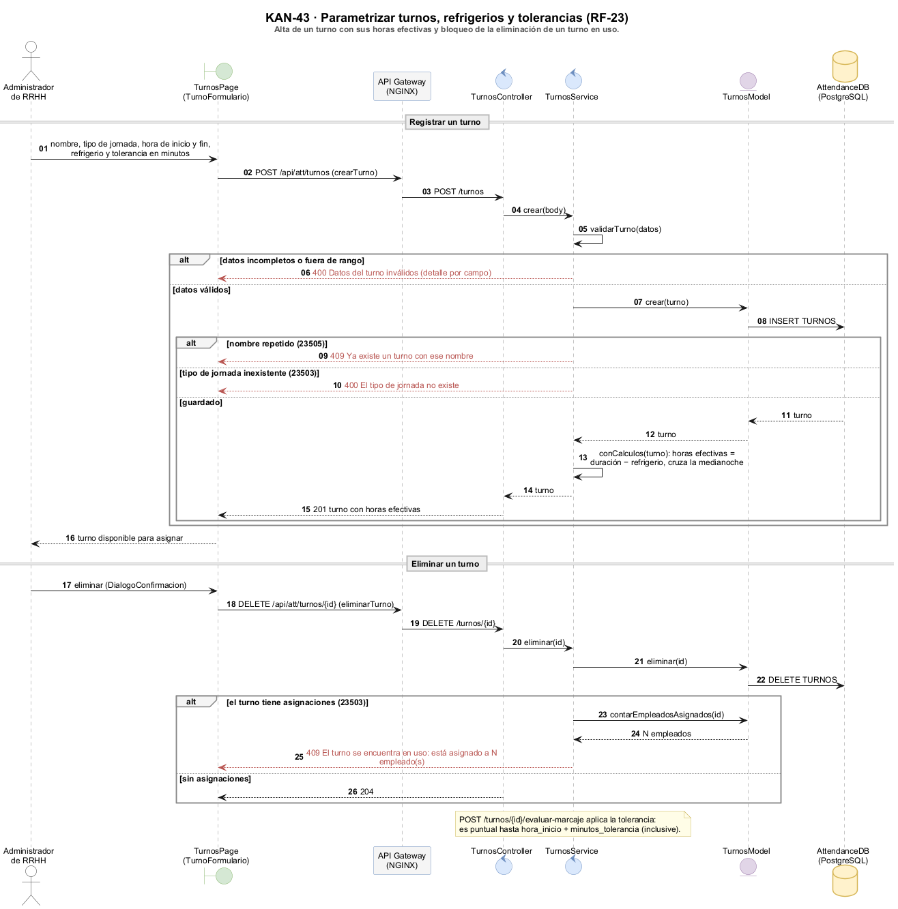

### 3.2 KAN-44 · Rol de turnos rotativos

Borrador en matriz, alertas de descanso mínimo, publicación en una transacción con el evento para Producción y Entregas, y consulta del colaborador.

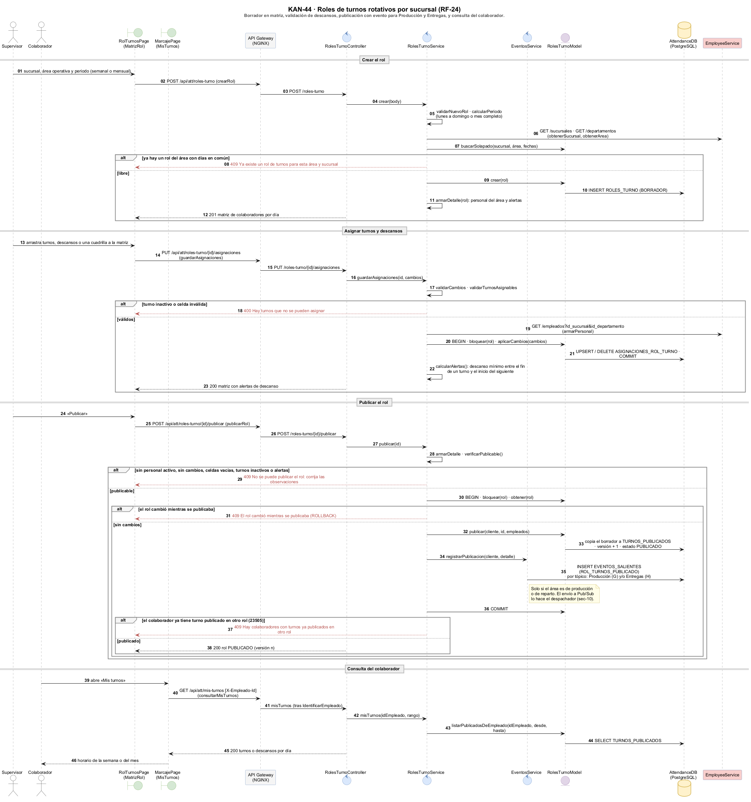

### 3.3 KAN-41 · Marcaje de entrada

Portal o reloj biométrico, verificación del empleado en EmployeeService, jornada del turno programado, rechazo de duplicados y atraso al instante.

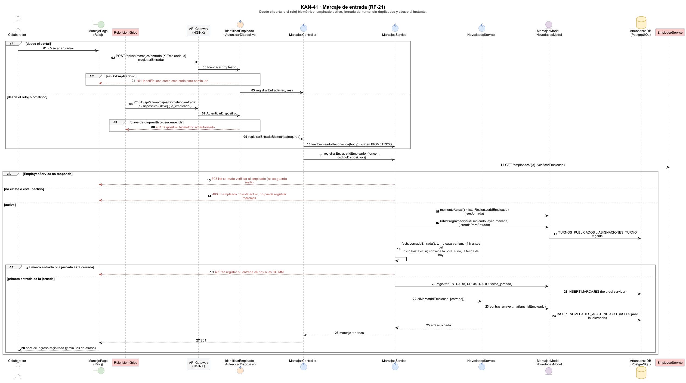

### 3.4 KAN-42 · Marcaje de salida

Cierre de la jornada en curso (también la que cruza la medianoche), horas trabajadas y salida sin entrada pendiente de justificación.

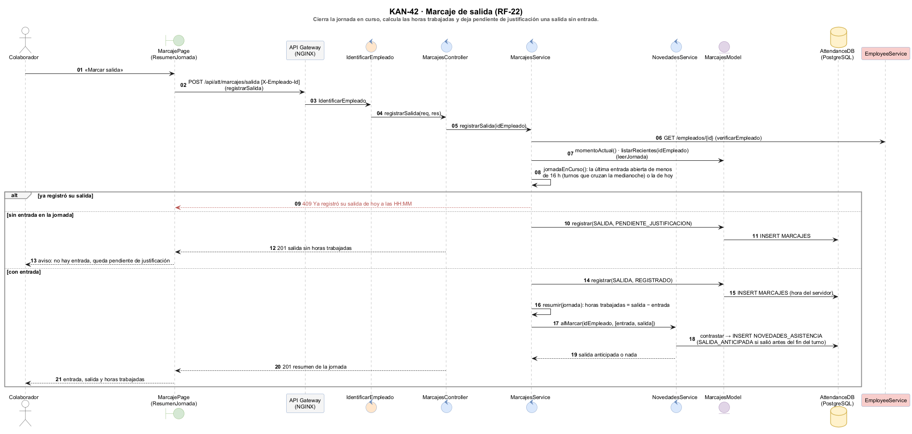

### 3.5 KAN-45 · Contraste automático y panel de alertas

El proceso corre cada 5 minutos sobre los últimos 7 días: registra novedades sin duplicar, consolida las jornadas cerradas para compensaciones y calcula las horas. El supervisor ve el estado del día por colaborador.

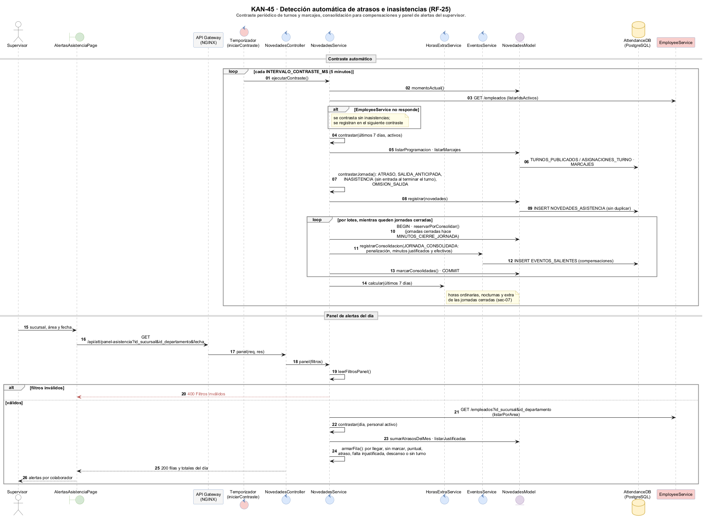

### 3.6 KAN-46 · Justificativos

Comprobantes PDF, JPG o PNG (hasta 3 de 5 MB) dentro de 48 horas, una solicitud vigente por novedad y revisión con comentario obligatorio al rechazar.

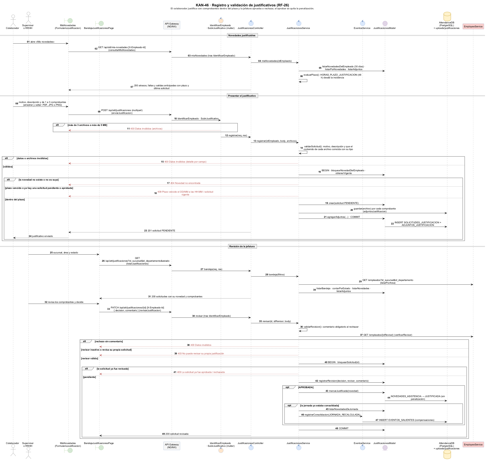

### 3.7 KAN-47 · Horas extra y recargo nocturno

Autorización previa, cálculo por jornada (nocturnas de 20:00 a 06:00, tope de 2 horas extra por día), conciliación del supervisor y cierre del periodo para planillas.

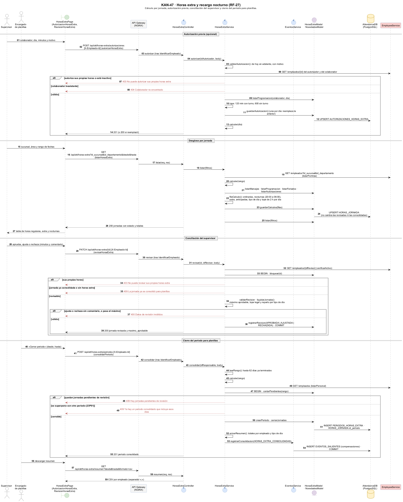

### 3.8 KAN-48 · Historial de asistencia individual *(borrador)*

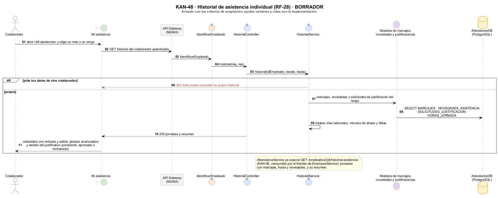

### 3.9 KAN-49 · Reportes de asistencia *(borrador)*

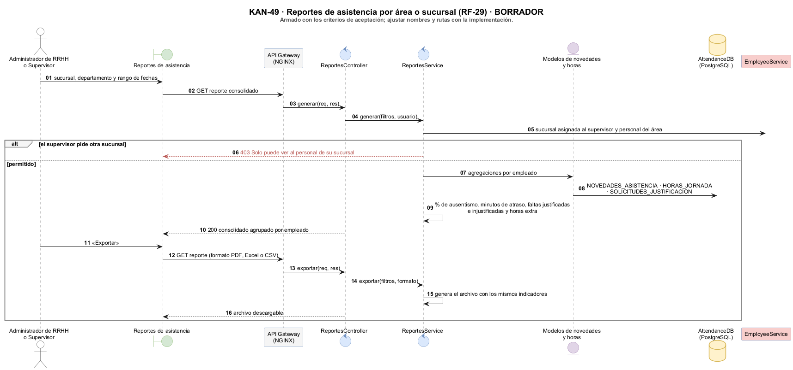

### 3.10 Eventos salientes

Patrón outbox: los eventos se guardan en la misma transacción que la operación y un despachador los envía cada 5 segundos, a Google Pub/Sub para Producción y Entregas, y a CompensationService para planillas, con reintentos.

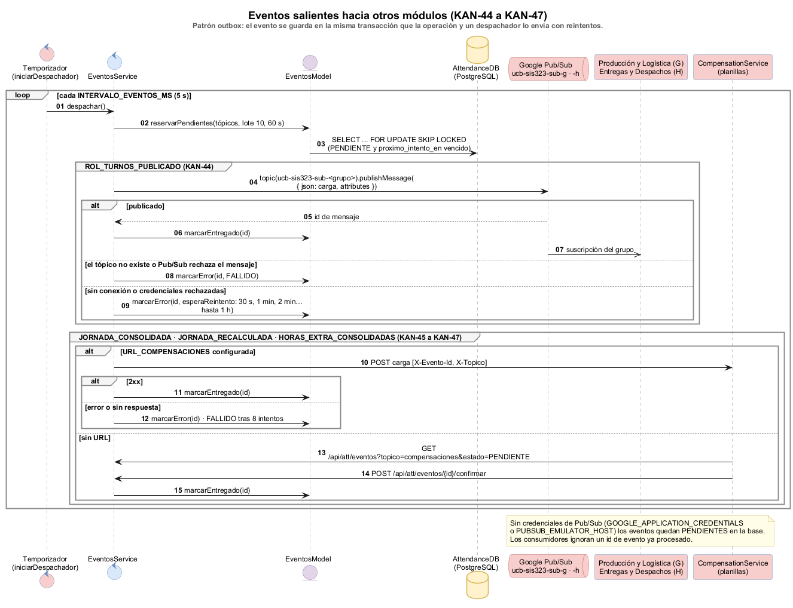

## Notación

| Elemento | Significado |
|---|---|
| ◆ línea continua | Composición: la parte no existe sin el todo |
| ◇ línea continua | Agregación |
| → línea continua | Asociación navegable |
| - - → línea punteada | Dependencia o referencia por UUID sin clave foránea («HTTP», «publica») |
| `/atributo` | Atributo derivado: se calcula, no se almacena |
| `[0..1]` | Atributo opcional |
| Flecha llena | Llamada síncrona |
| Flecha punteada | Respuesta |
| Flecha abierta | Mensaje asíncrono (eventos) |
| Flecha roja punteada | Respuesta de error (400, 401, 403, 404, 409, 503) |
| `alt` · `opt` · `loop` · `group` | Alternativas · opcional · repetición · agrupación |

**Colores:** verde = pantalla · gris = API Gateway · naranja = middleware · azul = controlador o servicio · morado = modelo · amarillo = enumeración o base de datos · rojo = job o sistema externo.

## Trazabilidad con el código

| Historia | Rutas | Servicio | Modelo | Pantalla |
|---|---|---|---|---|
| KAN-43 | `routes/turnos.routes.js` | `turnos.service.js` | `turnos.model.js` | `features/turnos` |
| KAN-44 | `routes/rolesTurno.routes.js` | `rolesTurno.service.js`, `eventos.service.js` | `rolesTurno.model.js`, `eventos.model.js` | `features/rol-turnos`, `features/marcaje/MisTurnos.jsx` |
| KAN-41 · KAN-42 | `routes/marcajes.routes.js` | `marcajes.service.js`, `empleados.service.js` | `marcajes.model.js` | `features/marcaje` |
| KAN-45 | `routes/novedades.routes.js` | `novedades.service.js` | `novedades.model.js` | `features/alertas-asistencia` |
| KAN-46 | `routes/justificaciones.routes.js` | `justificaciones.service.js` | `justificaciones.model.js` | `features/justificaciones` |
| KAN-47 | `routes/horasExtra.routes.js` | `horasExtra.service.js` | `horasExtra.model.js` | `features/horas-extra` |
| Eventos | `routes/eventos.routes.js` | `eventos.service.js`, `config/pubsub.js` | `eventos.model.js` | — |

Rutas, servicios y modelos están en `backend/AttendanceService/src/`; pantallas en `frontend/src/`. Las reglas de negocio y del esquema están en [`db/aclaracion.md`](../../db/aclaracion.md).

Para regenerar las imágenes: `java -jar plantuml.jar -charset UTF-8 -tsvg general/*.puml` y `-tpng detallados/*.puml`.
