# Épica 5 · Solicitud de vacaciones, permisos y licencias

Documentación UML de la épica 5 del Sistema de RR.HH. del ERP de supermercado (**KAN-307**). Incluye una **vista general** con un diagrama de clases y uno de secuencia para toda la épica, y una **vista detallada** con el modelo de dominio, las capas del servicio, las pantallas y un diagrama de secuencia por cada flujo.

Cada diagrama está en tres formatos: el **código fuente** (`.mmd`, [Mermaid](https://mermaid.js.org)) para editarlo, y la imagen en **SVG** (vectorial, se amplía sin perder nitidez) y **PNG**. Las imágenes que se ven aquí son las del repositorio; para cambiar un diagrama se edita su `.mmd` y se regeneran con [`generar-diagramas.sh`](generar-diagramas.sh).

## Contenido

1. [Historias de la épica](#historias-de-la-épica)
2. [Vista general](#1-vista-general)
3. [Diagramas de clases detallados](#2-diagramas-de-clases-detallados)
4. [Diagramas de secuencia por flujo](#3-diagramas-de-secuencia-por-flujo)
5. [Notación](#notación)
6. [Trazabilidad con el código](#trazabilidad-con-el-código)
7. [Configuración](#configuración)
8. [Cómo regenerar las imágenes](#cómo-regenerar-las-imágenes)

## Historias de la épica

Las seis historias están en estado **Finalizado** en Jira y mergeadas en `main`.

| Historia | Requerimiento | Qué resuelve |
|---|---|---|
| **KAN-50** | RF-30 · Solicitud formal de vacaciones | Fechas de inicio y fin, días hábiles sin feriados ni descansos, bloqueo por saldo insuficiente o cruce de fechas, aviso al supervisor |
| **KAN-51** | RF-31 · Licencias y permisos especiales | Causal tipificada con o sin goce de haberes, comprobante digital obligatorio según la causal y advertencia al superar el tope de días |
| **KAN-52** | RF-32 · Saldo de vacaciones | Días ganados por antigüedad (15, 20 o 30), gozados y en proceso, siempre calculados al consultar |
| **KAN-53** | RF-33 · Aprobación o rechazo | Bandeja del supervisor con prioridad y cobertura, débito definitivo del saldo, justificación obligatoria al rechazar e indisponibilidad hacia Producción y Entregas |
| **KAN-54** | RF-34 · Notificación del resultado | Alerta en el portal, campana con contador, página de notificaciones, correo resumen y enlace al detalle de la solicitud |
| **KAN-55** | RF-35 · Calendario de ausencias | Cronograma mensual, semanal y diario de ausencias aprobadas, color por tipo, filtros y aviso de baja cobertura |

## 1. Vista general

### 1.1 Diagrama de clases de la épica

Las entidades de la épica con sus atributos clave, agrupadas por historia. El `Empleado` vive en EmployeeService y las notificaciones en NotificationDB: AttendanceService guarda solo el UUID del empleado (línea punteada, sin clave foránea).


### 1.2 Diagrama de secuencia de la épica

Un recorrido de punta a punta en el orden en que se usa la épica:

1. **KAN-52 · KAN-50 · KAN-51** · el colaborador consulta su saldo y pide vacaciones o una licencia; su supervisor recibe el aviso.
2. **KAN-53** · el supervisor revisa con el impacto en el equipo y decide; al aprobar se debita el saldo y se avisa a Producción o Entregas.
3. **KAN-54** · el colaborador recibe la alerta y el correo y abre el detalle.
4. **KAN-55** · el supervisor ve las ausencias aprobadas y los días de baja cobertura en el calendario.

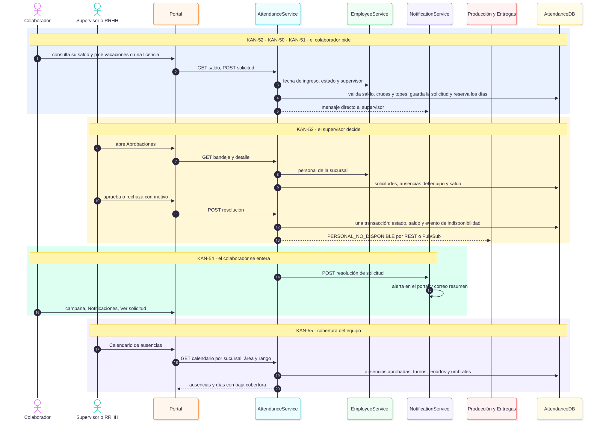

## 2. Diagramas de clases detallados

### 2.1 Modelo de dominio

Las tablas de la épica con sus atributos reales. Los catálogos de estado y de tipo de licencia son enumeraciones; `TurnoPublicado` y `EventoSaliente` vienen de la épica 4. La restricción `EXCLUDE` de `SolicitudLicencia` impide que un empleado tenga dos licencias `PENDIENTE` o `APROBADA` con fechas cruzadas.


### 2.2 Capas del servicio

Cómo se reparte la lógica en `AttendanceService`, qué clientes HTTP usa y qué funciones puras concentran las reglas de negocio (días hábiles, saldo, prioridad, cobertura y umbrales).


### 2.3 Pantallas del portal

Los componentes de React de cada historia, sus hooks y qué módulo de `api/` usa cada pantalla. La campana y la página de notificaciones se avisan entre sí con un pequeño bus de eventos, para que el contador se actualice al instante.


## 3. Diagramas de secuencia por flujo

Cada diagrama sigue las capas del servicio: pantalla → API Gateway → servicio → modelo → base de datos, más los sistemas externos. Las respuestas de error se indican con su código HTTP.

### 3.1 KAN-50 · Solicitud formal de vacaciones

Cálculo de días hábiles, validación de saldo, anticipación y cruces dentro de una transacción que bloquea al empleado, y aviso al supervisor directo.

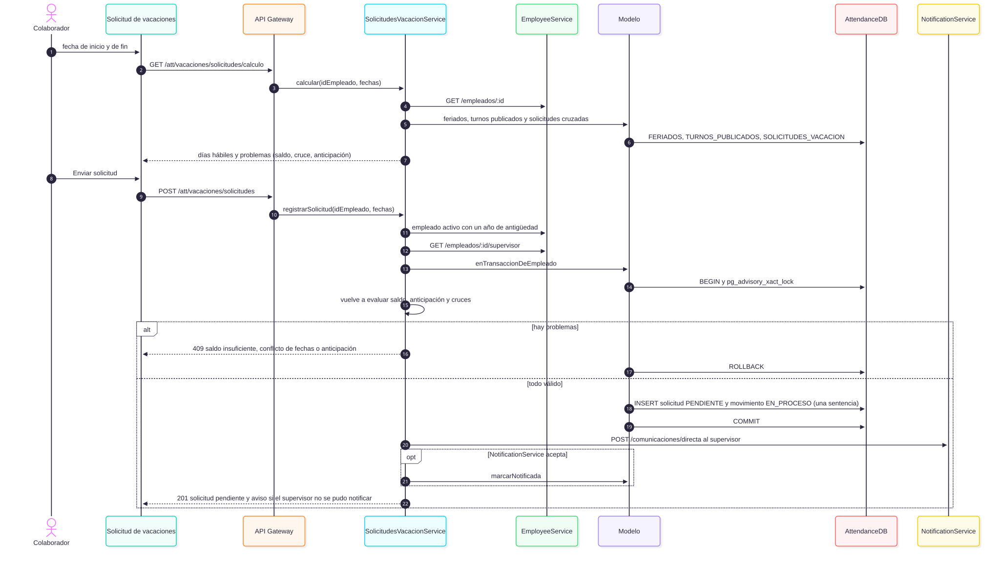

### 3.2 KAN-51 · Licencias y permisos especiales

Causal del catálogo con su clasificación de goce de haberes, comprobante obligatorio según la causal, validación del contenido del archivo y advertencia al superar el tope de días.

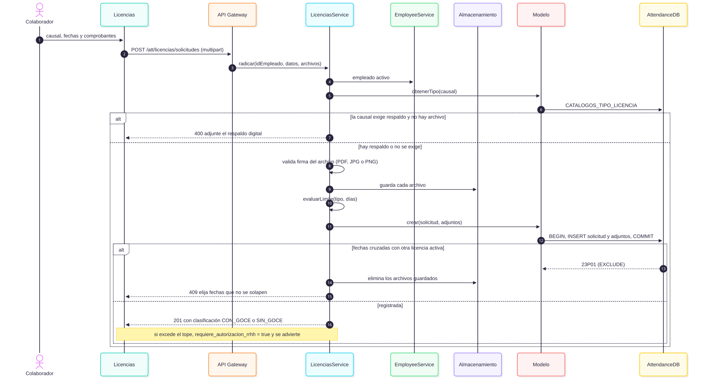

### 3.3 KAN-52 · Saldo de vacaciones

Los días ganados no se guardan: se calculan en cada consulta con la fecha de ingreso y la escala legal, y se restan los movimientos gozados y en proceso.

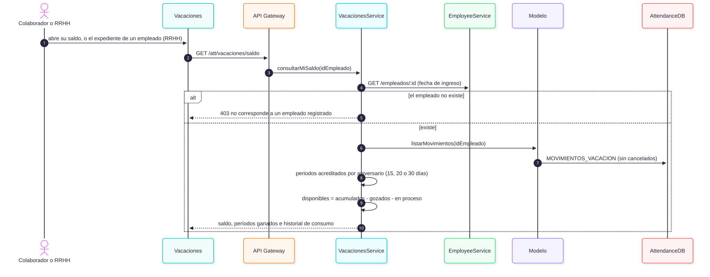

### 3.4 KAN-53 · Aprobación o rechazo

Bandeja con prioridad, detalle con cobertura del equipo y resolución en una sola transacción: el estado de la solicitud, el movimiento del saldo y el evento de indisponibilidad quedan juntos o no queda nada. Una licencia sobre su tope solo la aprueba RRHH.

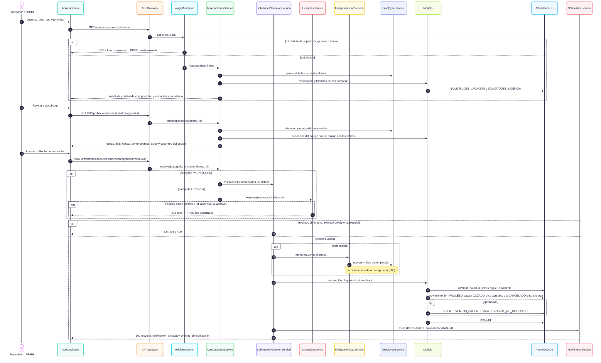

### 3.5 KAN-53 · Eventos de indisponibilidad hacia Producción y Entregas

Patrón outbox: el evento se guarda en la misma transacción que la aprobación y un despachador lo envía después, por REST si el módulo tiene URL y, si falla, por Google Pub/Sub, con reintentos de espera creciente. Un evento fallido se puede reenviar a mano.

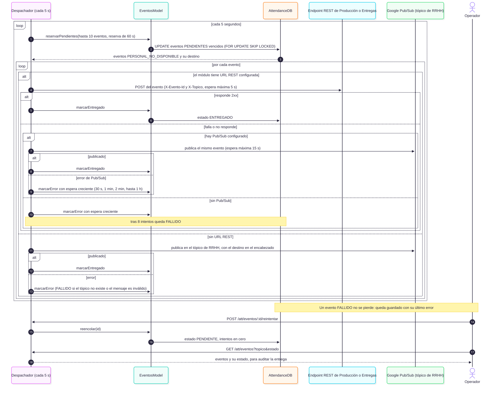

### 3.6 KAN-54 · Notificación del resultado

El aviso sale después de confirmar la resolución. NotificationService es idempotente por solicitud y empleado; si no responde, un reintento periódico completa el aviso. La campana consulta el contador cada 30 segundos y la página de notificaciones muestra el historial.

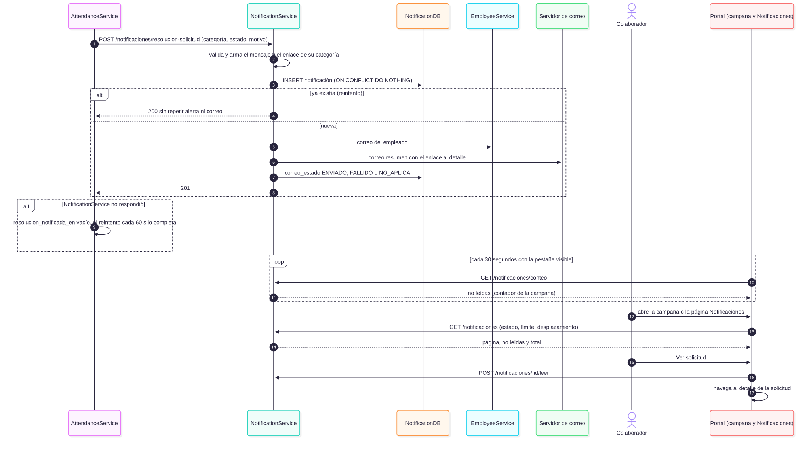

### 3.7 KAN-55 · Calendario consolidado de ausencias

Una sola consulta trae las ausencias aprobadas del personal; la cobertura por área y día se calcula con los turnos publicados, los feriados y el umbral que rige. RRHH puede configurar los umbrales.

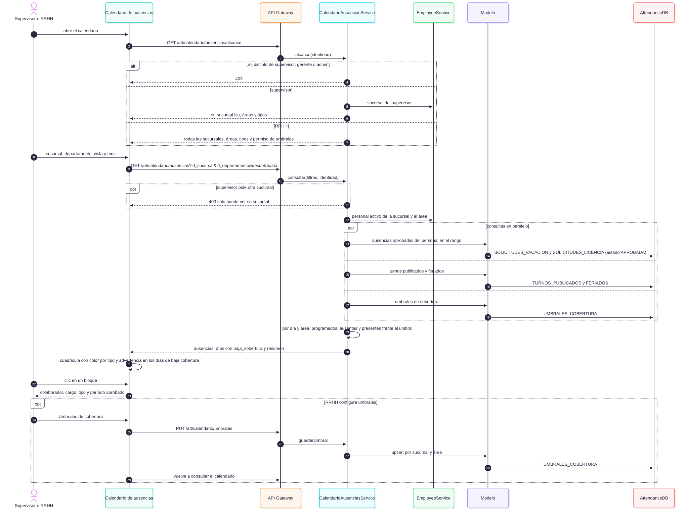

## Notación

| Elemento | Significado |
|---|---|
| `*--` | Composición: la parte no existe sin el todo |
| `-->` | Asociación navegable |
| `..>` | Dependencia o referencia por UUID sin clave foránea («HTTP», «publica») |
| `<<enumeration>>` · `<<catálogo>>` | Valores fijos |
| `<<hook>>` · `<<logica pura>>` | Hook de React · funciones sin efectos secundarios |
| `->>` · `-->>` | Llamada · respuesta |
| `alt` · `opt` · `loop` · `par` | Alternativas · opcional · repetición · en paralelo |
| Fondo de color (`rect`) | Agrupa los pasos de una historia en el diagrama general |

## Trazabilidad con el código

| Historia | Rutas | Servicio | Modelo | Pantalla |
|---|---|---|---|---|
| KAN-50 | `routes/solicitudesVacacion.routes.js` | `solicitudesVacacion.service.js` | `solicitudesVacacion.model.js` | `features/solicitud-vacaciones` |
| KAN-51 | `routes/licencias.routes.js` | `licencias.service.js` | `licencias.model.js` | `features/licencias` |
| KAN-52 | `routes/vacaciones.routes.js` | `vacaciones.service.js` | `vacaciones.model.js` | `features/vacaciones` |
| KAN-53 | `routes/aprobaciones.routes.js`, `routes/eventos.routes.js` | `aprobaciones.service.js`, `indisponibilidad.service.js`, `eventos.service.js` | `aprobaciones.model.js`, `eventos.model.js` | `features/aprobaciones` |
| KAN-54 | `NotificationService/src/routes/notificaciones.routes.js` | `notificaciones.service.js` (ambos servicios) | `notificaciones.model.js` | `features/notificaciones` |
| KAN-55 | `routes/calendarioAusencias.routes.js` | `calendarioAusencias.service.js` | `calendarioAusencias.model.js` | `features/calendario-ausencias` |

Rutas, servicios y modelos están en `backend/AttendanceService/src/` (salvo KAN-54, que además usa `backend/NotificationService/src/`); las pantallas, en `frontend/src/`. Las reglas de negocio y del esquema están en [`db/aclaracion.md`](../../db/aclaracion.md); el SQL, en `db/init.sql` (bloques idempotentes por historia).

## Configuración

| Variable | Servicio | Para qué |
|---|---|---|
| `EMPLOYEE_SERVICE_URL` | Attendance, Notification | Empleados, supervisor, sucursales y áreas |
| `NOTIFICATION_SERVICE_URL` | Attendance | Aviso al supervisor (KAN-50) y resultado al colaborador (KAN-54) |
| `INTERVALO_AVISOS_MS` | Attendance | Cada cuánto se reintentan los avisos sin confirmar (60 000 por defecto) |
| `AREAS_PRODUCCION` · `AREAS_REPARTO` | Attendance | Códigos de área que van a Producción y Logística o a Entregas y Despachos (KAN-53) |
| `URL_PRODUCCION_LOGISTICA` · `URL_ENTREGAS_DESPACHOS` | Attendance | Endpoint REST de cada módulo; sin URL se publica solo por Pub/Sub (KAN-53) |
| `RUTA_VACACIONES` | Notification | Pantalla a la que lleva la alerta de una vacación (`/asistencia/solicitud-vacaciones`) |
| `SMTP_HOST` · `SMTP_PORT` · `SMTP_SECURE` · `SMTP_USER` · `SMTP_PASS` · `SMTP_FROM` · `PORTAL_URL` | Notification | Correo resumen y su enlace; sin `SMTP_HOST` solo se crea la alerta del portal (KAN-54) |

## Cómo regenerar las imágenes

Hace falta Node.js y un navegador basado en Chromium (Chrome, Edge o Brave). Desde esta carpeta:

```bash
./generar-diagramas.sh
```

El script convierte cada `.mmd` de `general/` y `detallados/` en `.svg` y `.png` con [`@mermaid-js/mermaid-cli`](https://github.com/mermaid-js/mermaid-cli). Si no encuentra el navegador, indíquelo antes con `PUPPETEER_EXECUTABLE_PATH`, por ejemplo `export PUPPETEER_EXECUTABLE_PATH="/ruta/a/chrome"`.
