# Épica 7 · Planillas y gestión de compensaciones

Documentación UML de la épica 7 del Sistema de RR.HH. del ERP de supermercado (**KAN-15**, subtarea de documentación **KAN-361**). Incluye una **vista general** con un diagrama de clases y uno de secuencia para toda la épica, y una **vista detallada** con el modelo de dominio, el diseño por capas y un diagrama de secuencia por cada flujo.

Todo vive en **CompensationService** (CompensationDB). Los diagramas salen del código del repositorio: los nombres de tablas, rutas, módulos y funciones son los reales.

Cada diagrama está como **código fuente** (`.mmd`, [Mermaid](https://mermaid.js.org)) y como imagen **SVG** y **PNG**. Para cambiar un diagrama se edita su `.mmd` y se regeneran las imágenes con [`generar-diagramas.sh`](generar-diagramas.sh).

## Contenido

1. [Historias de la épica](#historias-de-la-épica)
2. [Vista general](#1-vista-general)
   - [Diagrama de clases de la épica](#11-diagrama-de-clases-de-la-épica)
   - [Diagrama de secuencia de la épica](#12-diagrama-de-secuencia-de-la-épica)
3. [Diagramas de clases detallados](#2-diagramas-de-clases-detallados)
4. [Diagramas de secuencia por flujo](#3-diagramas-de-secuencia-por-flujo)
5. [Trazabilidad con el código](#4-trazabilidad-con-el-código)
6. [Cómo regenerar las imágenes](#5-cómo-regenerar-las-imágenes)

## Historias de la épica

Las cuatro historias están en estado **Finalizado** en Jira y mergeadas en `main`. KAN-66 a KAN-69 (boletas digitales, aguinaldos, planilla tributaria y reporte contable) también pertenecen a la épica 7 pero siguen **Por hacer**: no tienen código y por eso no están en estos diagramas.

| Historia | Requerimiento | Qué resuelve |
|---|---|---|
| **KAN-62** | RF-42 · Conceptos de pago y deducción | Rubros salariales (ingreso, descuento o aporte) con monto fijo o porcentaje, cuenta contable, historial de vigencias y solo inactivación si ya se usaron |
| **KAN-63** | RF-43 · Generación y aprobación de la planilla mensual | Consolida asistencia, horas extra, licencias y deducciones en un borrador; al aprobarla queda bloqueada y publica de forma asíncrona (outbox) el asiento a Contabilidad y la orden de dispersión a Pagos, con reintentos y cierre al recibir ambas confirmaciones |
| **KAN-64** | RF-44 · Cálculo de haberes, descuentos y líquido pagable | Total ganado, descuentos de ley y líquido pagable de cada colaborador con el desglose por concepto; un líquido negativo o totales que no cuadran dejan una alerta que bloquea la aprobación |
| **KAN-65** | RF-45 · Anticipos de sueldo y préstamos | Registra el anticipo o préstamo con su plan de cuotas, valida que ninguna cuota supere el 20% del líquido pagable (sumando lo ya comprometido) y descuenta la cuota del mes en la planilla |

## 1. Vista general

### 1.1 Diagrama de clases de la épica

Las entidades de las cuatro historias con sus atributos clave. `NovedadPlanilla` (bonos por condiciones especiales) y el porcentaje de `BONO-ANTIGUEDAD` en `CalculoPlanilla` los produce la Épica 8 (KAN-70/72): aquí solo se consumen como un renglón más del cálculo, sin vigencia de concepto propia.


### 1.2 Diagrama de secuencia de la épica

Un recorrido de punta a punta en el orden en que se usa la épica:

1. **KAN-62** · el Contador define los conceptos de pago y deducción con su vigencia.
2. **KAN-65** · se registran los anticipos y préstamos del periodo, con su plan de cuotas.
3. **KAN-63 + KAN-64** · se genera la planilla del mes: consolida asistencia, horas extra y licencias, y calcula haberes, descuentos y líquido pagable de cada colaborador.
4. **KAN-63** · el Contador aprueba la planilla y el asiento y la orden de pago salen de forma asíncrona (outbox) hacia Contabilidad y Pagos.
5. **KAN-63** · con ambas confirmaciones la planilla queda cerrada.
6. **KAN-65** · el Contador cierra el periodo de deducciones: las cuotas del mes quedan pagadas y el saldo de cada préstamo se actualiza.

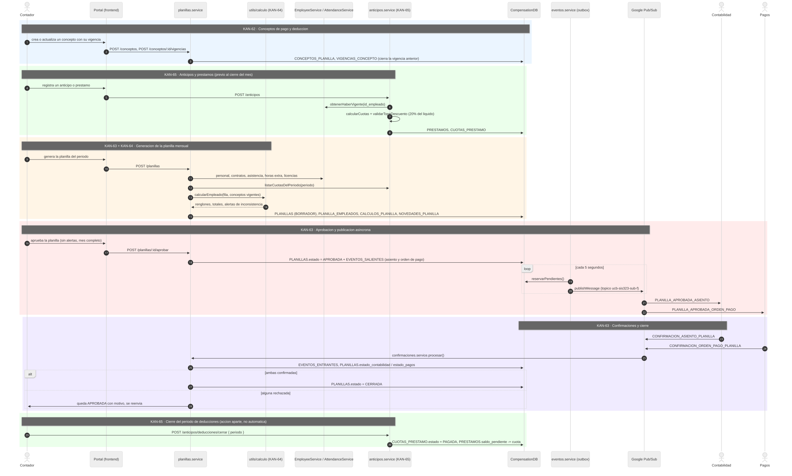

## 2. Diagramas de clases detallados

### 2.1 Modelo de dominio

Las tablas de la épica tal como están en `db/init.sql`, con sus restricciones reales (`CHECK`, `EXCLUDE` sin solapamiento de vigencias, FK sin `CASCADE` en lo ya usado). No incluye las tablas de condiciones especiales ni de antigüedad (`CONDICIONES_ESPECIALES`, `BONOS_CONDICION`, `TRAMOS_ANTIGUEDAD`…), que pertenecen a la Épica 8.


### 2.2 Capas del servicio

Cómo se reparte la lógica en CompensationService: rutas de `conceptos`, `planillas`, `anticipos` y `confirmaciones`, sus controladores, servicios y modelos, la lógica pura de cálculo y validación, el despachador de la bandeja de salida (outbox) y los clientes HTTP hacia EmployeeService y AttendanceService.


## 3. Diagramas de secuencia por flujo

| # | Flujo | Historia | Diagrama |
|---|---|---|---|
| 1 | Crear un concepto y registrar una nueva vigencia | KAN-62 | [sec-01](detallados/sec-01-kan62-conceptos-vigencias.svg) |
| 2 | Generación de la planilla mensual en borrador | KAN-63 | [sec-02](detallados/sec-02-kan63-generar-planilla.svg) |
| 3 | Cálculo de haberes, descuentos y alertas de inconsistencia | KAN-64 | [sec-03](detallados/sec-03-kan64-calculo-alertas.svg) |
| 4 | Aprobación y publicación asíncrona del asiento y la orden de pago | KAN-63 | [sec-04](detallados/sec-04-kan63-aprobacion-outbox.svg) |
| 5 | Confirmaciones de Contabilidad y Pagos, y cierre de la planilla | KAN-63 | [sec-05](detallados/sec-05-kan63-confirmaciones-cierre.svg) |
| 6 | Registro de un anticipo o préstamo con su plan de cuotas | KAN-65 | [sec-06](detallados/sec-06-kan65-registro-prestamo.svg) |
| 7 | Deducción de la cuota en la planilla y cierre del periodo | KAN-65 | [sec-07](detallados/sec-07-kan65-deduccion-cierre-cuotas.svg) |

### 3.1 KAN-62 · Crear un concepto y registrar una nueva vigencia

Crear valida tipo, forma de cálculo y cuenta contable; una nueva vigencia cierra la anterior sin tocar su valor (las planillas ya generadas conservan el histórico). `BONO-ANTIGUEDAD` no admite vigencias manuales: su porcentaje depende de la escala de la Épica 8.

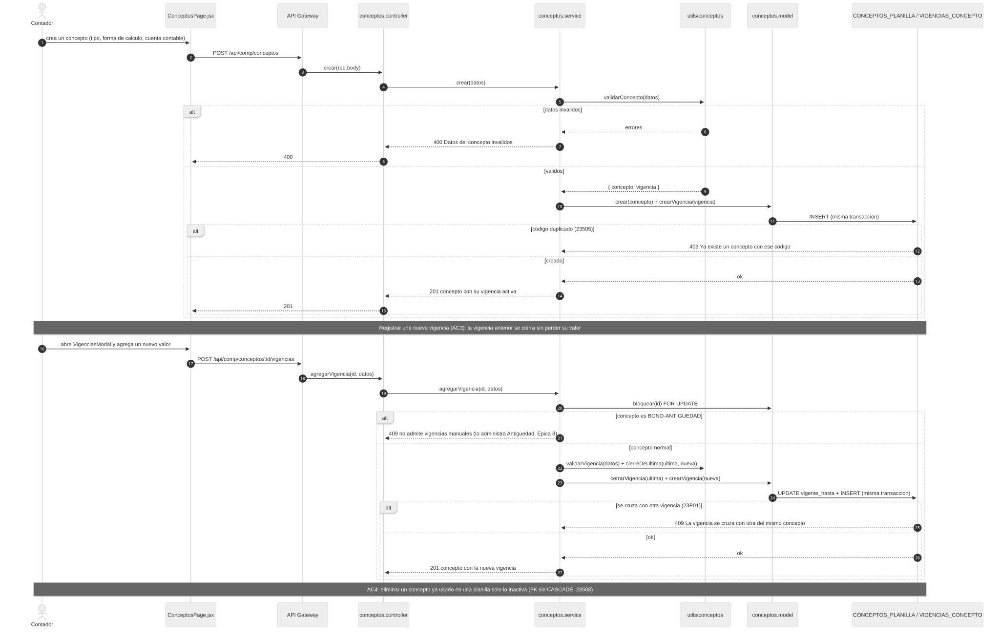

### 3.2 KAN-63 · Generación de la planilla mensual

Consolida personal, contratos, asistencia, horas extra y licencias de AttendanceService y EmployeeService, reprocesa los bonos de condiciones especiales de la Épica 8 y calcula a cada colaborador (KAN-64) antes de guardar el borrador.

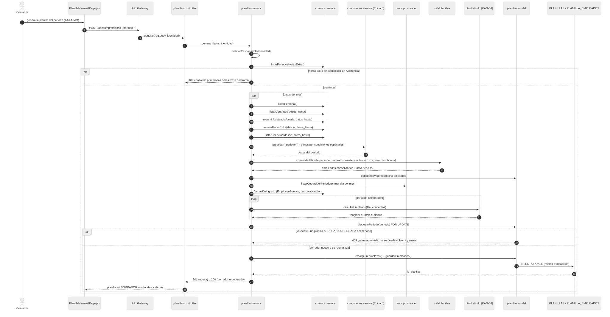

### 3.3 KAN-64 · Cálculo de haberes, descuentos y líquido pagable

El total ganado suma haber básico, horas extra, dominicales, recargo nocturno, antigüedad y bonos; los descuentos incluyen los aportes de ley, el Aporte Nacional Solidario por tramo y las cuotas de préstamo. Un líquido negativo o un total que no cuadra deja una alerta que bloquea la aprobación.

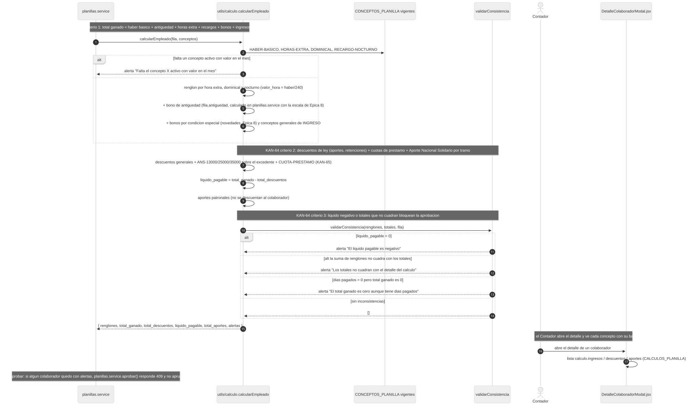

### 3.4 KAN-63 · Aprobación y publicación asíncrona (outbox)

Al aprobar, el asiento para Contabilidad y la orden de dispersión para Pagos se guardan en `EVENTOS_SALIENTES` en la misma transacción que la aprobación; un despachador los publica cada 5 segundos en Pub/Sub, con reintentos de espera creciente si el broker falla.

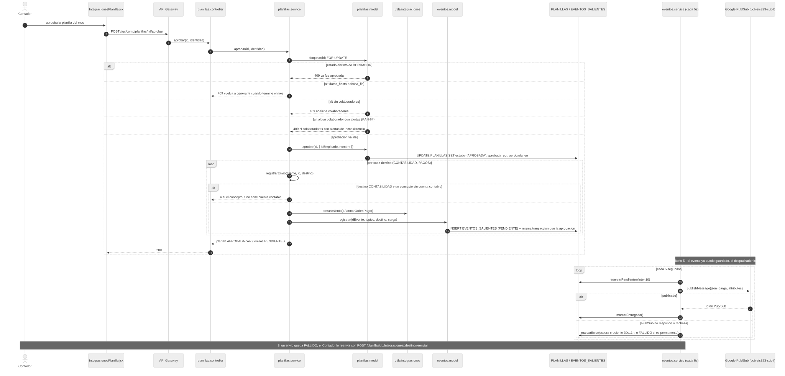

### 3.5 KAN-63 · Confirmaciones y cierre de la planilla

Contabilidad y Pagos confirman por su propio tópico; RRHH descarta duplicados por `id_mensaje`, ignora respuestas a un envío anterior y cierra la planilla solo cuando ambas integraciones quedan `CONFIRMADA`. Un mensaje inválido queda `FALLIDO` sin reintentos; un error pasajero se reintenta y luego entra a la cola de fallidos.

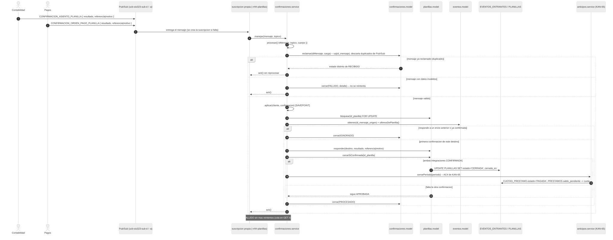

### 3.6 KAN-65 · Registro de un anticipo o préstamo

El plan de cuotas reparte el monto en partes iguales (la última absorbe el redondeo); el tope de descuento se valida contra el líquido pagable sumando lo ya comprometido en otros préstamos activos del mismo colaborador.

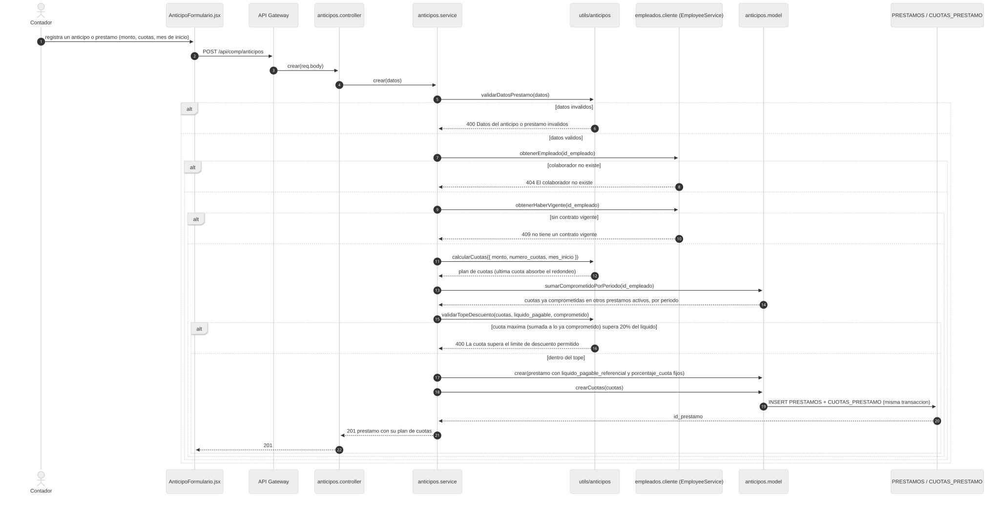

### 3.7 KAN-65 · Deducción de la cuota y cierre del periodo

La planilla consulta las cuotas `PENDIENTE` del mes al generarse (KAN-63). El cierre del periodo de deducciones es una acción aparte del Contador, posterior al cierre de la planilla, y debe hacerse en orden cronológico: no se puede cerrar un periodo si uno anterior sigue con cuotas pendientes.

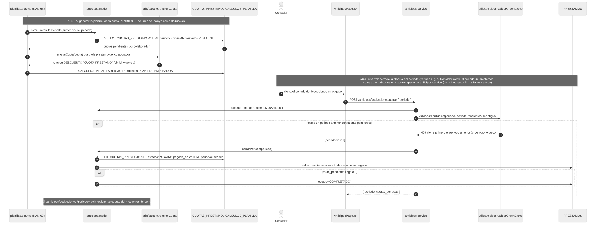

## 4. Trazabilidad con el código

| Elemento | Ubicación |
|---|---|
| Tablas | `db/init.sql`, reglas en `db/aclaracion.md` |
| Conceptos de pago (KAN-62) | `src/routes/conceptos.routes.js`, `src/controllers/conceptos.controller.js`, `src/services/conceptos.service.js`, `src/models/conceptos.model.js`, `src/utils/conceptos.js` |
| Planillas (KAN-63 y KAN-64) | `src/routes/planillas.routes.js`, `src/controllers/planillas.controller.js`, `src/services/planillas.service.js`, `src/models/planillas.model.js`, `src/utils/planillas.js`, `src/utils/calculo.js` |
| Integraciones salientes (outbox) | `src/services/eventos.service.js`, `src/models/eventos.model.js`, `src/utils/integraciones.js` |
| Confirmaciones entrantes | `src/routes/confirmaciones.routes.js`, `src/controllers/confirmaciones.controller.js`, `src/services/confirmaciones.service.js`, `src/models/confirmaciones.model.js` |
| Anticipos y préstamos (KAN-65) | `src/routes/anticipos.routes.js`, `src/controllers/anticipos.controller.js`, `src/services/anticipos.service.js`, `src/models/anticipos.model.js`, `src/utils/anticipos.js` |
| Clientes externos | `src/services/externos.service.js` (EmployeeService, AttendanceService), `src/clients/empleados.cliente.js` (EmployeeService) |
| Mensajería | `src/config/pubsub.js`, `src/routes/mensajesPublicados.routes.js` (bitácora de lo publicado, para pruebas) |
| Transacciones | `src/config/transaccion.js` |
| Pantallas | `frontend/src/features/conceptos/`, `frontend/src/features/planillas/`, `frontend/src/features/anticipos/` |
| Pruebas | `tests/conceptos.test.js`, `tests/planillas.test.js`, `tests/calculo.test.js`, `tests/anticipos.test.js`, `tests/integraciones.test.js` |

| Método y ruta | Historia |
|---|---|
| `GET/POST /conceptos`, `GET/PUT /conceptos/:id`, `PATCH /conceptos/:id/estado`, `DELETE /conceptos/:id`, `POST /conceptos/:id/vigencias` | KAN-62 |
| `GET/POST /planillas`, `GET /planillas/:id`, `DELETE /planillas/:id`, `POST /planillas/:id/aprobar` | KAN-63, KAN-64 |
| `POST /planillas/:id/integraciones/:destino/reenviar` | KAN-63 |
| `GET /confirmaciones`, `POST /confirmaciones/:id/reprocesar` | KAN-63 |
| `GET/POST /anticipos`, `GET /anticipos/:id` | KAN-65 |
| `GET /anticipos/deducciones`, `POST /anticipos/deducciones/cerrar` | KAN-65 |

## 5. Cómo regenerar las imágenes

Requisitos: Node.js y un navegador Chromium. El script usa `npx @mermaid-js/mermaid-cli`, que se descarga en la caché de npm la primera vez (no se instala de forma global). Si no encuentra el navegador: `export PUPPETEER_EXECUTABLE_PATH="/ruta/al/navegador"`.

```bash
bash backend/CompensationService/docs/epica-7/generar-diagramas.sh
```

Genera, junto a cada `.mmd`, su `.svg` y su `.png`. Para un PDF de un diagrama: `npx @mermaid-js/mermaid-cli -i archivo.mmd -o archivo.pdf`. Otra opción es pegar el `.mmd` en [mermaid.live](https://mermaid.live) y descargar la imagen.
