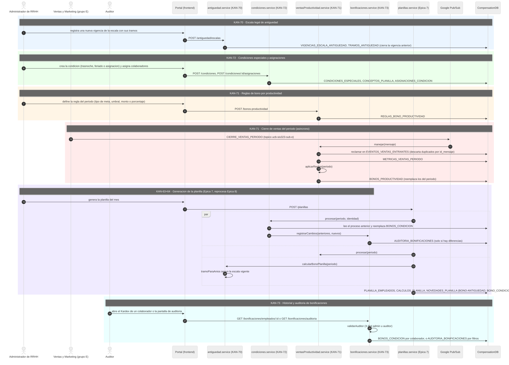
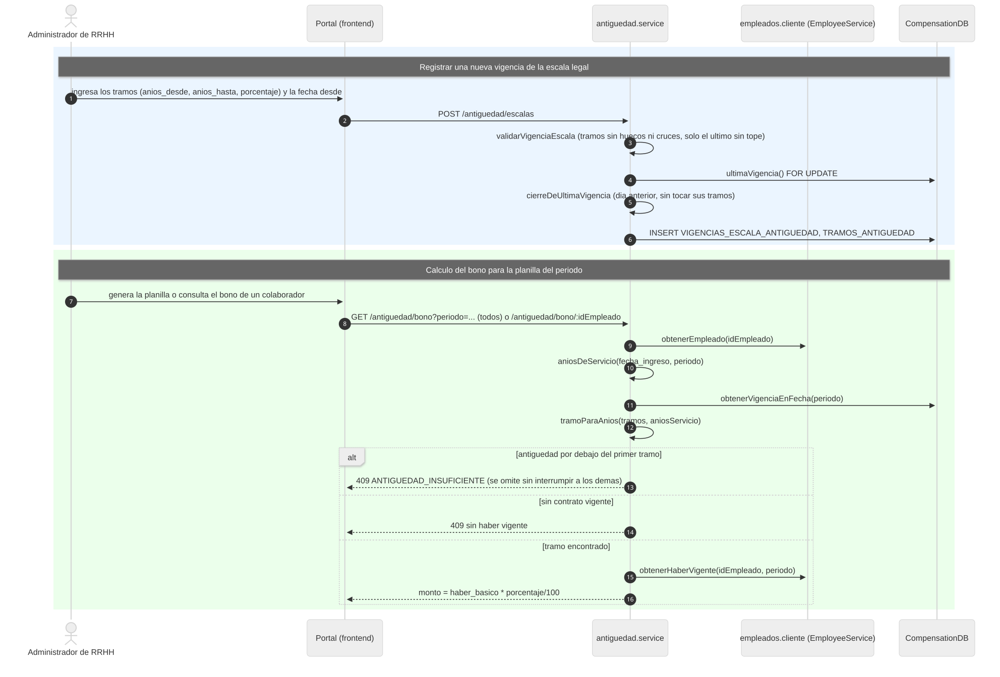
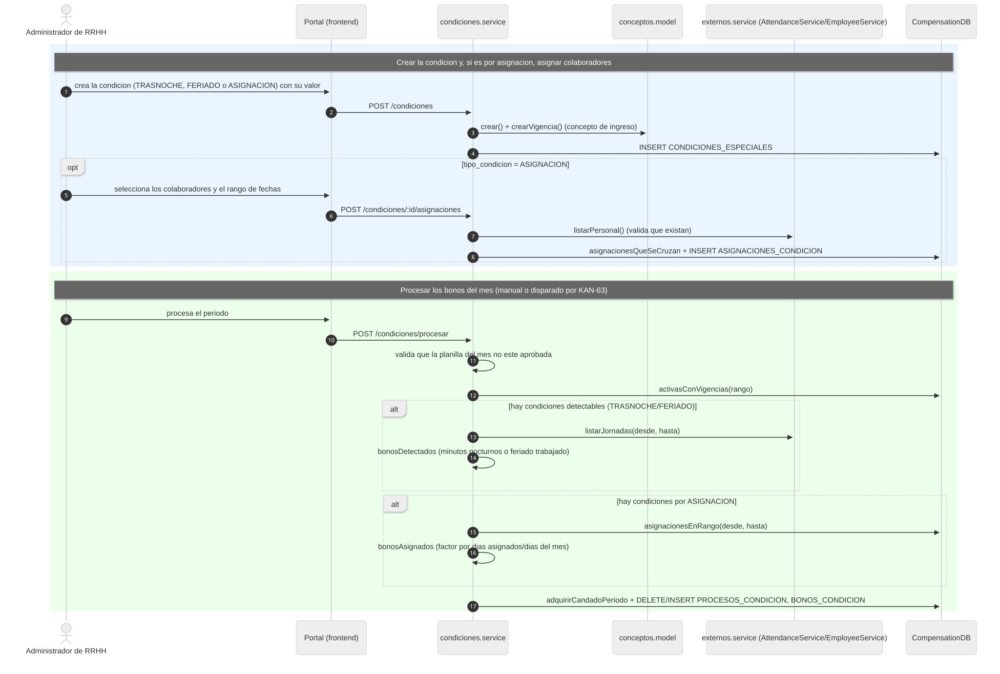
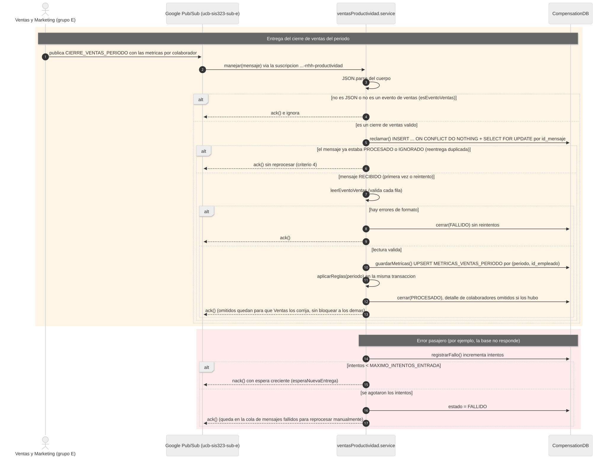
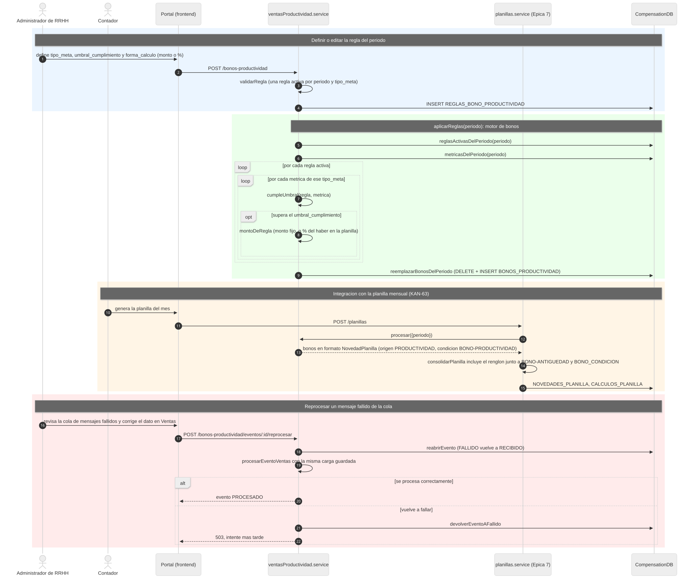
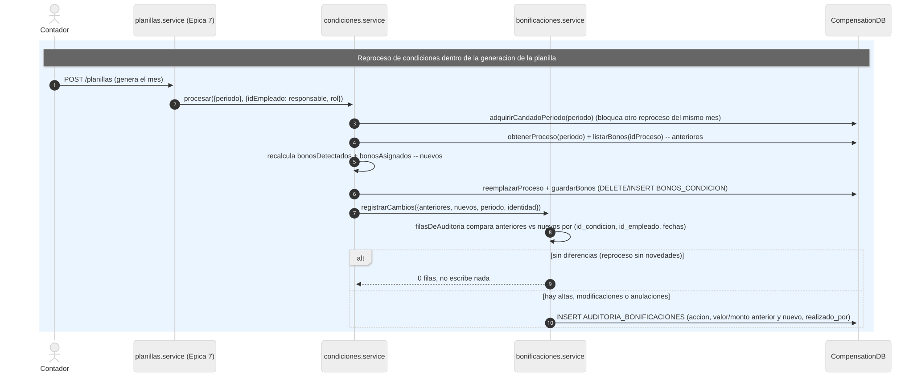
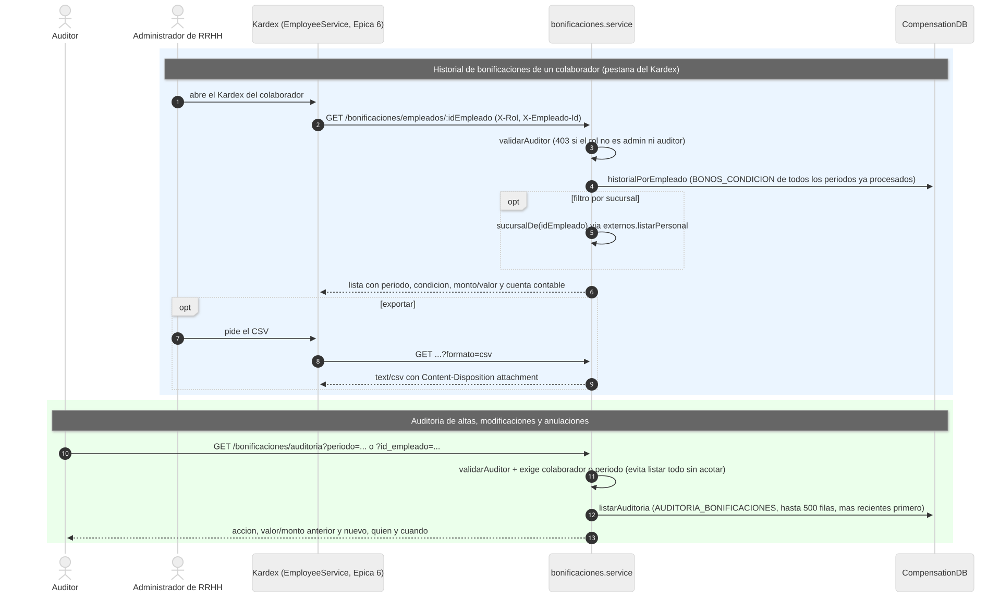

# Épica 8 · Cálculo de antigüedad y bonos

Documentación UML de la épica 8 del Sistema de RR.HH. del ERP de supermercado (**KAN-16**, subtarea de documentación **KAN-382**). Incluye una **vista general** con un diagrama de clases y uno de secuencia para toda la épica, y una **vista detallada** con el modelo de dominio, el diseño por capas y un diagrama de secuencia por cada flujo.

Todo vive en **CompensationService** (CompensationDB), el mismo servicio de la épica 7. Los diagramas salen del código del repositorio: los nombres de tablas, rutas, módulos y funciones son los reales.

Cada diagrama está como **código fuente** (`.mmd`, [Mermaid](https://mermaid.js.org)) y como imagen **SVG** y **PNG**. Para cambiar un diagrama se edita su `.mmd` y se regeneran las imágenes con [`generar-diagramas.sh`](generar-diagramas.sh).

## Contenido

1. [Historias de la épica](#historias-de-la-épica)
2. [Vista general](#1-vista-general)
   - [Diagrama de clases de la épica](#11-diagrama-de-clases-de-la-épica)
   - [Diagrama de secuencia de la épica](#12-diagrama-de-secuencia-de-la-épica)
3. [Diagramas de clases detallados](#2-diagramas-de-clases-detallados)
4. [Diagramas de secuencia por flujo](#3-diagramas-de-secuencia-por-flujo)
5. [Trazabilidad con el código](#4-trazabilidad-con-el-código)
6. [Cómo regenerar las imágenes](#5-cómo-regenerar-las-imágenes)

## Historias de la épica

| Historia | Requerimiento | Qué resuelve |
|---|---|---|
| **KAN-70** | RF-50 · Bono de antigüedad | Calcula el bono según los años de servicio y la escala legal vigente, con tramos por rango de años; una nueva vigencia no toca los tramos ya usados, así los cálculos anteriores conservan su porcentaje histórico |
| **KAN-71** | RF-51 · Bonos por metas de venta, puntualidad o desempeño en caja | Reglas por periodo y tipo de meta (monto fijo o porcentaje), consumidor asíncrono del cierre de ventas de Ventas y Marketing con idempotencia por `id_mensaje`, y motor que compara cada métrica contra el umbral de su regla |
| **KAN-72** | RF-52 · Bonificaciones por condiciones especiales | Condiciones detectadas de las jornadas marcadas (trasnoche, feriado) o asignadas por colaborador, con un concepto de ingreso propio y vigencias; reprocesar un periodo reemplaza sus bonos |
| **KAN-73** | RF-53 · Historial y auditoría de bonificaciones | Historial de los bonos de condición especial de un colaborador en el Kardex y auditoría de altas, modificaciones y anulaciones entre reprocesos, con exportación CSV y acceso restringido a Administrador de RRHH o Auditor |

## 1. Vista general

### 1.1 Diagrama de clases de la épica

Las entidades de las cuatro historias con sus atributos clave. `ConceptoPlanilla`, `NovedadPlanilla` y `CalculoPlanilla` son de la Épica 7 (KAN-62/64): el bono de antigüedad y el de productividad llegan a la planilla como un renglón más, sin vigencia de concepto propia, igual que lo documenta la épica 7 en sentido inverso.



### 1.2 Diagrama de secuencia de la épica

Un recorrido de punta a punta en el orden en que se configura y se usa la épica:

1. **KAN-70** · se registra la escala legal de antigüedad con sus tramos.
2. **KAN-72** · se crean las condiciones especiales y, si corresponde, se asignan colaboradores.
3. **KAN-71** · se define la regla del periodo (meta de venta, puntualidad o desempeño en caja).
4. **KAN-71** · Ventas y Marketing publica el cierre de ventas del periodo; el motor de reglas genera los bonos de productividad.
5. **KAN-63 + KAN-64 (Épica 7)** · al generar la planilla, se reprocesan los bonos de condición y de productividad, y se calcula el bono de antigüedad de cada colaborador.
6. **KAN-73** · ese reproceso deja el diff en la auditoría de bonificaciones.
7. **KAN-73** · el Auditor o el Administrador de RRHH consultan el historial en el Kardex o la auditoría por periodo.



## 2. Diagramas de clases detallados

### 2.1 Modelo de dominio

Las tablas de la épica tal como están en `db/init.sql`, con sus restricciones reales (`CHECK`, `EXCLUDE` sin solapamiento de vigencias o asignaciones, `UNIQUE` por periodo). No incluye las tablas de la épica 7 (`CONCEPTOS_PLANILLA`, `PLANILLAS`...), salvo como referencia externa.



### 2.2 Capas del servicio

Cómo se reparte la lógica en CompensationService: rutas de `antiguedad`, `condiciones`, `bonos-productividad` y `bonificaciones`, sus controladores, servicios y modelos, la lógica pura de validación y cálculo, el consumidor de Pub/Sub del cierre de ventas y los clientes HTTP hacia EmployeeService y AttendanceService.



## 3. Diagramas de secuencia por flujo

| # | Flujo | Historia | Diagrama |
|---|---|---|---|
| 1 | Vigencia de la escala legal y cálculo del bono de antigüedad | KAN-70 | [sec-01](detallados/sec-01-kan70-calculo-antiguedad.svg) |
| 2 | Condiciones especiales: creación, asignación y procesamiento del mes | KAN-72 | [sec-02](detallados/sec-02-kan72-condiciones-especiales.svg) |
| 3 | Consumo del cierre de ventas del periodo (Pub/Sub, idempotencia y reintentos) | KAN-71 | [sec-03](detallados/sec-03-kan71-cierre-ventas.svg) |
| 4 | Motor de reglas de productividad e integración en la planilla | KAN-71 | [sec-04](detallados/sec-04-kan71-motor-reglas-planilla.svg) |
| 5 | Auditoría de bonos de condición durante el reproceso de la planilla | KAN-73 | [sec-05](detallados/sec-05-kan73-auditoria-reproceso.svg) |
| 6 | Historial en el Kardex y auditoría por periodo, con RBAC | KAN-73 | [sec-06](detallados/sec-06-kan73-historial-kardex.svg) |

### 3.1 KAN-70 · Vigencia de la escala y cálculo del bono

Una escala nueva valida que los tramos no tengan huecos ni se cruce y solo el último quede sin tope; la vigencia anterior se cierra el día previo sin tocar sus tramos. Un colaborador por debajo del primer tramo no es un error del cálculo: queda como `ANTIGUEDAD_INSUFICIENTE` para que el front lo muestre como "omitido".



### 3.2 KAN-72 · Condiciones especiales y su procesamiento

`TRASNOCHE` y `FERIADO` se detectan de las jornadas marcadas; `ASIGNACION` depende de qué colaboradores tenga asignados la condición en el rango del mes. Reprocesar reemplaza los bonos del periodo bajo un candado que evita dos procesos del mismo mes a la vez.



### 3.3 KAN-71 · Consumo del cierre de ventas

El `id_mensaje` de Ventas y Marketing evita procesar dos veces la misma entrega; un mensaje inválido queda `FALLIDO` sin reintentos y uno con un error pasajero se reintenta con espera creciente hasta entrar a la cola de mensajes fallidos.



### 3.4 KAN-71 · Motor de reglas e integración en la planilla

El motor compara cada métrica del periodo contra el umbral de la regla activa de su tipo de meta y reemplaza los bonos del periodo. Al generar la planilla (KAN-63), `planillas.service` llama a `ventasProductividad.service.procesar()` igual que llama a `condiciones.service.procesar()`.



### 3.5 KAN-73 · Auditoría durante el reproceso

`condiciones.service.procesar()` lee los bonos del proceso anterior antes de reemplazarlos y le pasa ambos conjuntos a `bonificaciones.service.registrarCambios()`. Un reproceso sin novedades no escribe nada en la auditoría.



### 3.6 KAN-73 · Historial en el Kardex y auditoría

El historial de un colaborador aparece como una pestaña más del Kardex de EmployeeService (épica 6); la auditoría exige un colaborador o un periodo para no listar todo sin acotar. Ambos endpoints exigen rol `admin` o `auditor` por el encabezado `X-Rol`.



## 4. Trazabilidad con el código

| Elemento | Ubicación |
|---|---|
| Tablas | `db/init.sql` |
| Bono de antigüedad (KAN-70) | `src/routes/antiguedad.routes.js`, `src/controllers/antiguedad.controller.js`, `src/services/antiguedad.service.js`, `src/models/antiguedad.model.js`, `src/utils/antiguedad.js` |
| Condiciones especiales (KAN-72) | `src/routes/condiciones.routes.js`, `src/controllers/condiciones.controller.js`, `src/services/condiciones.service.js`, `src/models/condiciones.model.js`, `src/utils/condiciones.js` |
| Bono de productividad y cierre de ventas (KAN-71) | `src/routes/ventasProductividad.routes.js`, `src/controllers/ventasProductividad.controller.js`, `src/services/ventasProductividad.service.js`, `src/models/ventasProductividad.model.js`, `src/utils/ventasProductividad.js` |
| Historial y auditoría (KAN-73) | `src/routes/bonificaciones.routes.js`, `src/controllers/bonificaciones.controller.js`, `src/services/bonificaciones.service.js`, `src/models/bonificaciones.model.js`, `src/utils/bonificaciones.js` |
| Mensajería entrante | `src/config/pubsub.js` (tópico por defecto `ucb-sis323-sub-e`, variable `PUBSUB_TOPICO_VENTAS`) |
| Clientes externos | `src/services/externos.service.js` (AttendanceService, EmployeeService), `src/clients/empleados.cliente.js` (EmployeeService) |
| Integración con la planilla (Épica 7) | `src/services/planillas.service.js` (`generar()` llama a `condiciones.procesar`, `ventasProductividad.procesar` y `antiguedad.calcularBonoPlanilla`) |
| Pantallas | `frontend/src/features/antiguedad/`, `frontend/src/features/condiciones/`, `frontend/src/features/bonos-productividad/`, `frontend/src/features/Kardex/components/TablaBonificaciones.jsx` (EmployeeService) |
| Pruebas | `tests/antiguedad.test.js`, `tests/condiciones.test.js`, `tests/ventasProductividad.test.js`, `tests/bonificaciones.test.js` |

| Método y ruta | Rol | Historia |
|---|---|---|
| `GET /antiguedad/escalas`, `GET /antiguedad/escalas/vigente`, `POST /antiguedad/escalas`, `GET /antiguedad/bono`, `GET /antiguedad/bono/:idEmpleado` | — | KAN-70 |
| `GET/POST /condiciones`, `GET/PUT/DELETE /condiciones/:id`, `GET /condiciones/bonos`, `POST /condiciones/procesar`, `.../asignaciones` | — | KAN-72 |
| `GET/POST /bonos-productividad`, `PUT/PATCH/DELETE /bonos-productividad/:id`, `POST /bonos-productividad/procesar`, `GET /bonos-productividad/bonos`, `GET /bonos-productividad/eventos`, `POST /bonos-productividad/eventos/:id/reprocesar` | — | KAN-71 |
| `GET /bonificaciones/empleados/:idEmpleado`, `GET /bonificaciones/auditoria` | admin o auditor (`X-Rol`) | KAN-73 |

## 5. Cómo regenerar las imágenes

Requisitos: Node.js y un navegador Chromium. El script usa `npx @mermaid-js/mermaid-cli`, que se descarga en la caché de npm la primera vez (no se instala de forma global). Si no encuentra el navegador: `export PUPPETEER_EXECUTABLE_PATH="/ruta/al/navegador"`.

```bash
bash backend/CompensationService/docs/epica-8/generar-diagramas.sh
```

Genera, junto a cada `.mmd`, su `.svg` y su `.png`. Para un PDF de un diagrama: `npx @mermaid-js/mermaid-cli -i archivo.mmd -o archivo.pdf`. Otra opción es pegar el `.mmd` en [mermaid.live](https://mermaid.live) y descargar la imagen.
