# Épica 9 · Desvinculación y liquidación final

Documentación UML de la épica 9 del Sistema de RR.HH. del ERP de supermercado. Incluye una **vista general** con un diagrama de clases y uno de secuencia para toda la épica, y una **vista detallada** con el modelo de dominio, el diseño por capas y un diagrama de secuencia por cada flujo.

Todo vive en **CompensationService** (CompensationDB), el mismo servicio de las épicas 7 y 8. Además usa EmployeeService (ficha y baja del colaborador), AttendanceService (saldo de vacaciones), AuthService (revocación de la cuenta) y NotificationService (avisos). Los diagramas salen del código del repositorio: los nombres de tablas, rutas, módulos y funciones son los reales.

Cada diagrama está como imagen **PNG**.

## Contenido

1. [Historias de la épica](#historias-de-la-épica)
2. [Vista general](#1-vista-general)
   - [Diagrama de clases de la épica](#11-diagrama-de-clases-de-la-épica)
   - [Diagrama de secuencia de la épica](#12-diagrama-de-secuencia-de-la-épica)
3. [Diagramas de clases detallados](#2-diagramas-de-clases-detallados)
4. [Diagramas de secuencia por flujo](#3-diagramas-de-secuencia-por-flujo)
5. [Trazabilidad con el código](#4-trazabilidad-con-el-código)

## Historias de la épica

| Historia | Requerimiento | Qué resuelve |
|---|---|---|
| **KAN-74** | RF-54 · Registro de la baja con su causal | Registra la salida con su causal, la fecha de retiro y un documento de respaldo; crea el proceso en `INICIADO`, copia de la causal si corresponde desahucio e impide dos procesos abiertos para la misma persona. El colaborador sigue activo hasta el cierre definitivo |
| **KAN-75** | RF-55 · Sueldo promedio indemnizable | Promedia el total ganado de las últimas 3 planillas **cerradas** hasta el mes del retiro, guarda una copia mes a mes, agrega observaciones si faltan meses y pasa el proceso a `EN_CURSO` |
| **KAN-76** | RF-56 · Indemnización y desahucio | Calcula el tiempo de servicio, la indemnización proporcional (más de 90 días) y el desahucio (tres sueldos, solo con causal de desahucio y fuera del período de prueba); un despido legal no da lugar a ninguno |
| **KAN-77** | Saldos proporcionales del finiquito | Duodécimas de aguinaldo de la gestión, vacaciones pendientes y duodécimas de vacaciones truncas, todo con el sueldo promedio |
| **KAN-78** | RF-58 · Finiquito con Pagos y Contabilidad | Consolida los cálculos, descuenta préstamos y anticipos activos, y al aprobar publica la orden de pago (A) y el asiento (D) por Pub/Sub; con ambas confirmaciones pasa a `PAGADO` y salda los préstamos cubiertos. Incluye PDF, cola de errores y reintentos |
| **KAN-79** | RF-59 · Cierre definitivo y bloqueo de accesos | Con el finiquito aprobado o pagado, da de baja al colaborador, revoca su cuenta y sus sesiones, y avisa a Ventas/POS (E), Inventarios (I), Entregas (H) y CRM (B); si alguno no confirma a tiempo se reenvía y se alerta al Administrador |

## 1. Vista general

### 1.1 Diagrama de clases de la épica

Las entidades de las seis historias con sus atributos clave. Todo cuelga de `ProcesoDesvinculacion`: los tres cálculos (promedio, beneficios y saldos) alimentan el `Finiquito`, y el `CierreDesvinculacion` exige un finiquito aprobado o pagado. `PlanillaEmpleado` y `Prestamo` son de la Épica 7; `SaldoVacaciones`, de la Épica 5 (AttendanceService).

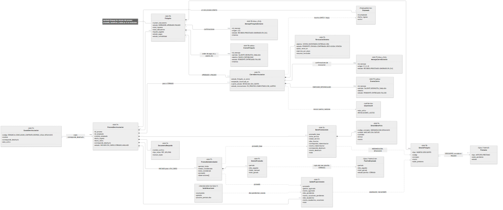

### 1.2 Diagrama de secuencia de la épica

Un recorrido de punta a punta en el orden en que se usa la épica:

1. **KAN-74** · el Administrador de RRHH registra la baja con su causal y su respaldo.
2. **KAN-75** · se calcula el sueldo promedio indemnizable y el proceso pasa a `EN_CURSO`.
3. **KAN-76 + KAN-77** · se calculan la indemnización, el desahucio y los saldos proporcionales.
4. **KAN-78** · se genera el borrador del finiquito, se aprueba y salen la orden de pago y el asiento; con ambas confirmaciones queda `PAGADO`.
5. **KAN-79** · el cierre definitivo da de baja al colaborador, revoca su cuenta y avisa a los cuatro módulos operativos, que confirman la revocación.

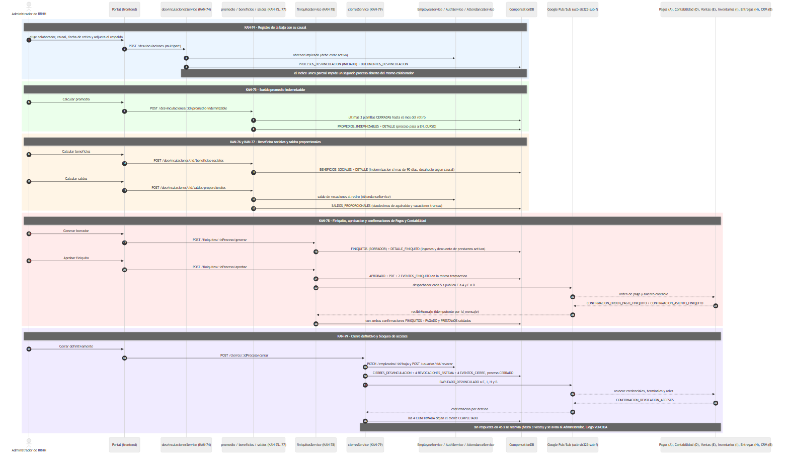

## 2. Diagramas de clases detallados

### 2.1 Modelo de dominio: liquidación (KAN-74 a KAN-77)

Las tablas tal como están en `db/init.sql`, con sus restricciones reales: el índice único parcial que impide dos procesos abiertos, el límite de 5 MB del respaldo, los `CHECK` de montos y unidades del cálculo. `PLANILLAS` y `PLANILLA_EMPLEADOS` aparecen solo como referencia externa de la Épica 7.

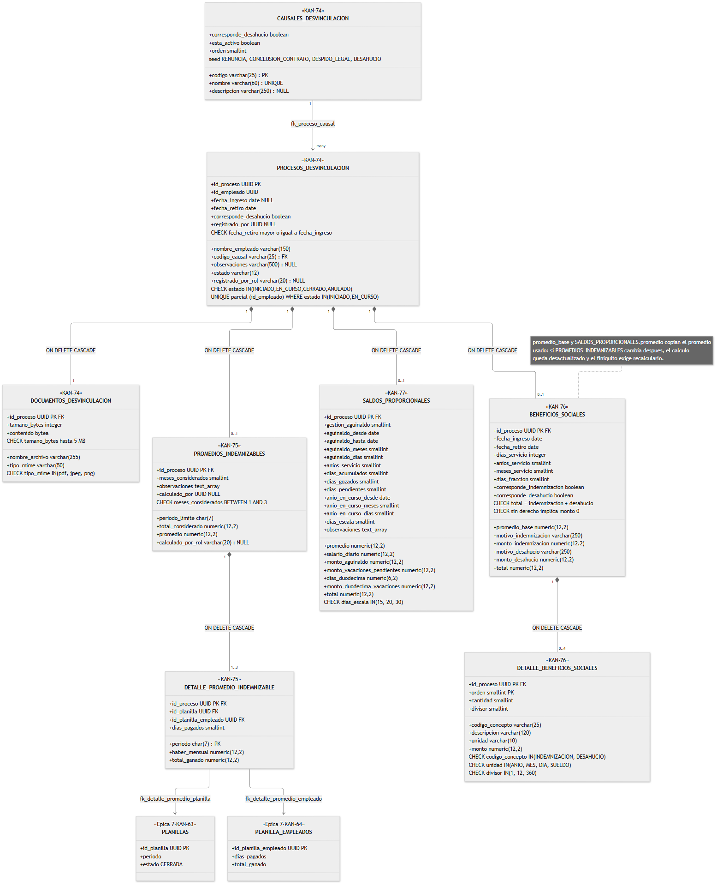

### 2.2 Modelo de dominio: finiquito y cierre (KAN-78 y KAN-79)

Cada integración tiene su propia bandeja de salida (`EVENTOS_FINIQUITO`, `EVENTOS_CIERRE`) y su propia bandeja de entrada con cola de errores (`MENSAJES_FINIQUITO_ENTRANTES`, `MENSAJES_CIERRE_ENTRANTES`). La unicidad de `id_mensaje` está en la entrada, que es donde se descartan los duplicados.

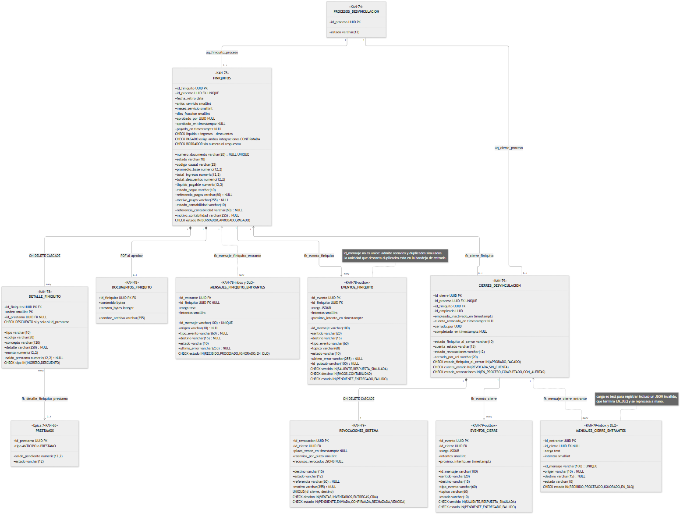

### 2.3 Capas del servicio

Cómo se reparte la lógica en CompensationService: las rutas de `desvinculaciones` (que agrupan KAN-74 a KAN-77), `finiquitos` y `cierres`, sus controladores, servicios y modelos, la lógica pura, los despachadores de las bandejas de salida, los consumidores de confirmaciones y los clientes HTTP hacia los otros servicios.

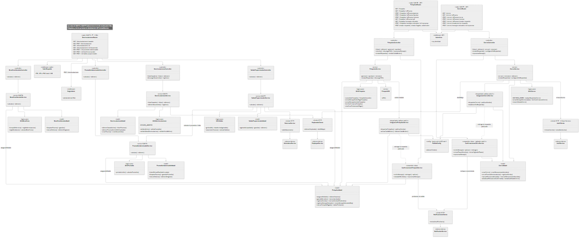

## 3. Diagramas de secuencia por flujo

| # | Flujo | Historia | Diagrama |
|---|---|---|---|
| 1 | Registro de la baja con su causal y respaldo | KAN-74 | [sec-01](detallados/sec-01-kan74-registro-baja.png) |
| 2 | Cálculo y consulta del sueldo promedio indemnizable | KAN-75 | [sec-02](detallados/sec-02-kan75-promedio-indemnizable.png) |
| 3 | Indemnización por tiempo de servicio y desahucio | KAN-76 | [sec-03](detallados/sec-03-kan76-indemnizacion-desahucio.png) |
| 4 | Duodécimas de aguinaldo y vacaciones truncas | KAN-77 | [sec-04](detallados/sec-04-kan77-saldos-proporcionales.png) |
| 5 | Generación, aprobación y publicación del finiquito (outbox) | KAN-78 | [sec-05](detallados/sec-05-kan78-generar-aprobar-finiquito.png) |
| 6 | Confirmaciones de Pagos y Contabilidad, pago y cola de errores | KAN-78 | [sec-06](detallados/sec-06-kan78-confirmaciones-pago.png) |
| 7 | Cierre definitivo: baja, revocación y avisos a los módulos | KAN-79 | [sec-07](detallados/sec-07-kan79-cierre-definitivo.png) |
| 8 | Confirmaciones de revocación, plazos vencidos y reenvío | KAN-79 | [sec-08](detallados/sec-08-kan79-confirmaciones-plazos.png) |
| 9 | Cierre de la sesión abierta y bloqueo del inicio de sesión | KAN-79 | [sec-09](detallados/sec-09-kan79-bloqueo-sesion.png) |

### 3.1 KAN-74 · Registro de la baja

`exigirAdmin` valida el rol antes de que `subirRespaldo` lea el archivo. El servicio revisa la causal, que el colaborador esté activo, la fecha de retiro y que no tenga otro proceso abierto; el índice único parcial cubre además la carrera entre dos registros simultáneos. Un proceso `ANULADO` no bloquea.

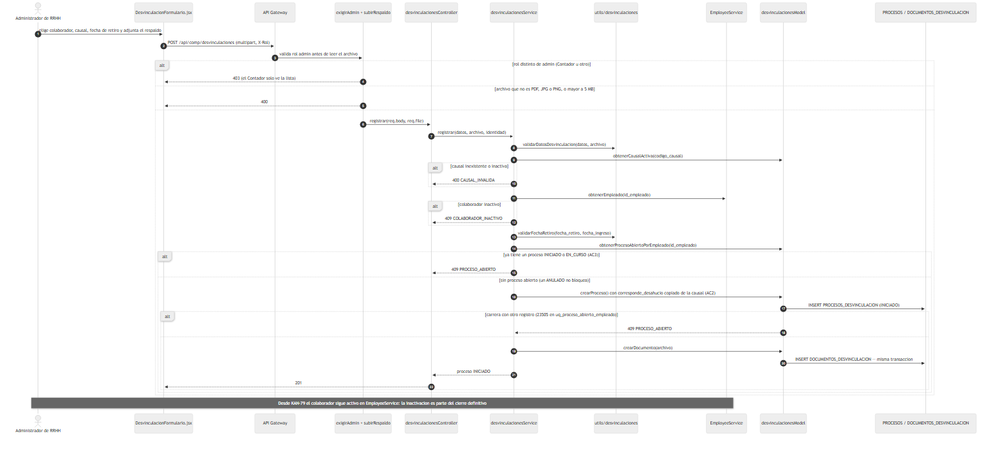

### 3.2 KAN-75 · Sueldo promedio indemnizable

Solo cuentan las planillas en estado `CERRADA`: una planilla aprobada pero no cerrada se salta. Con menos de 3 meses se promedian los disponibles y se deja la observación. El Contador consulta el desglose, pero solo el Administrador puede calcular.

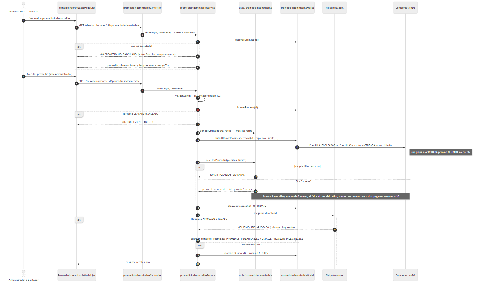

### 3.3 KAN-76 · Indemnización y desahucio

El tiempo de servicio cuenta el día de ingreso y el de retiro. La indemnización exige más de 90 días; el desahucio sale de `corresponde_desahucio`, copiado de la causal, y no se paga en el período de prueba. Un despido legal no da lugar a ninguno de los dos (LGT, art. 16).

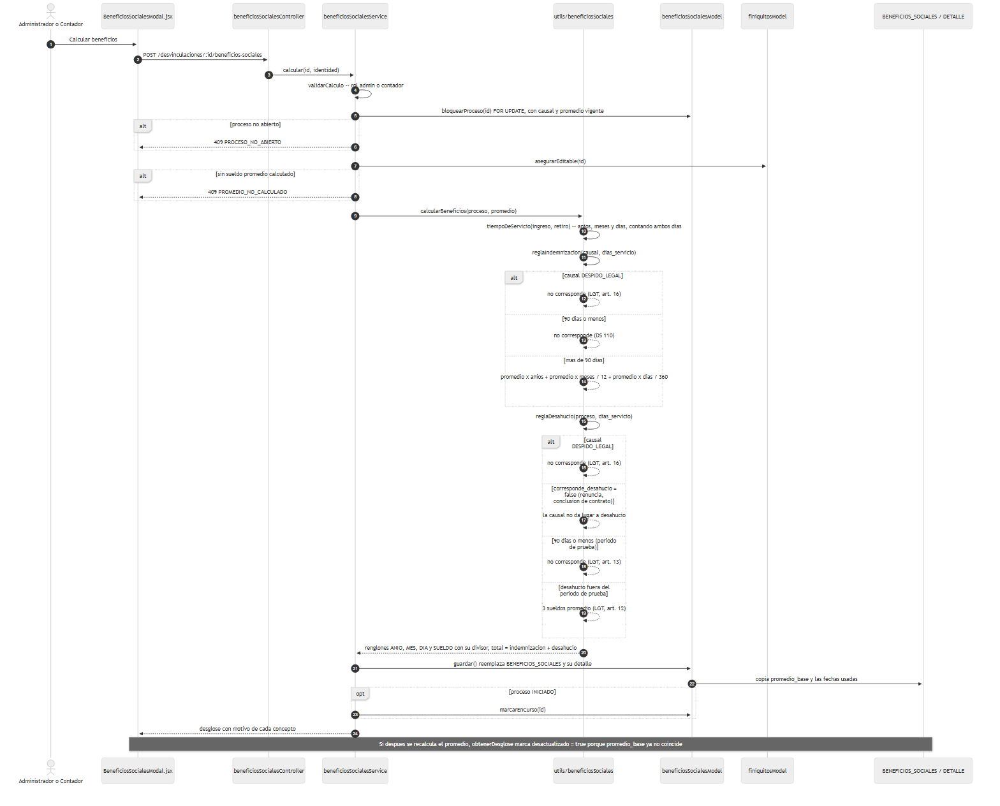

### 3.4 KAN-77 · Saldos proporcionales

Si el promedio todavía no se calculó, se calcula primero. Las vacaciones vienen del módulo de vacaciones de AttendanceService a la fecha del retiro, y el aguinaldo no se repite si ya se pagó en la planilla de aguinaldos de esa gestión.

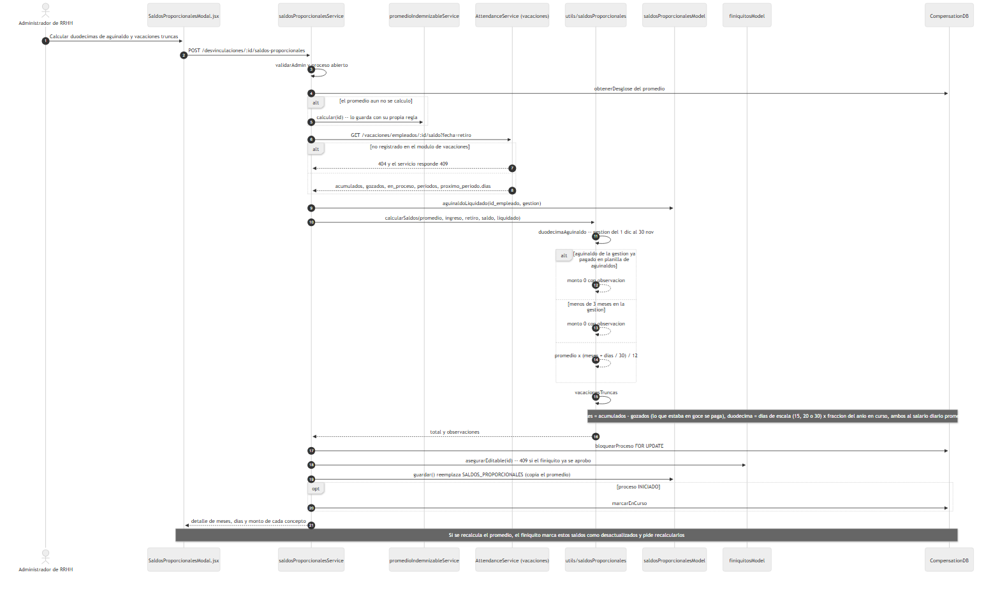

### 3.5 KAN-78 · Generación, aprobación y outbox

El borrador exige los tres cálculos y que estén hechos con el promedio vigente. Al aprobar se vuelve a consolidar: si algo cambió, hay que regenerar. La aprobación, el PDF y los dos eventos se guardan en una sola transacción, y un despachador los publica cada 5 segundos en el tópico F. La caída simulada del broker deja el envío esperando y lo reintenta solo.

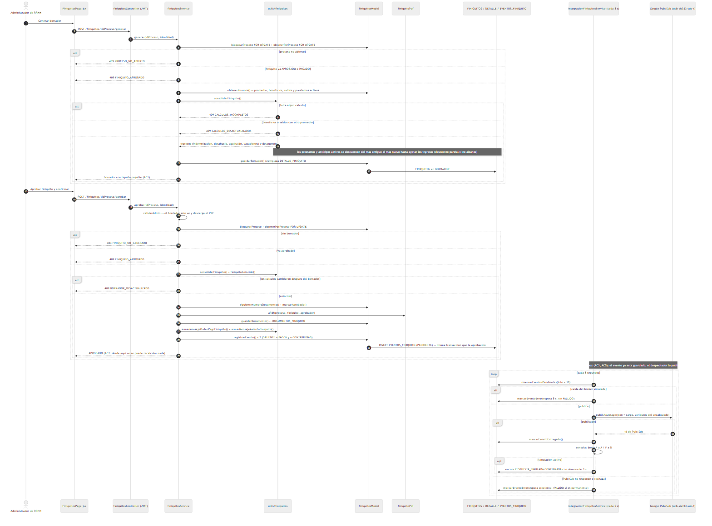

### 3.6 KAN-78 · Confirmaciones y pago

El consumidor descarta los duplicados por `id_mensaje`, ignora las respuestas a un envío anterior y, con Pagos y Contabilidad confirmados, marca el finiquito como `PAGADO` y salda los préstamos cubiertos. Un mensaje que sigue fallando después de los reintentos queda `EN_DLQ` y se reprocesa a mano.

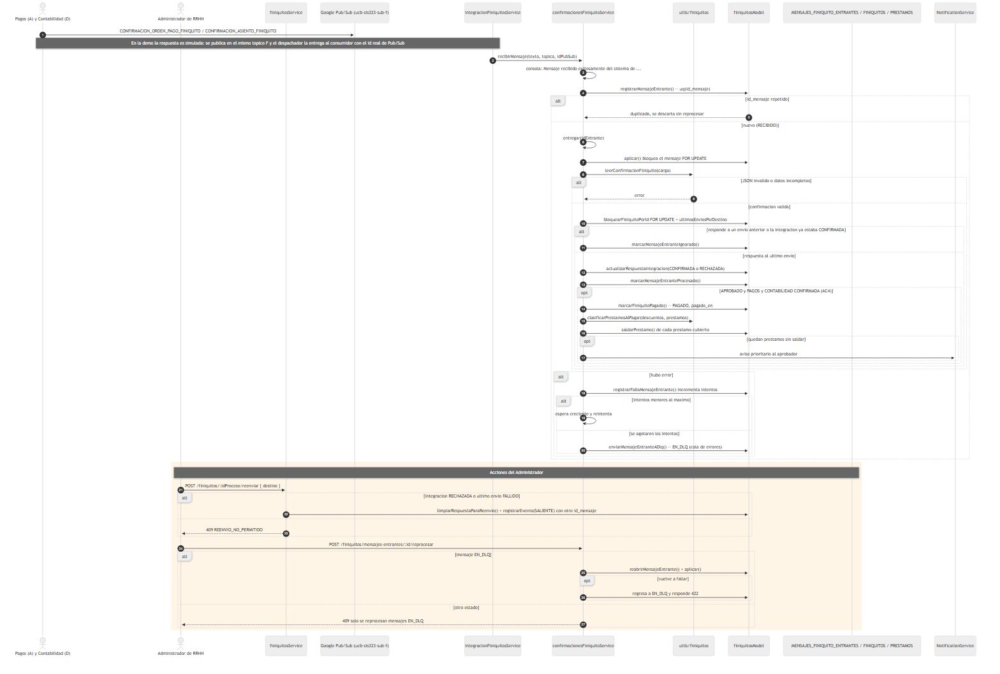

### 3.7 KAN-79 · Cierre definitivo

La baja en EmployeeService, la revocación en AuthService, el cierre con sus 4 revocaciones, los 4 eventos y el paso del proceso a `CERRADO` ocurren dentro de la misma operación. Al publicarse cada envío empieza a correr el plazo de 45 segundos.

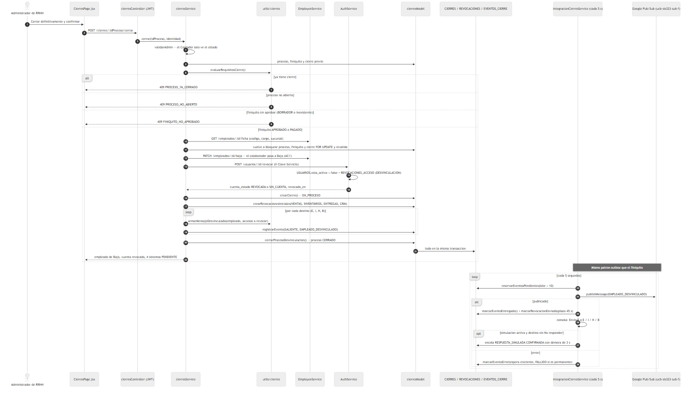

### 3.8 KAN-79 · Confirmaciones, plazos y reenvío

Con los 4 sistemas confirmados, el cierre queda `COMPLETADO`. El vigilante de plazos reenvía hasta 3 veces a un sistema que no responde, con un aviso cada vez, y después lo marca `VENCIDA`. El Administrador puede reenviar a mano una revocación rechazada, vencida o con el envío fallido.

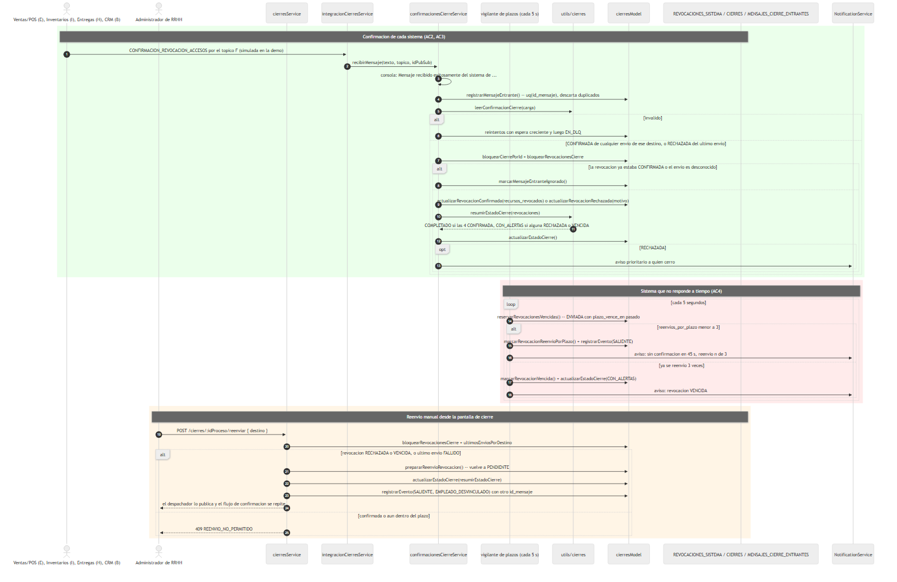

### 3.9 KAN-79 · Bloqueo de la sesión

El portal revisa la sesión cada 60 segundos y al volver a la pestaña. AuthService rechaza los tokens emitidos antes de la revocación, y el inicio de sesión de una cuenta revocada por desvinculación responde `ACCESO_REVOCADO`.

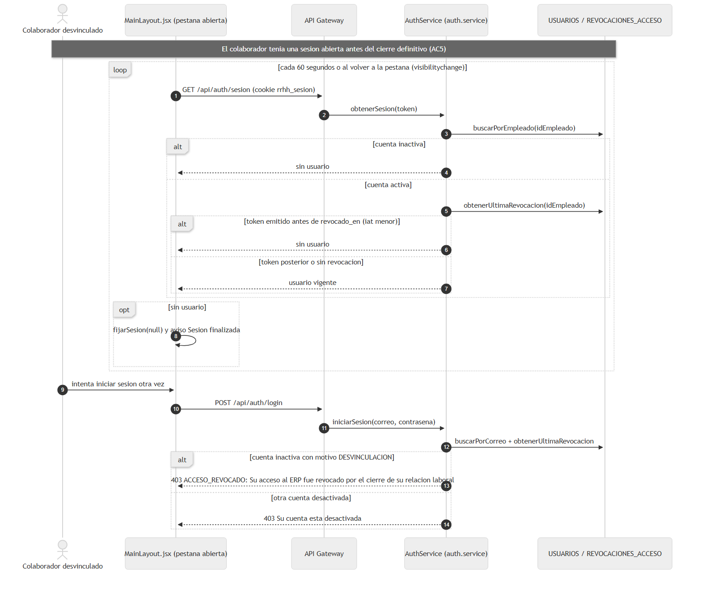

## 4. Trazabilidad con el código

| Elemento | Ubicación |
|---|---|
| Tablas | `db/init.sql` |
| Registro de la baja (KAN-74) | `src/routes/desvinculacionesRoutes.js`, `src/controllers/desvinculacionesController.js`, `src/services/desvinculacionesService.js`, `src/models/desvinculacionesModel.js`, `src/utils/desvinculaciones.js`, `src/middlewares/exigirAdmin.js`, `src/middlewares/subirRespaldo.js` |
| Sueldo promedio (KAN-75) | `src/controllers/promedioIndemnizableController.js`, `src/services/promedioIndemnizableService.js`, `src/models/promedioIndemnizableModel.js`, `src/utils/promedioIndemnizable.js` |
| Indemnización y desahucio (KAN-76) | `src/controllers/beneficiosSocialesController.js`, `src/services/beneficiosSocialesService.js`, `src/models/beneficiosSocialesModel.js`, `src/utils/beneficiosSociales.js` |
| Saldos proporcionales (KAN-77) | `src/controllers/saldosProporcionalesController.js`, `src/services/saldosProporcionalesService.js`, `src/models/saldosProporcionalesModel.js`, `src/utils/saldosProporcionales.js` |
| Finiquito (KAN-78) | `src/routes/finiquitosRoutes.js`, `src/controllers/finiquitosController.js`, `src/services/finiquitosService.js`, `src/services/finiquitoPdf.js`, `src/services/integracionFiniquitosService.js`, `src/services/confirmacionesFiniquitoService.js`, `src/models/finiquitosModel.js`, `src/utils/finiquitos.js` |
| Cierre definitivo (KAN-79) | `src/routes/cierresRoutes.js`, `src/controllers/cierresController.js`, `src/services/cierresService.js`, `src/services/integracionCierresService.js`, `src/services/confirmacionesCierreService.js`, `src/models/cierresModel.js`, `src/utils/cierres.js` |
| Clientes externos | `src/clients/empleados.cliente.js` (EmployeeService), `src/services/externos.service.js` (AttendanceService), `src/clients/authCliente.js` (AuthService), `src/clients/notificacionesCliente.js` (NotificationService) |
| Mensajería | `src/config/pubsub.js`, tópico propio `ucb-sis323-sub-f` (envíos y respuestas simuladas) |
| Arranque | `index.js` (`iniciarDespachadorFiniquitos`, `iniciarDespachadorCierres`, `iniciarVigilantePlazos`, `reanudarRecibidos`) |
| Revocación de la sesión | `backend/AuthService/src/services/auth.service.js`, `backend/AuthService/src/models/usuarios.model.js`, `frontend/src/layouts/MainLayout.jsx` |
| Pantallas | `frontend/src/features/desvinculaciones/`, `frontend/src/features/finiquitos/`, `frontend/src/features/cierres/` |
| Pruebas | `tests/desvinculaciones.test.js`, `tests/promedioIndemnizable.test.js`, `tests/saldosProporcionales.test.js`, `tests/finiquitos.test.js`, `tests/integracionFiniquitos.test.js`, `tests/cierres.test.js`, `tests/integracionCierres.test.js` |

| Método y ruta | Rol | Historia |
|---|---|---|
| `GET /desvinculaciones/causales`, `GET /desvinculaciones`, `GET /desvinculaciones/:id` | admin o contador | KAN-74 |
| `POST /desvinculaciones`, `GET /desvinculaciones/:id/documento` | admin | KAN-74 |
| `GET /desvinculaciones/:id/promedio-indemnizable` / `POST` | admin o contador / admin | KAN-75 |
| `GET` y `POST /desvinculaciones/:id/beneficios-sociales` | admin o contador | KAN-76 |
| `GET /desvinculaciones/:id/saldos-proporcionales` / `POST` | admin o contador / admin | KAN-77 |
| `GET /finiquitos`, `GET /finiquitos/:idProceso`, `GET /finiquitos/:idProceso/pdf` | admin o contador | KAN-78 |
| `POST /finiquitos/:idProceso/generar`, `/aprobar`, `/reenviar`, `/simular-respuesta`, `GET /finiquitos/mensajes-entrantes`, `POST /finiquitos/mensajes-entrantes/simular`, `/:id/reprocesar`, `POST /finiquitos/simulacion/caida-broker` | admin | KAN-78 |
| `GET /cierres`, `GET /cierres/:idProceso`, `GET /cierres/:idProceso/mensajes` | admin o contador | KAN-79 |
| `POST /cierres/:idProceso/cerrar`, `/reenviar`, `/simular-respuesta`, `POST /cierres/simulacion/sin-respuesta`, `POST /cierres/mensajes-entrantes/:id/reprocesar` | admin | KAN-79 |
