# Épica 10 · Seguimiento de ascensos y promoción interna

Documentación UML de la épica 10 del Sistema de RR.HH. del ERP de supermercado (**KAN-18**, subtarea de documentación **KAN-388**). Incluye una **vista general** con un diagrama de clases y uno de secuencia para toda la épica, y una **vista detallada** con el modelo de dominio, el diseño por capas y un diagrama de secuencia por cada flujo principal.

Todo vive en **EmployeeService** (EmployeeDB), junto con el expediente del colaborador de la épica 6: los ascensos se registran como adendas en el historial contractual y el plan de capacitación se mide contra el Kardex. Para validar los méritos consulta **PerformanceService**, y para los avisos usa **NotificationService**. Los diagramas salen del código del repositorio, así que los nombres de tablas, rutas, módulos y funciones son los reales.

## Contenido

1. [Historias de la épica](#historias-de-la-épica)
2. [Vista general](#1-vista-general)
   - [Diagrama de clases de la épica](#11-diagrama-de-clases-de-la-épica)
   - [Diagrama de secuencia de la épica](#12-diagrama-de-secuencia-de-la-épica)
3. [Diagramas de clases detallados](#2-diagramas-de-clases-detallados)
4. [Diagramas de secuencia por flujo](#3-diagramas-de-secuencia-por-flujo)
5. [Trazabilidad con el código](#4-trazabilidad-con-el-código)
6. [Cómo regenerar las imágenes](#5-cómo-regenerar-las-imágenes)
7. [Notación](#notación)

## Historias de la épica

| Historia | Requerimiento | Qué resuelve |
|---|---|---|
| **KAN-80** | RF-60 · Publicación de convocatorias internas | Convocatoria para un cargo vacante, visible solo para empleados activos, con aviso a los elegibles y cierre automático al vencer |
| **KAN-81** | RF-61 · Postulación y validación de méritos | Postulación única por empleado, validación de antigüedad y de la nota de la última evaluación (PerformanceService) y ranking de aptos por puntaje |
| **KAN-82** | RF-62 · Formalización del ascenso | Cambio de cargo y salario con fecha de vigencia, adenda ASCENSO en el Kardex, aplicación automática si la vigencia es futura, cierre de la convocatoria y aviso al promovido |
| **KAN-83** | RF-63 · Plan de capacitación previo al ascenso | Cursos requeridos por el cargo destino con su estado según el Kardex, porcentaje de avance por candidato y advertencia al formalizar con cursos pendientes |

> En el código, la formalización del ascenso (RF-62) está comentada como **KAN-84**; en Jira es **KAN-82**. Esta documentación usa la numeración de Jira.

## 1. Vista general

### 1.1 Diagrama de clases de la épica

Las entidades de las cuatro historias, agrupadas por paquete, con sus atributos clave y sus responsabilidades como operaciones. La `ConvocatoriaAscenso` (KAN-80) reúne las postulaciones (KAN-81), y la postulación elegida guarda los datos del ascenso (KAN-82). El `PlanAscenso` (KAN-83) es un camino paralelo hacia el mismo resultado: un cambio de cargo en la trayectoria del empleado.

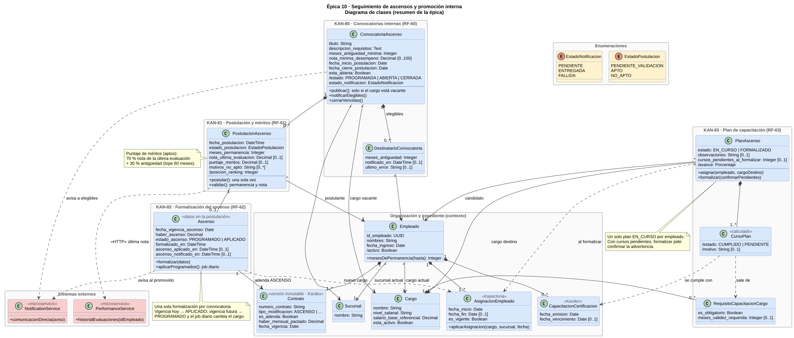

### 1.2 Diagrama de secuencia de la épica

Un recorrido de punta a punta en cuatro secciones:

1. **KAN-80** · RRHH publica la convocatoria y se avisa a los empleados elegibles.
2. **KAN-81** · un empleado se postula, el sistema valida sus méritos y RRHH revisa el ranking.
3. **KAN-82** · RRHH formaliza el ascenso del postulante elegido.
4. **KAN-83** · RRHH asigna un plan de capacitación, sigue su avance y formaliza el ascenso.

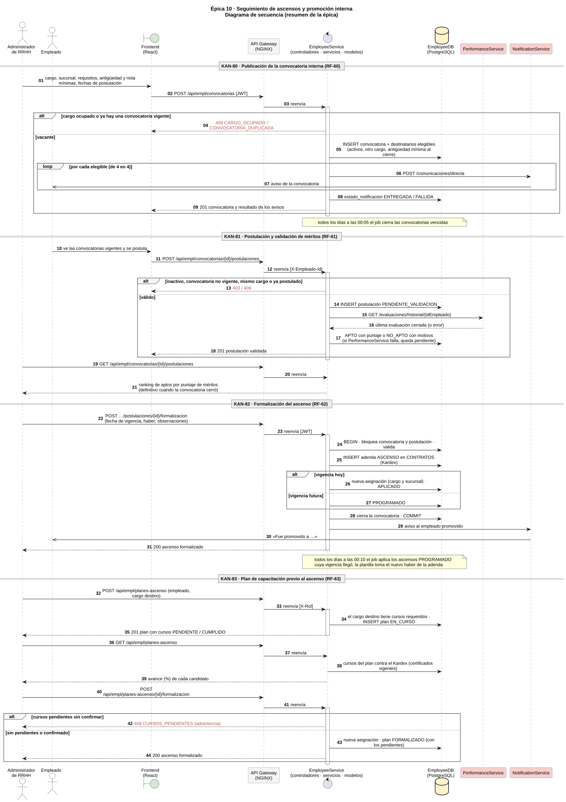

## 2. Diagramas de clases detallados

### 2.1 Modelo de dominio

Las 5 tablas propias de la épica en EmployeeDB (`CONVOCATORIAS_ASCENSO`, `DESTINATARIOS_CONVOCATORIA`, `POSTULACIONES_ASCENSO`, `PLANES_ASCENSO` y `REQUISITOS_CAPACITACION_CARGO`) con sus columnas reales, el estado derivado de la convocatoria, las enumeraciones y las restricciones únicas. Las tablas de otras épicas que se usan (empleados, cargos, contratos, asignaciones y capacitaciones del Kardex) aparecen en gris.

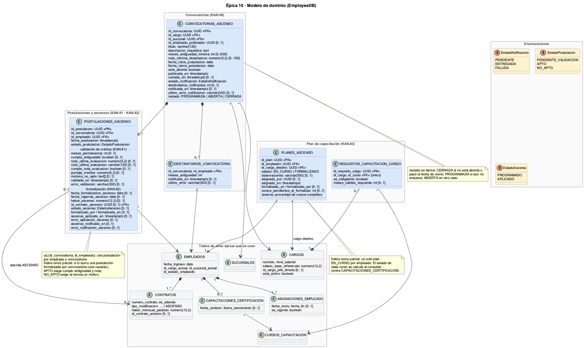

### 2.2 Diseño por capas

Una banda por historia: rutas, middlewares (`autenticar`, `exigirRol`, `identificarEmpleado`), controladores, servicios, utilidades de cálculo, modelos, los dos jobs diarios y los sistemas externos.

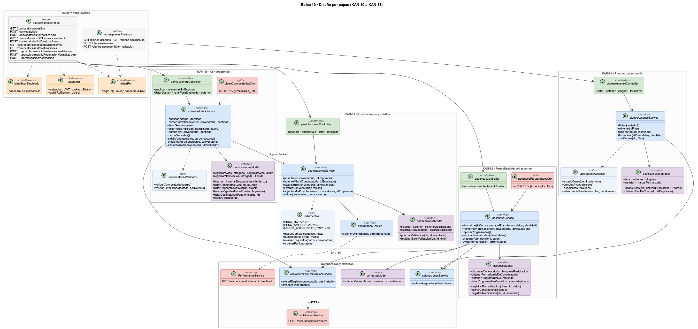

> El backend está hecho con módulos de JavaScript (controlador → servicio → modelo). En el diseño cada módulo se representa como una clase con estereotipo (`«controller»`, `«service»`, `«model»`…): sus funciones exportadas aparecen como operaciones públicas (`+`) y las internas como privadas (`-`).

## 3. Diagramas de secuencia por flujo

### 3.1 KAN-80 · Publicar una convocatoria interna

Solo se publica si el cargo está vacante en la sucursal y no hay otra convocatoria vigente para el mismo puesto. Se guardan como destinatarios los empleados activos que no ocupan el cargo y cumplen la antigüedad mínima al cierre, y se les avisa de 4 en 4 por NotificationService. Si algún aviso falla, se puede reintentar solo para los pendientes.

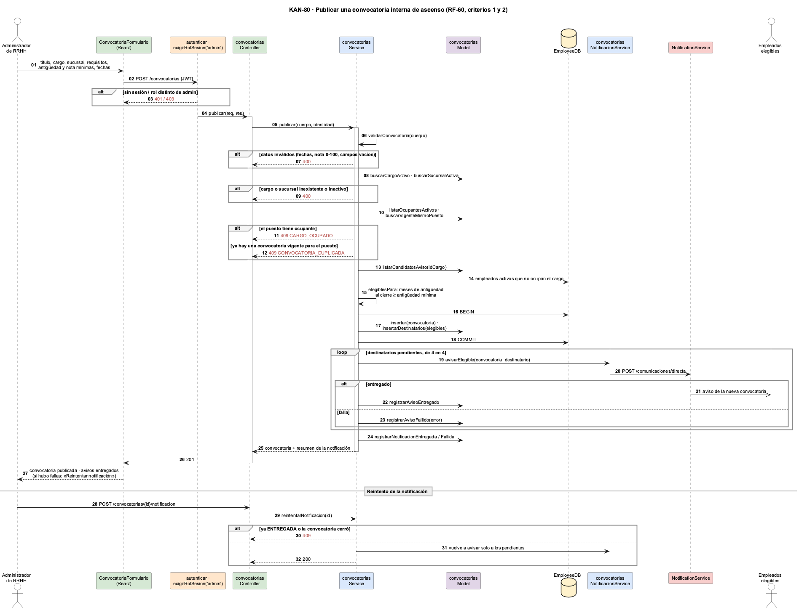

### 3.2 KAN-80 · Consulta para empleados activos y cierre automático

Un empleado inactivo recibe 403. El estado de la convocatoria se deriva de sus fechas y, todos los días a las 00:05, un job marca como cerradas las vencidas.

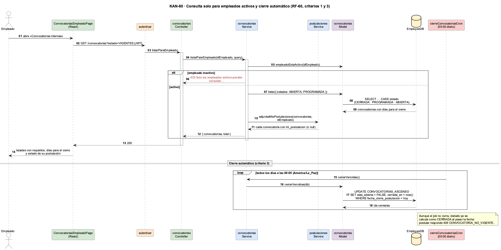

### 3.3 KAN-81 · Postularse y validar los méritos

Una sola postulación por empleado y convocatoria. Se valida al registrarla con la permanencia y la nota de la última evaluación cerrada en PerformanceService. Si PerformanceService no responde, la postulación queda pendiente en vez de marcarse como no apta.

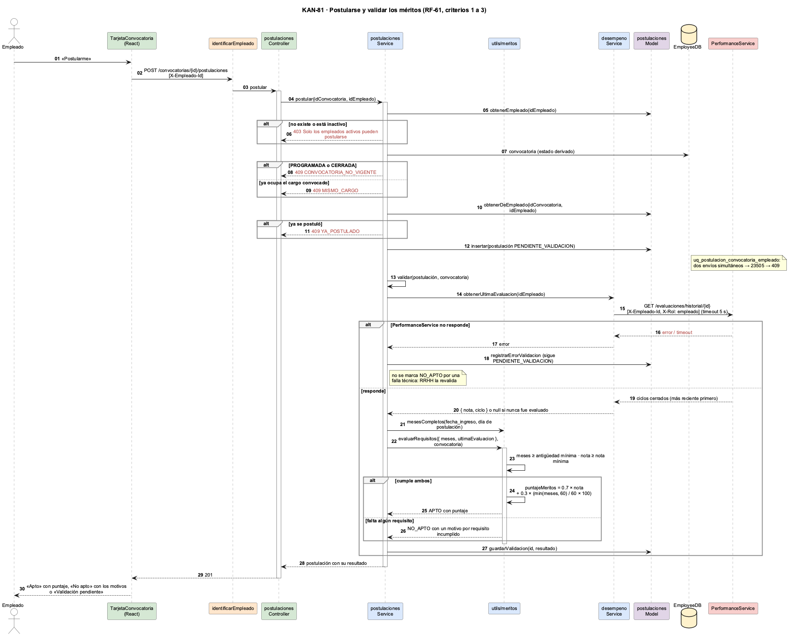

### 3.4 KAN-81 · Ranking y nueva validación

Ranking de aptos por puntaje de méritos (70 % nota + 30 % antigüedad con tope de 60 meses), definitivo cuando la convocatoria cerró. Los no aptos se muestran con sus motivos, y RRHH puede volver a validar una postulación.

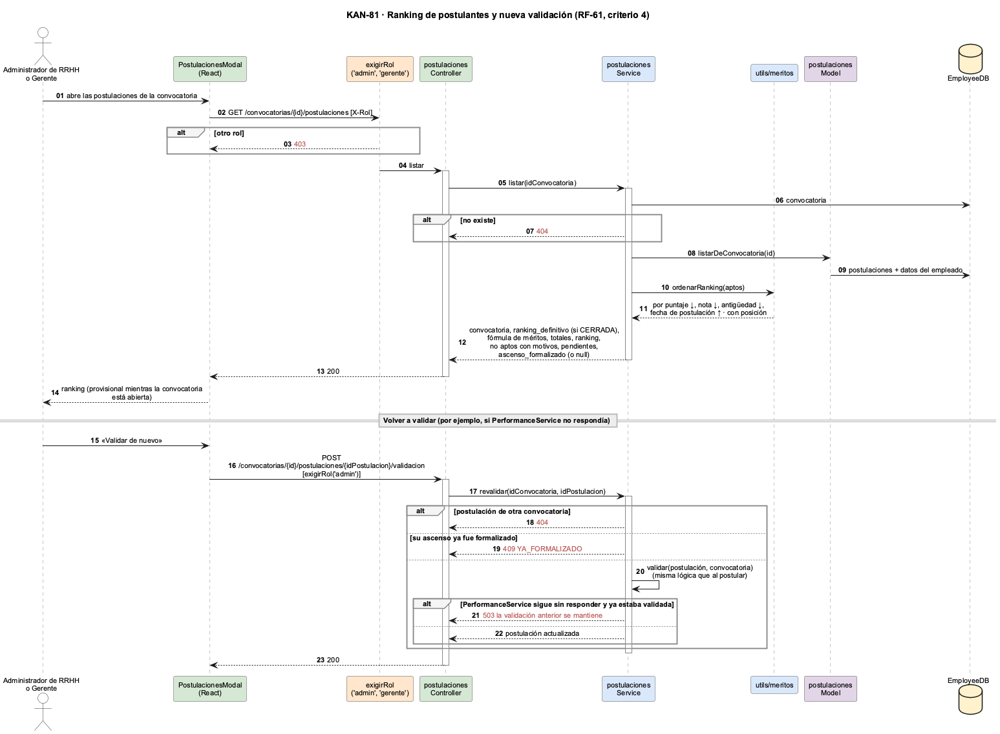

### 3.5 KAN-82 · Formalizar el ascenso

Todas las reglas se validan antes de tocar nada. Después se registra la adenda ASCENSO en el historial contractual. Si la vigencia es hoy, se cambia el cargo en el momento; si es futura, queda programado. La convocatoria se cierra y se avisa al promovido; si el aviso falla, el ascenso igual queda formalizado.

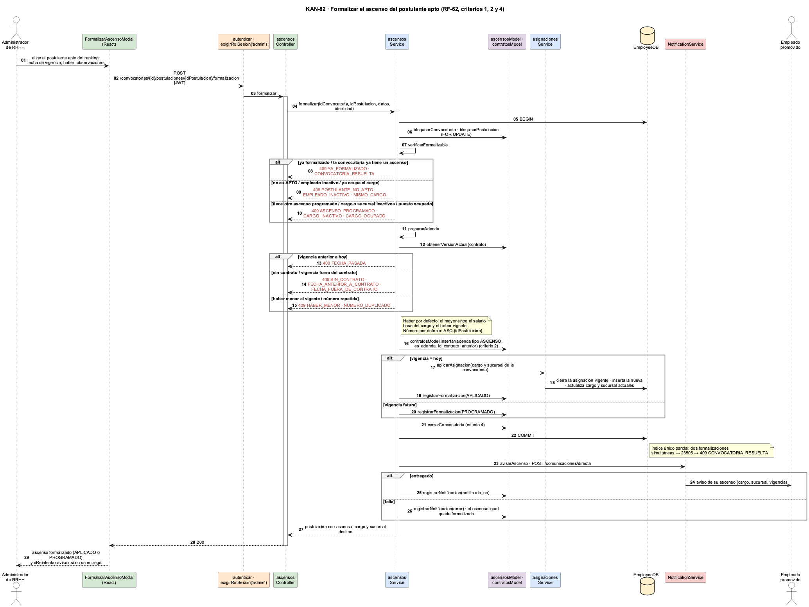

### 3.6 KAN-82 · Aplicar los ascensos programados

Todos los días a las 00:10, un job aplica el cambio de cargo de los ascensos cuya vigencia llegó, cada uno en su propia transacción. La planilla del periodo toma el nuevo haber desde la adenda.

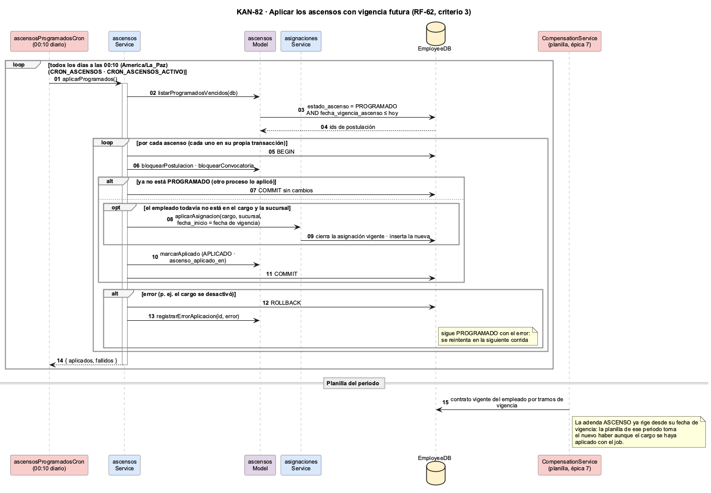

### 3.7 KAN-83 · Asignar el plan y seguir su avance

El cargo destino debe tener capacitaciones requeridas, y cada empleado tiene a lo sumo un plan en curso. El estado de cada curso se calcula en cada consulta contra el Kardex, así que un certificado recién registrado aparece como cumplido al instante.

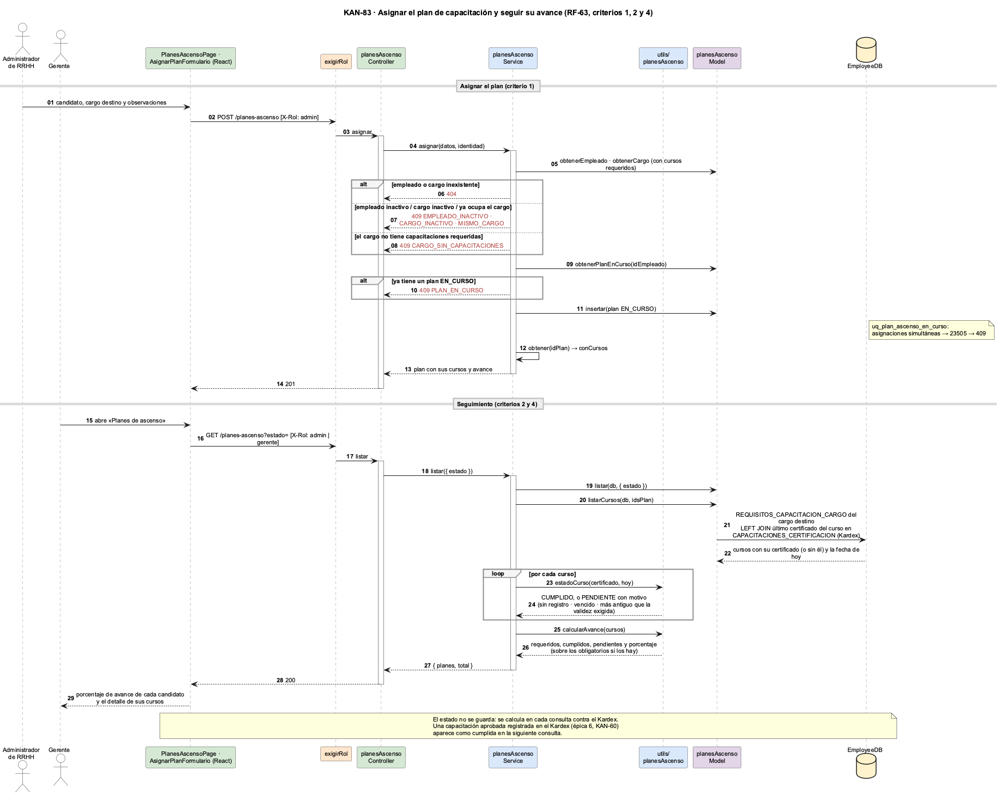

### 3.8 KAN-83 · Formalizar con cursos pendientes

Si quedan cursos pendientes, la primera llamada responde una advertencia con la lista. Al confirmarla, el ascenso se formaliza y queda constancia de cuántos cursos faltaban.

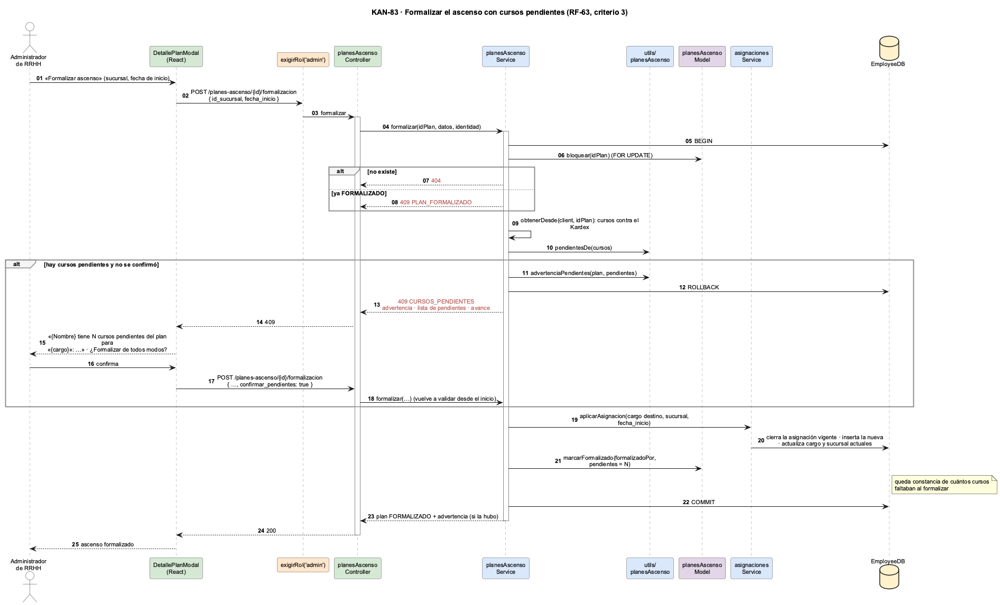

## 4. Trazabilidad con el código

Rutas relativas a `backend/EmployeeService/`. Por el gateway, las rutas van con el prefijo `/api/empl`.

| Historia | Rutas HTTP | Servicio | Modelo · tablas | Pantalla (frontend) |
|---|---|---|---|---|
| KAN-80 | `POST /convocatorias`, `GET /convocatorias`, `GET /convocatorias/gestion`, `GET /convocatorias/:id`, `POST /convocatorias/:id/notificacion` | `src/services/convocatoriasService.js`, `convocatoriasNotificacionService.js`, `src/jobs/cierreConvocatoriasCron.js` | `convocatoriasModel` · `CONVOCATORIAS_ASCENSO`, `DESTINATARIOS_CONVOCATORIA` | `features/convocatorias-internas/ConvocatoriasRrhhPage.jsx`, `ConvocatoriaFormulario.jsx`, `ConvocatoriasEmpleadoPage.jsx` |
| KAN-81 | `POST /convocatorias/:id/postulaciones`, `GET …/postulaciones/mia`, `GET …/postulaciones`, `POST …/postulaciones/:id/validacion` | `src/services/postulacionesService.js`, `desempenoService.js`, `src/utils/meritos.js` | `postulacionesModel` · `POSTULACIONES_ASCENSO` | `TarjetaConvocatoria.jsx`, `PostulacionesModal.jsx` |
| KAN-82 | `POST …/postulaciones/:id/formalizacion`, `POST …/formalizacion/notificacion` | `src/services/ascensosService.js`, `asignacionesService.js`, `src/jobs/ascensosProgramadosCron.js` | `ascensosModel`, `contratosModel` · `POSTULACIONES_ASCENSO`, `CONTRATOS`, `ASIGNACIONES_EMPLEADO` | `FormalizarAscensoModal.jsx` |
| KAN-83 | `GET /planes-ascenso`, `GET /planes-ascenso/:id`, `POST /planes-ascenso`, `POST /planes-ascenso/:id/formalizacion` | `src/services/planesAscensoService.js`, `src/utils/planesAscenso.js` | `planesAscensoModel` · `PLANES_ASCENSO`, `REQUISITOS_CAPACITACION_CARGO`, `CAPACITACIONES_CERTIFICACION` | `features/planes-ascenso/PlanesAscensoPage.jsx`, `AsignarPlanFormulario.jsx`, `DetallePlanModal.jsx` |

**Integraciones:**

| Desde | Hacia | Para qué | Cómo |
|---|---|---|---|
| EmployeeService | PerformanceService | Nota de la última evaluación cerrada del postulante | `GET /evaluaciones/historial/:idEmpleado` (timeout 5 s) |
| EmployeeService | NotificationService | Aviso a los elegibles de una convocatoria y al empleado promovido | `POST /comunicaciones/directa` |
| CompensationService (épica 7) | EmployeeDB | La planilla toma el haber de la adenda ASCENSO según su vigencia | Contrato vigente por tramos |

**Jobs** (zona horaria `APP_TIMEZONE`, por defecto `America/La_Paz`):

| Job | Expresión por defecto | Variables | Qué hace |
|---|---|---|---|
| `cierreConvocatoriasCron` | `5 0 * * *` | `CRON_CIERRE_CONVOCATORIAS`, `CRON_CIERRE_CONVOCATORIAS_ACTIVO` | Cierra las convocatorias cuya fecha de cierre pasó |
| `ascensosProgramadosCron` | `10 0 * * *` | `CRON_ASCENSOS`, `CRON_ASCENSOS_ACTIVO` | Aplica el cambio de cargo de los ascensos programados cuya vigencia llegó |

## 5. Cómo regenerar las imágenes

Las fuentes son archivos PlantUML (`.puml`). El script genera las imágenes de la vista general en SVG y las detalladas en PNG:

```bash
cd backend/EmployeeService/docs/epica-10
./generar-diagramas.sh
```

Requisitos: Java 8 o superior y `plantuml.jar` (o el comando `plantuml` instalado). Si el jar está en otra ruta: `export PLANTUML_JAR=/ruta/plantuml.jar`.

## Notación

| Elemento | Significado |
|---|---|
| ◆ línea continua | Composición: la parte no existe sin el todo |
| → línea continua | Asociación navegable |
| - - → línea punteada | Dependencia («usa», «HTTP») |
| `/atributo` | Atributo derivado: se calcula en la consulta, no se almacena |
| `[0..1]` | Atributo opcional |
| Flecha llena | Llamada síncrona |
| Flecha punteada | Respuesta |
| Flecha abierta | Mensaje asíncrono (avisos) |
| Flecha roja punteada | Respuesta de error (400, 401, 403, 404, 409, 503) |
| `alt` · `opt` · `loop` | Alternativas · opcional · repetición |

**Colores de los diagramas detallados:** verde = controlador o pantalla · azul = servicio · morado = modelo · naranja = middleware · rojo = job o sistema externo · amarillo = enumeración o base de datos.
