# Épica 6 · Historial de seguimiento, Kardex y memorándums

Documentación UML de la épica 6 del Sistema de RR.HH. del ERP de supermercado (**KAN-308**). Incluye una **vista general** con un diagrama de clases y uno de secuencia para toda la épica, y una **vista detallada** con el modelo de dominio, el diseño por capas y un diagrama de secuencia por cada flujo principal.

## Contenido

1. [Historias de la épica](#historias-de-la-épica)
2. [Vista general](#1-vista-general)
   - [Diagrama de clases de la épica](#11-diagrama-de-clases-de-la-épica)
   - [Diagrama de secuencia de la épica](#12-diagrama-de-secuencia-de-la-épica)
3. [Diagramas de clases detallados](#2-diagramas-de-clases-detallados)
4. [Diagramas de secuencia por flujo](#3-diagramas-de-secuencia-por-flujo)
5. [Notación](#notación)
6. [Trazabilidad con el código](#trazabilidad-con-el-código)

## Historias de la épica

| Historia | Requerimiento | Qué resuelve |
|---|---|---|
| **KAN-56** | RF-36 · Consulta de Kardex laboral consolidado | Ficha única del colaborador con contratos, trayectoria, memorándums, capacitaciones y asistencia |
| **KAN-57** | RF-37 · Memorándums de llamada de atención | Emisión con evidencia, CITE correlativo, PDF oficial y alerta roja por reincidencia |
| **KAN-58** | RF-38 · Memorándums de felicitación | Reconocimientos con el mismo correlativo y un PDF con diseño institucional |
| **KAN-59** | RF-39 · Notificación y confirmación de recepción | Aviso prioritario al colaborador, acuse con fecha, IP y usuario, y alerta a RRHH si vence el plazo |
| **KAN-60** | RF-40 · Capacitaciones y certificaciones | Registro con certificado y vigencia, compra del servicio a Compras por Pub/Sub y alertas de caducidad |
| **KAN-61** | RF-41 · Modificaciones contractuales y adendas | Versionado inmutable del contrato, bloqueo de fechas inconsistentes y línea de tiempo |

## 1. Vista general

### 1.1 Diagrama de clases de la épica

Las entidades de las seis historias, agrupadas por paquete, con sus atributos clave y sus responsabilidades como operaciones. El `KardexLaboral` (KAN-56) consolida todo lo que registran las demás historias sobre el `Empleado`.

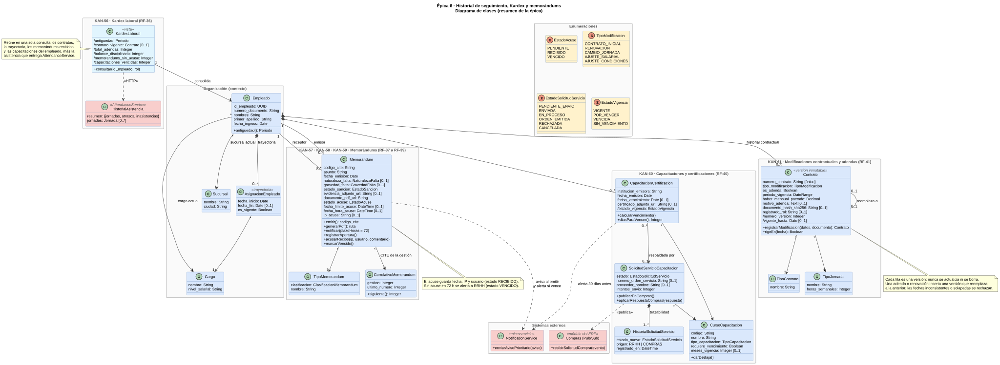

### 1.2 Diagrama de secuencia de la épica

Un recorrido de punta a punta en seis secciones, en el orden en que se alimenta el expediente:

1. **KAN-61** · se formaliza una renovación o adenda y se crea una nueva versión del contrato.
2. **KAN-60** · se registra una capacitación con su certificado y, si es externa, se solicita a Compras.
3. **KAN-57 · KAN-58** · se emite un memorándum y se notifica al colaborador.
4. **KAN-59** · el colaborador lo lee y acusa recibo.
5. **Tareas programadas** · acuses vencidos, certificaciones por vencer y reintentos de compra.
6. **KAN-56** · RRHH consulta el Kardex, que reúne todo lo anterior.

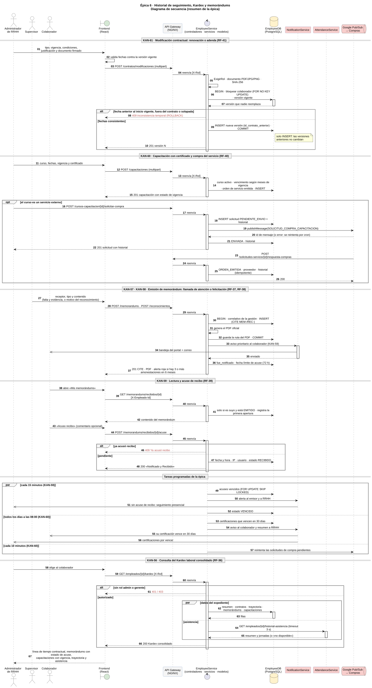

## 2. Diagramas de clases detallados

### 2.1 Modelo de dominio

Las 17 entidades de la épica con sus atributos reales en EmployeeDB, los atributos derivados (`/vigente_hasta`, `/estado_vigencia`…), las enumeraciones con sus valores, las multiplicidades y las reglas del dominio.

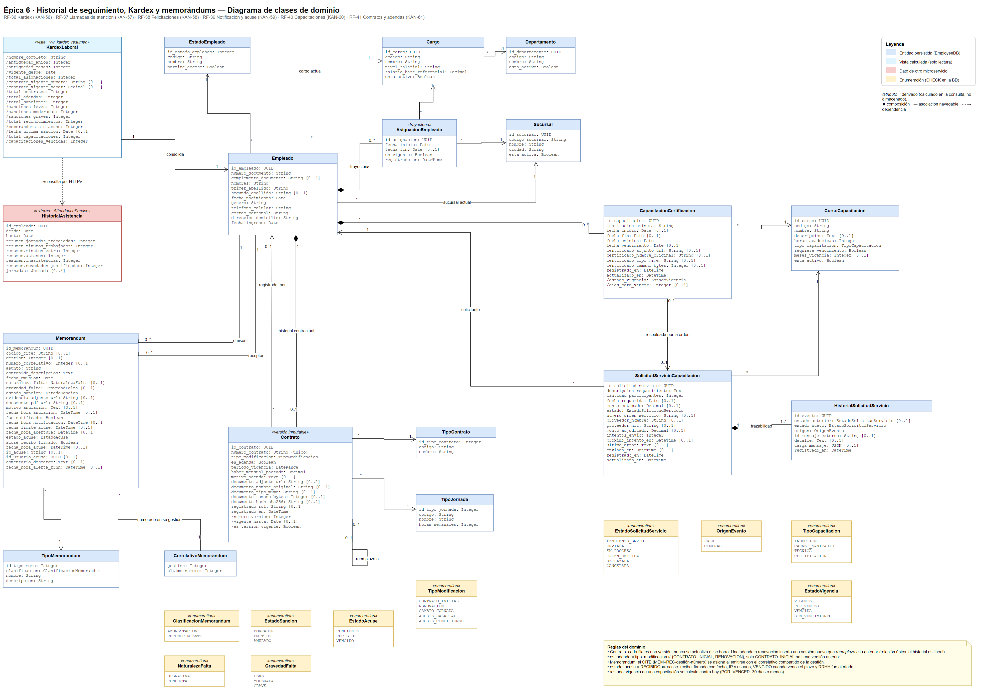

### 2.2 Diseño por capas · Kardex y memorándums

KAN-56 a KAN-59, en una banda por historia: middlewares, controladores con la ruta HTTP de cada operación, validadores, servicios, modelos y sistemas externos (AttendanceService y NotificationService).

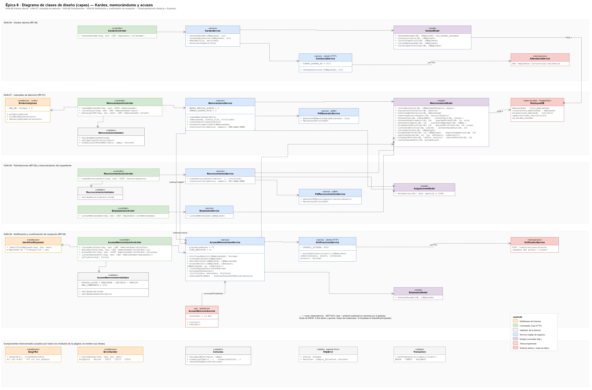

### 2.3 Diseño por capas · Capacitaciones y contratos

KAN-60 y KAN-61, con los jobs programados, la publicación en Google Pub/Sub hacia el Sistema de Compras y el modelo de contratos que solo inserta.

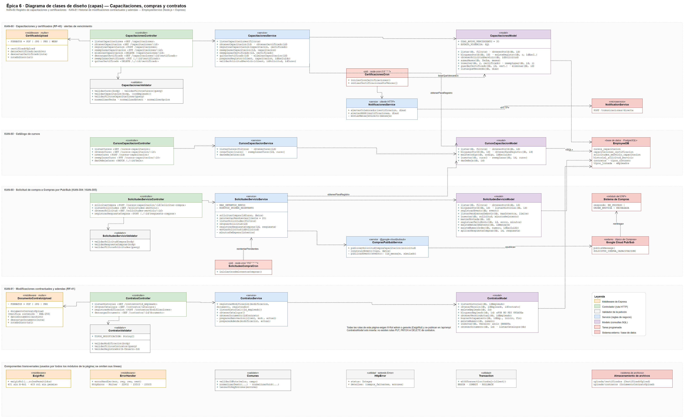

> El backend está hecho con módulos de JavaScript (controlador → servicio → modelo). En el diseño cada módulo se representa como una clase con estereotipo (`«controller»`, `«service»`, `«model»`…): sus funciones exportadas aparecen como operaciones públicas (`+`) y las internas como privadas (`-`).

## 3. Diagramas de secuencia por flujo

### 3.1 KAN-56 · Consultar el Kardex laboral

Control de rol y consulta en paralelo: las secciones del expediente salen de EmployeeDB y la asistencia de AttendanceService. Si AttendanceService no responde, el Kardex se entrega igual.

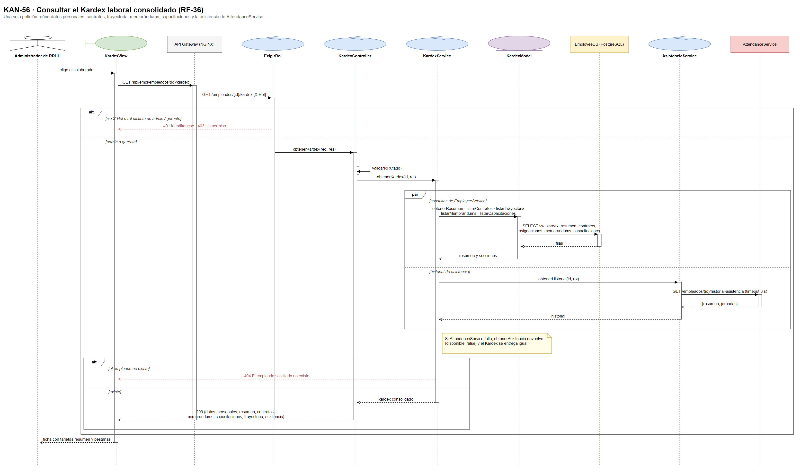

### 3.2 KAN-57 · Emitir una llamada de atención

Evidencia adjunta, validación, correlativo por gestión, PDF oficial dentro de la misma transacción, alerta roja por reincidencia y aviso al colaborador.

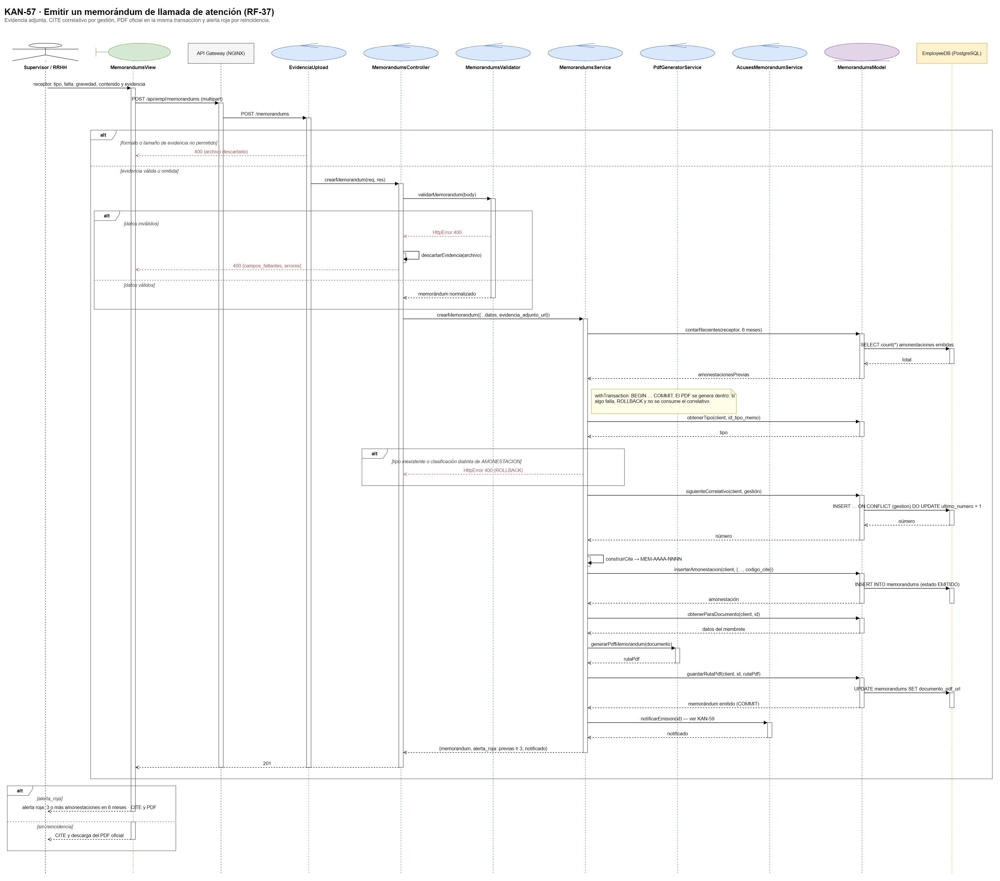

### 3.3 KAN-58 · Emitir una felicitación

Vista previa del diseño institucional, correlativo compartido con las llamadas de atención, PDF de reconocimiento y aviso al colaborador.

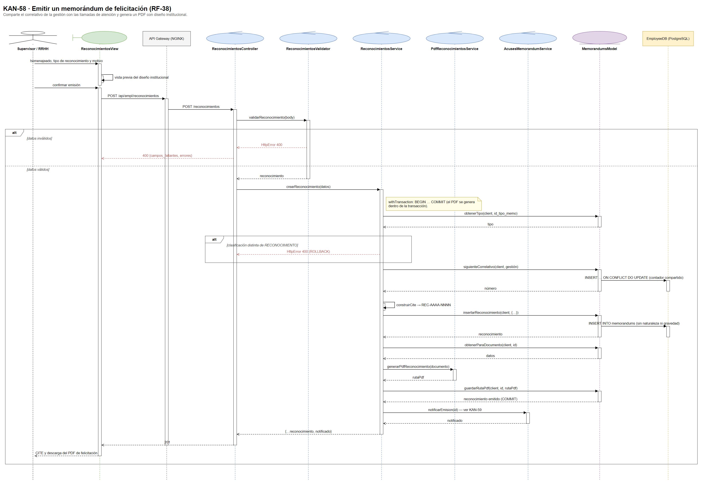

### 3.4 KAN-59 · Notificación y acuse de recibo

Aviso prioritario al emitirse el memorándum, primera apertura registrada y acuse con fecha, IP y usuario; un segundo acuse se rechaza.

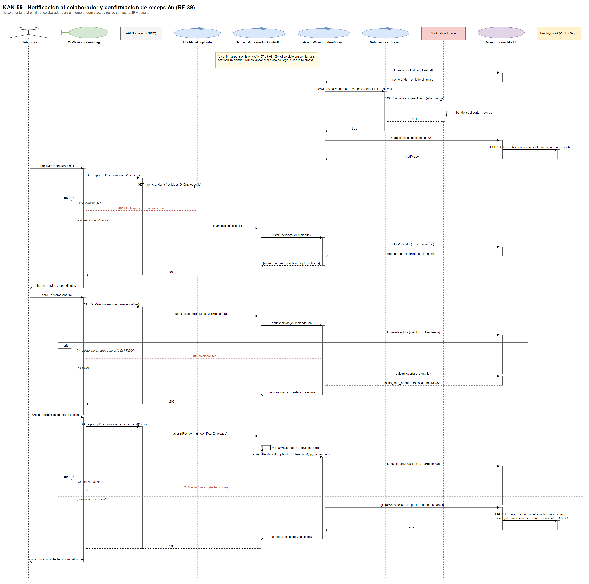

### 3.5 KAN-59 · Vencimiento de acuses

El job corre cada 15 minutos: reintenta los avisos que no llegaron, alerta al emisor y a RRHH por cada acuse vencido y deja la vista de seguimiento al día.

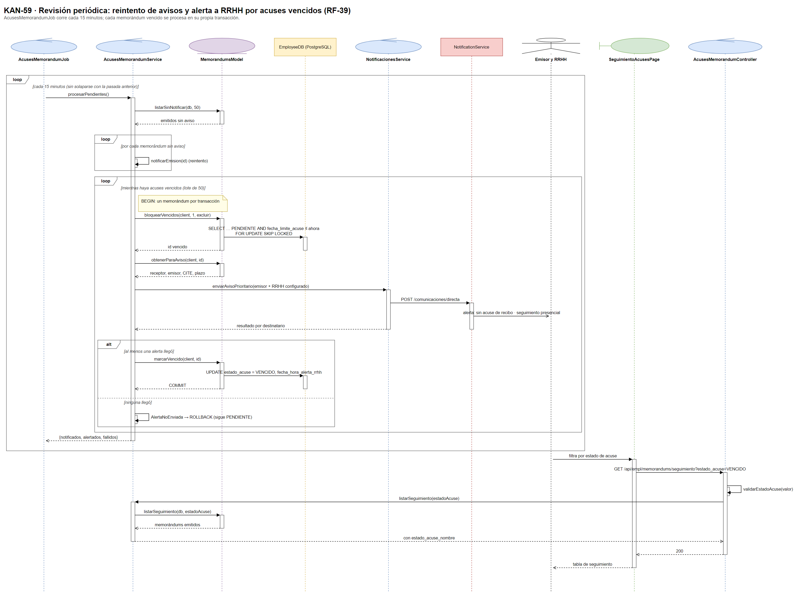

### 3.6 KAN-60 · Registrar una capacitación

Certificado verificado, vencimiento calculado desde la vigencia del curso, vínculo con una orden de servicio emitida y rechazo de duplicados.

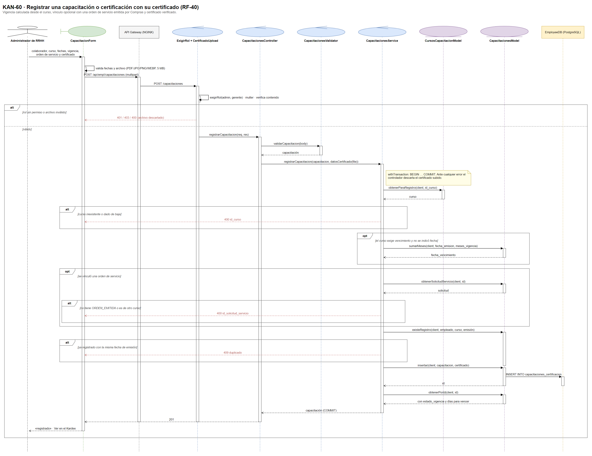

### 3.7 KAN-60 · Solicitud de compra a Compras

La solicitud se registra aunque Pub/Sub falle. Un cron reintenta el envío cada 10 minutos y Compras responde con la orden de servicio, que se aplica una sola vez.

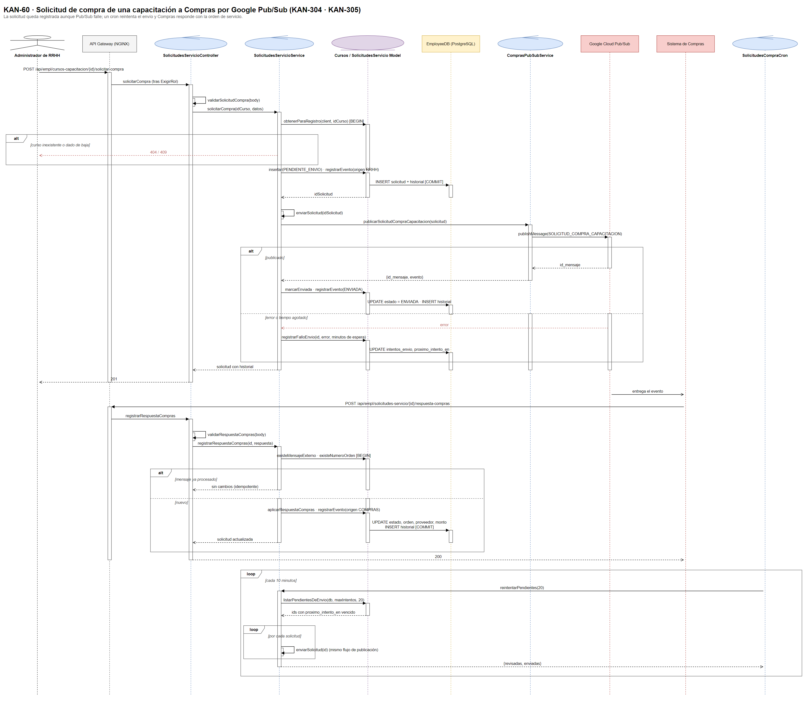

### 3.8 KAN-60 · Alertas de vencimiento de certificaciones

Todos los días a las 08:00 se avisa a cada colaborador cuya certificación vence en 30 días y se envía un resumen a RRHH.

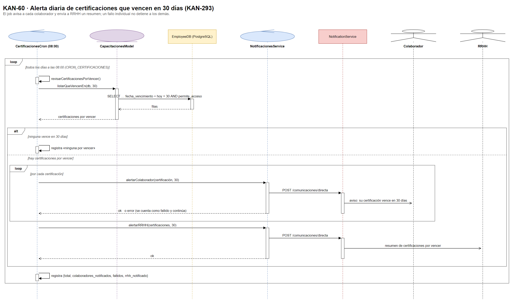

### 3.9 KAN-61 · Registrar una renovación o adenda

Validación de fechas en el formulario y en el backend, bloqueo por colaborador para evitar registros simultáneos y una versión nueva que nunca altera las anteriores.

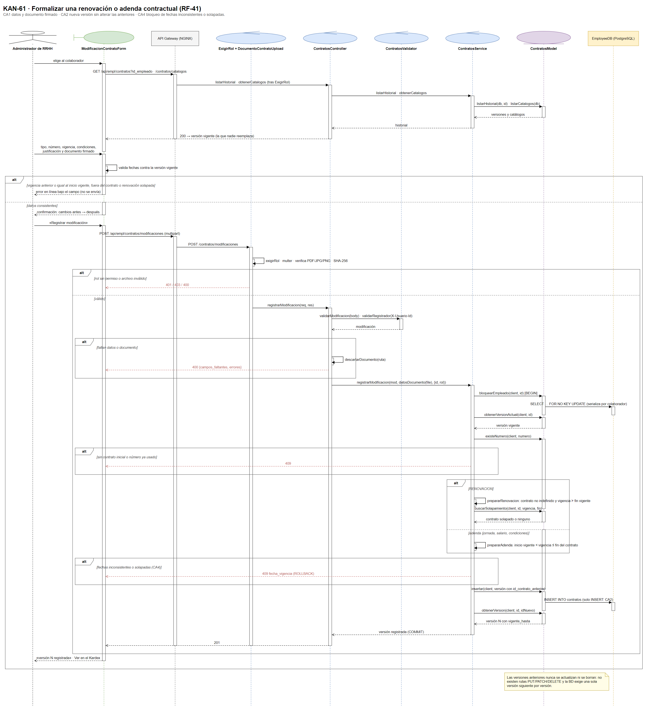

### 3.10 KAN-61 · Línea de tiempo contractual

Historial cronológico en el Kardex, con la vigencia calculada de cada versión, los cambios respecto a la anterior y la descarga del documento firmado.

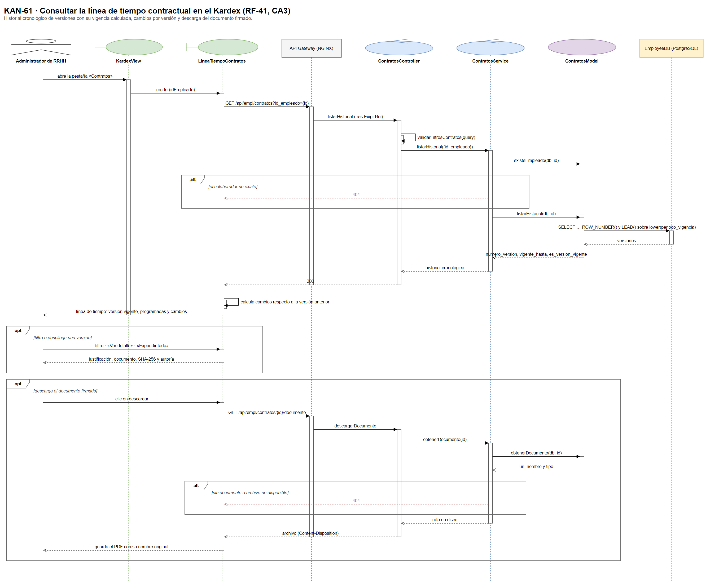

## Notación

| Elemento | Significado |
|---|---|
| ◆ línea continua | Composición: la parte no existe sin el todo |
| → línea continua | Asociación navegable |
| - - → línea punteada | Dependencia («usa», «HTTP», «publica») |
| `/atributo` | Atributo derivado: se calcula en la consulta, no se almacena |
| `[0..1]` | Atributo opcional |
| Flecha llena | Llamada síncrona |
| Flecha punteada | Respuesta |
| Flecha abierta | Mensaje asíncrono (avisos y eventos) |
| Flecha roja punteada | Respuesta de error (400, 401, 403, 404, 409) |
| `alt` · `opt` · `loop` · `par` | Alternativas · opcional · repetición · en paralelo |

**Colores de los diagramas detallados:** verde = controlador o pantalla · azul = servicio · morado = modelo · naranja = middleware · rojo = job o sistema externo · amarillo = enumeración o base de datos.
