# Épica 1 · Evaluación del desempeño

Documentación UML de la épica 1 (**KAN-8**) del Sistema de RR.HH. del ERP de supermercado. Incluye una **vista general** con un diagrama de clases y uno de secuencia para toda la épica, y una **vista detallada** con el modelo de dominio y un diagrama de secuencia por cada flujo principal. Toda la épica vive en **PerformanceService** (PerformanceDB). Los diagramas salen del código del repositorio: los nombres de tablas, rutas, módulos y funciones son los reales.

## Contenido

1. [Historias de la épica](#historias-de-la-épica)
2. [Vista general](#1-vista-general)
   - [Diagrama de clases de la épica](#11-diagrama-de-clases-de-la-épica)
   - [Diagrama de secuencia de la épica](#12-diagrama-de-secuencia-de-la-épica)
3. [Diagrama de clases detallado](#2-diagrama-de-clases-detallado)
4. [Diagramas de secuencia por flujo](#3-diagramas-de-secuencia-por-flujo)
5. [Notación](#notación)
6. [Trazabilidad con el código](#trazabilidad-con-el-código)

## Historias de la épica

| Historia | Requerimiento | Qué resuelve |
|---|---|---|
| **KAN-9** | RF-01 · Diseño de plantillas de evaluación | Plantilla en borrador con nombre, área destino, objetivo y vigencia; alerta de duplicidad por nombre, área y vigencia; publicación que bloquea su estructura base |
| **KAN-22** | RF-02 · Preguntas ponderadas y escalas de valoración | Secciones de competencias y factores operativos con criterios y preguntas; peso porcentual que debe sumar 100 %; escalas cuantitativas o cualitativas con la etiqueta de cada nivel; nueva versión para cambiar una plantilla publicada |
| **KAN-23** | RF-03 · Asignación de evaluaciones por periodo | Ciclo programado sobre una plantilla publicada, asignación masiva evaluador–evaluado por área, sucursal o colaboradores según la jerarquía de cada sucursal, recordatorio a 3 días de la fecha límite y cierre con evaluaciones vencidas |
| **KAN-24** | RF-04 · Respuesta y registro de la evaluación | Bandeja del evaluador, formulario dinámico con autoguardado en borrador y envío con puntaje ponderado que bloquea la edición; las preguntas obligatorias pendientes impiden el envío |
| **KAN-25** | RF-05 · Retroalimentación cualitativa final | Fortalezas, aspectos de mejora, comentarios generales y compromisos de desarrollo con fecha objetivo; solo lectura una vez enviada |
| **KAN-26** | RF-06 · Consulta de evaluaciones individuales | Resultados del colaborador con desglose por competencia y retroalimentación, evolución del puntaje por periodo y control de acceso por rol |
| **KAN-27** | RF-07 · Consolidación y análisis de desempeño por RRHH | Promedios por departamento, sucursal y competencia de un ciclo cerrado, comparativa y brechas bajo el umbral, y métricas del CRM pedidas por Pub/Sub con reintentos y cola de errores |

## 1. Vista general

### 1.1 Diagrama de clases de la épica

Las entidades de la épica agrupadas por historia, con sus atributos clave y sus responsabilidades como operaciones. La `PlantillaEvaluacion` y sus versiones definen **qué** se evalúa; el `CicloEvaluacion` define **cuándo y a quién**, y la `Evaluacion` es el eje de la ejecución: de ella cuelgan las respuestas, la retroalimentación y los compromisos. Los resultados del colaborador (KAN-26) y el consolidado (KAN-27) no se guardan: se calculan desde las evaluaciones enviadas. `Empleado`, `Departamento` y `Sucursal` son réplicas mínimas de EmployeeService con el mismo UUID; el `Cargo` solo se consulta a EmployeeService para resolver la jerarquía.

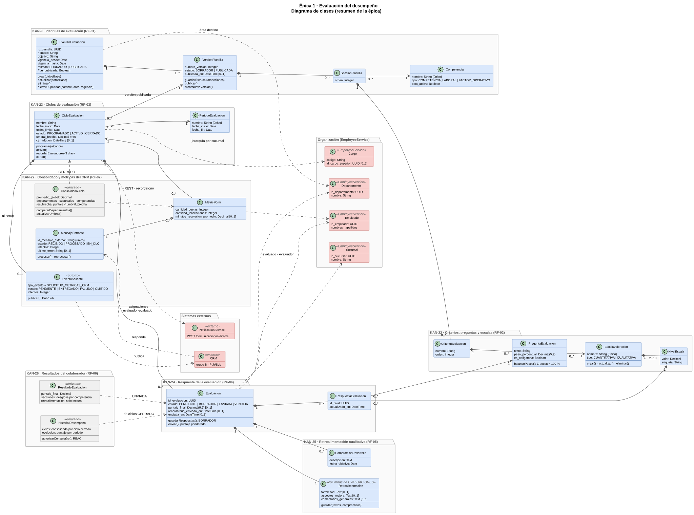

### 1.2 Diagrama de secuencia de la épica

Un recorrido de punta a punta en el orden en que avanza una evaluación:

1. **KAN-22 · KAN-9** · el Administrador de RRHH crea la escala de valoración, la plantilla en borrador y su estructura (secciones, criterios y preguntas con peso), y la publica cuando los pesos suman 100 %.
2. **KAN-23** · programa el ciclo con el asistente: elige la plantilla publicada, el periodo, las fechas y el alcance; el servicio calcula las asignaciones evaluador–evaluado con la jerarquía de EmployeeService y crea una evaluación pendiente por cada una.
3. **Job diario** · activa el ciclo en su fecha de inicio y, a 3 días de la fecha límite, avisa a los evaluadores con evaluaciones pendientes por NotificationService.
4. **KAN-24 · KAN-25** · el evaluador responde el formulario (autoguardado en borrador), registra la retroalimentación y los compromisos, y envía; el puntaje ponderado queda congelado.
5. **Job diario** · al vencer la fecha límite cierra el ciclo, marca como vencidas las evaluaciones sin enviar y deja la solicitud de métricas para el CRM (outbox).
6. **KAN-26** · el colaborador consulta sus resultados y la evolución de su puntaje por periodo.
7. **KAN-27** · el despachador publica la solicitud en Pub/Sub (de RRHH, grupo F, al CRM, grupo B), llegan las métricas del CRM (hoy, una respuesta simulada) y RRHH consulta el consolidado con las brechas de productividad.

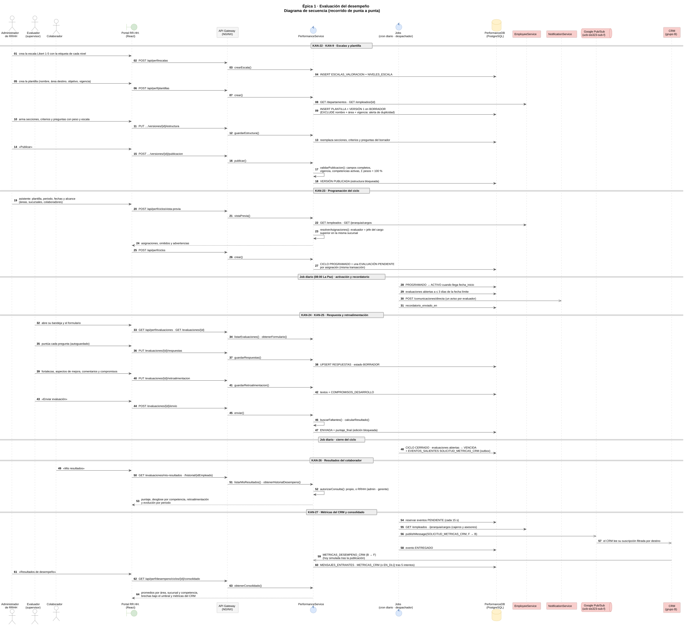

## 2. Diagrama de clases detallado

### 2.1 Modelo de dominio

Las tablas de la épica en PerformanceDB con sus atributos reales (`db/init.sql`), los catálogos de `db/catalogos.sql` como enumeraciones, los atributos derivados (`/en_uso`, `/en_uso_publicado`), las multiplicidades, las restricciones que sostienen las reglas de negocio (exclusión por nombre, área y vigencia de la plantilla; una evaluación por ciclo, evaluado y evaluador; estado enviado solo con puntaje) y la réplica mínima de EmployeeDB.

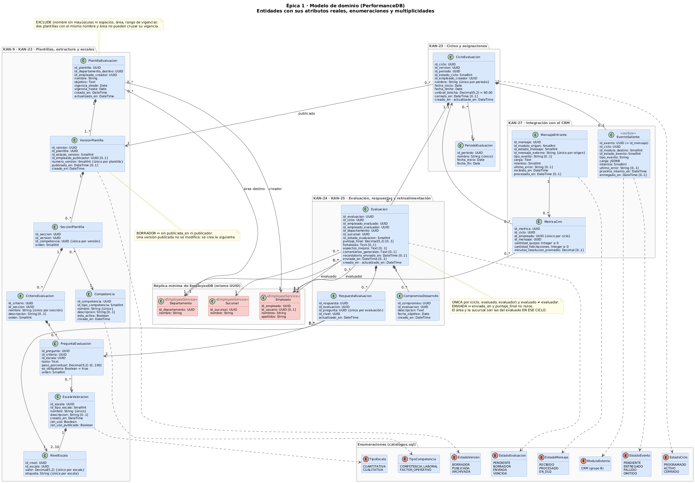

## 3. Diagramas de secuencia por flujo

Cada diagrama sigue las capas del servicio: pantalla → API Gateway → middleware → servicio → modelo → PerformanceDB, más los sistemas externos (EmployeeService, NotificationService, Google Pub/Sub y el CRM).

### 3.1 KAN-9 · Plantilla de evaluación en borrador

Listado con filtros, creación en borrador (con la versión 1) validando el área destino en EmployeeService, alerta de duplicidad por nombre, área y vigencia (también ante dos creaciones simultáneas, por la restricción `EXCLUDE`) y bloqueo de los datos base y de la eliminación una vez publicada.

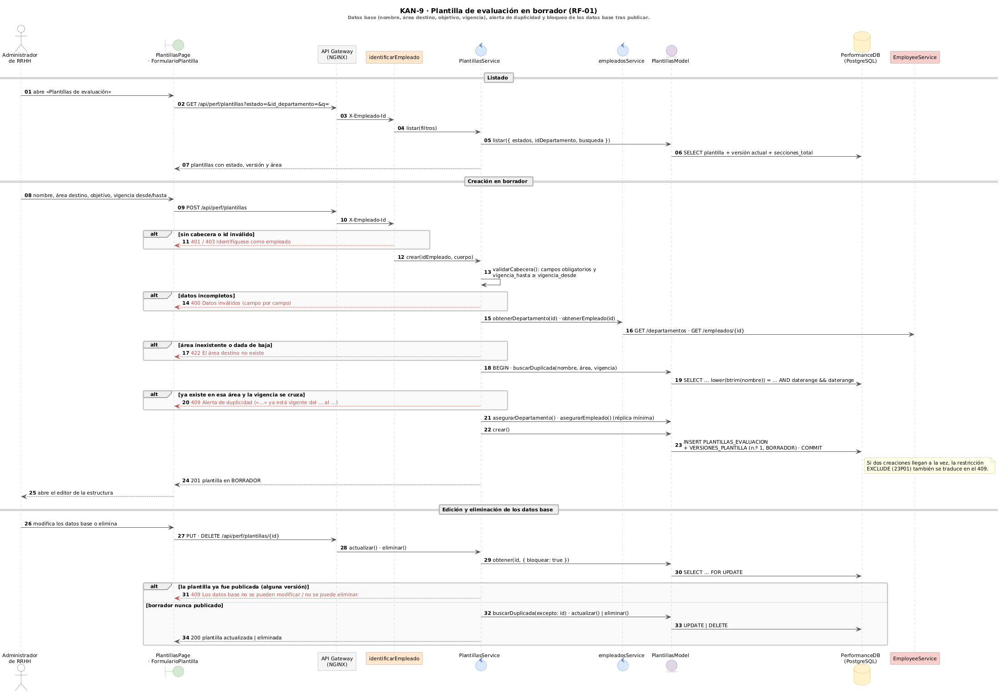

### 3.2 KAN-22 · Escalas de valoración y competencias

Escalas cuantitativas o cualitativas de 2 a 10 niveles con la etiqueta descriptiva de cada uno (la que ve el evaluador). Una escala usada en una versión publicada solo admite cambios de nombre y descripción, y una asignada a preguntas no se elimina. Alta de competencias y factores operativos sin nombres repetidos.

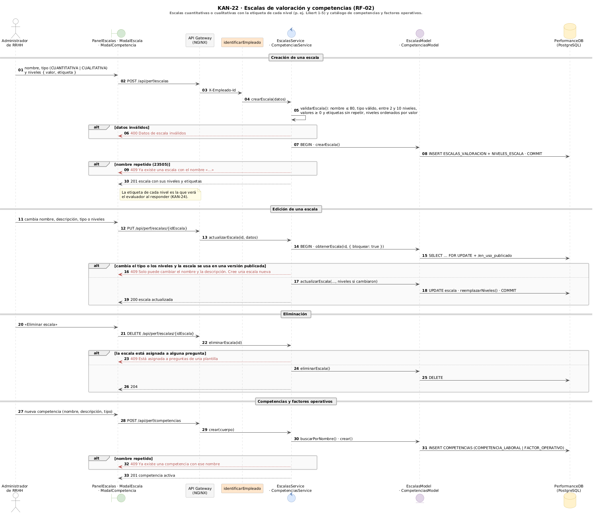

### 3.3 KAN-9 · KAN-22 · Estructura y publicación

Guardado de secciones, criterios y preguntas del borrador con su peso, escala y obligatoriedad, y balance de pesos en vivo. La publicación aplica las reglas (`REGLAS_PUBLICACION`): datos base completos, vigencia no terminada, competencias activas, criterios con preguntas y pesos que suman 100 %; si algo falta responde 422 con la lista de pendientes. La versión anterior publicada queda archivada.

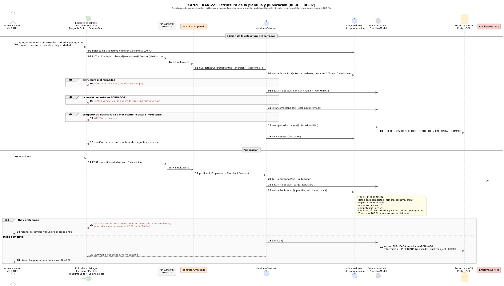

### 3.4 KAN-22 · Nueva versión de una plantilla publicada

Modificar las preguntas o los pesos de una versión publicada se rechaza con 409 y se exige crear una nueva versión: un borrador con la estructura de la última, sin alterar los ciclos ya programados, que siguen apuntando a su versión.

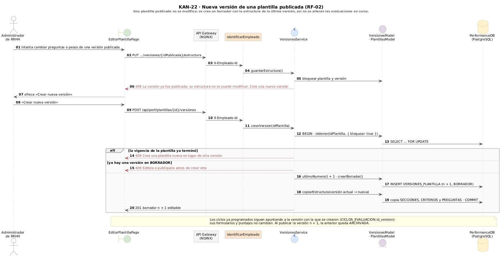

### 3.5 KAN-23 · Programación del ciclo y asignación masiva

Asistente de tres pasos (plantilla y periodo, alcance con vista previa, fechas). El evaluado sale del alcance área ∩ sucursal más los colaboradores sueltos, y su evaluador es quien ocupa el cargo jefe directo **en la misma sucursal**. Se informan los omitidos (sin cargo superior o sin evaluador en la sucursal) y la advertencia de otra área. El ciclo queda `PROGRAMADO` con una evaluación `PENDIENTE` por asignación, en una sola transacción.

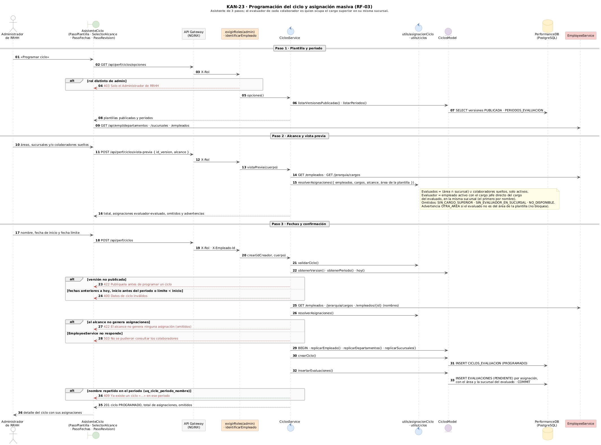

### 3.6 KAN-23 · Job diario de ciclos

`node-cron` a las 08:00 de La Paz y una vez al arrancar (o `POST /ciclos/procesar` a pedido), con un bloqueo de PostgreSQL para que no corran dos a la vez: activa los ciclos que empiezan, envía un aviso por evaluador y ciclo cuando faltan 3 días o menos para la fecha límite y cierra los vencidos, marcando como `VENCIDA` las evaluaciones sin enviar y guardando la solicitud de métricas al CRM.

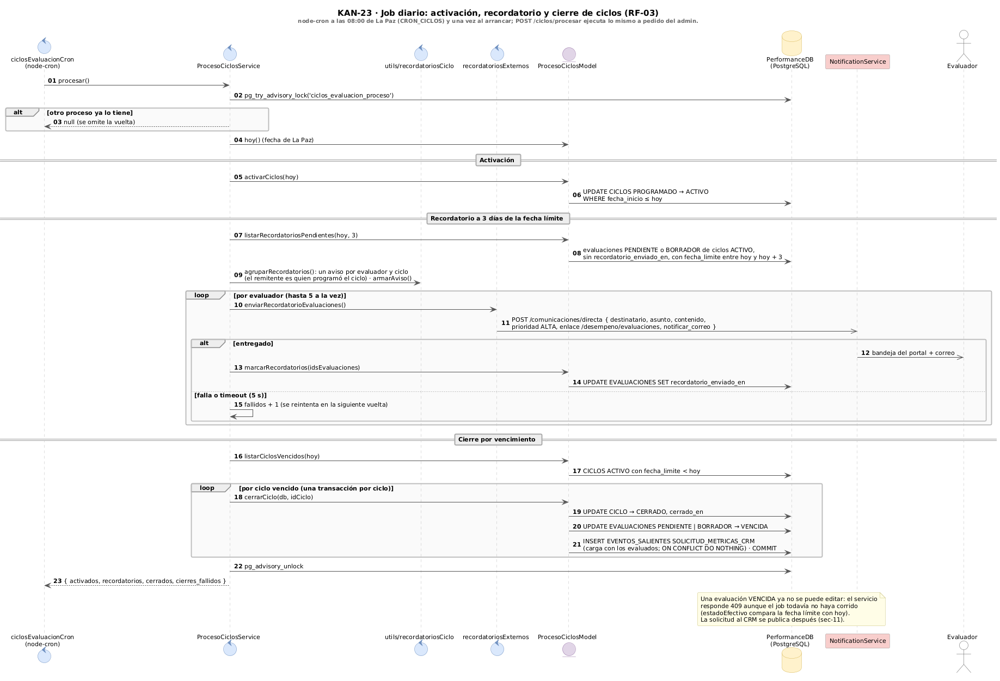

### 3.7 KAN-24 · Respuesta del formulario y envío

Bandeja del evaluador con progreso por evaluación, formulario armado desde la versión de la plantilla del ciclo, autoguardado de cada respuesta en `BORRADOR` y envío: si faltan preguntas obligatorias responde 422 con la lista para resaltarlas; si no, calcula el puntaje ponderado (0 a 100, solo sobre las preguntas respondidas) y bloquea la edición. Una evaluación vencida ya no se puede responder.

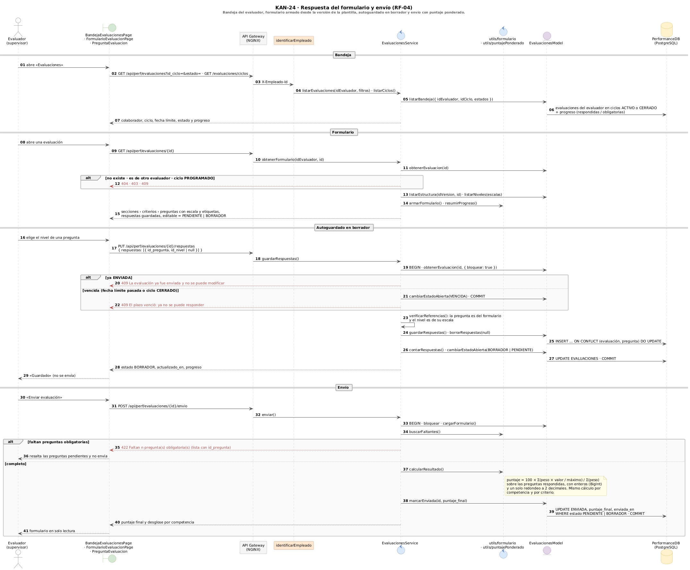

### 3.8 KAN-25 · Retroalimentación cualitativa y compromisos

Sección final que se habilita con los puntajes completos: fortalezas, aspectos de mejora, comentarios generales y compromisos de desarrollo con fecha objetivo (no anterior a hoy). Tras el envío queda en solo lectura, también para el colaborador.

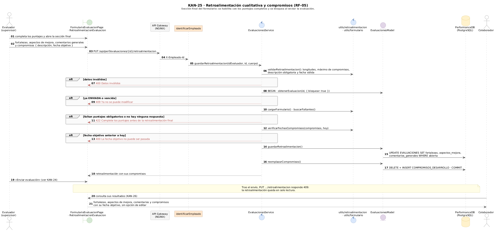

### 3.9 KAN-26 · Resultados e historial del colaborador

El colaborador ve solo sus evaluaciones enviadas, con el desglose por competencia y la retroalimentación, y su historial de ciclos cerrados con la evolución del puntaje por periodo. Consultar a otro colaborador solo se permite a RRHH (`admin` o `gerente`); cualquier otro rol recibe 403.

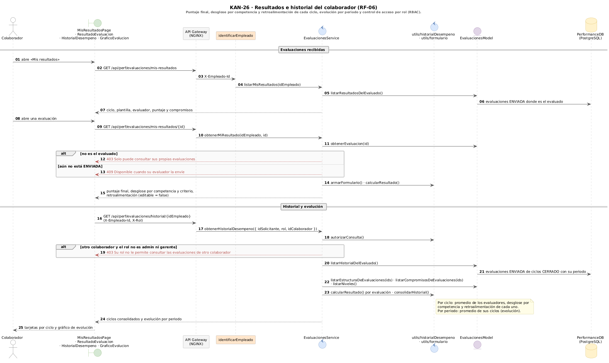

### 3.10 KAN-27 · Consolidado, comparativa y brechas

Panel de RRHH sobre un ciclo cerrado: promedio global, cobertura y promedios por departamento, sucursal y competencia calculados en el backend (sin vistas), primero por colaborador y después por grupo. Un grupo es brecha cuando su promedio queda por debajo del umbral del ciclo, que solo el `admin` puede ajustar.

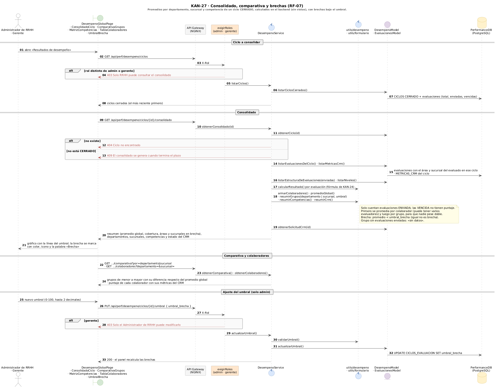

### 3.11 KAN-27 · Publicación de la solicitud de métricas al CRM

Patrón outbox: un despachador cada 15 segundos reserva los eventos pendientes (`FOR UPDATE SKIP LOCKED`), selecciona a los cajeros y asesores de atención al cliente (`ATC-CAJ`, `ATC-ASE`) y publica la solicitud en el tópico único de RRHH con el encabezado como atributos. Reintentos con espera creciente de 30 s hasta 1 h, `FALLIDO` ante un error permanente o al octavo intento, `OMITIDO` si no hay a quién medir, y reintento manual del `admin`.

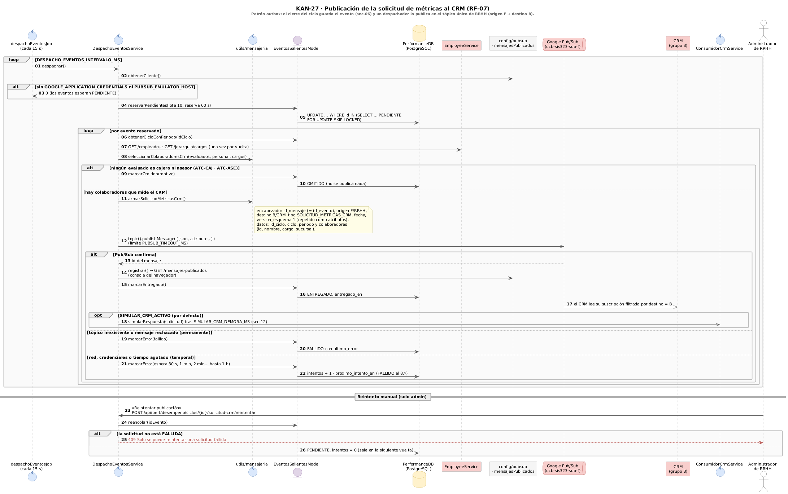

### 3.12 KAN-27 · Consumo de las métricas del CRM

Cada respuesta del CRM (hoy simulada tras una publicación confirmada) se registra en `MENSAJES_ENTRANTES`: un duplicado se descarta y un mensaje nuevo se aplica todo o nada, con hasta 5 intentos de espera creciente. Al agotarlos queda `EN_DLQ` con el motivo, sin bloquear el consolidado; el `admin` lo revisa, lo reprocesa o simula mensajes para probar duplicados y errores.

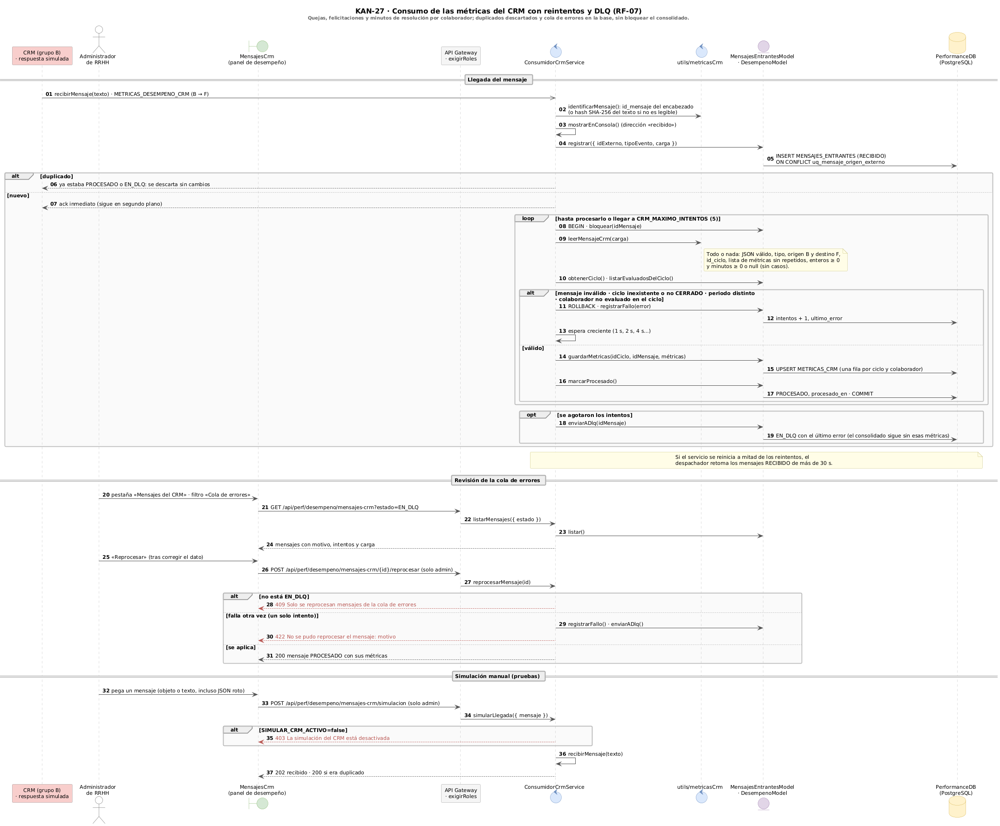

## Notación

| Elemento | Significado |
|---|---|
| ◆ línea continua | Composición: la parte no existe sin el todo |
| → línea continua | Asociación navegable |
| - - → línea punteada | Dependencia o referencia por UUID a otro servicio («REST», «publica», «responde») |
| `/atributo` | Atributo derivado: se calcula, no se almacena |
| `[0..1]` | Atributo opcional |
| `«derivado»` | Resultado que se calcula en el backend y no tiene tabla |
| `«outbox»` | Evento guardado en la misma transacción que lo origina y publicado después |
| `«columnas de EVALUACIONES»` | Datos guardados como columnas de otra tabla |
| Flecha llena | Llamada síncrona |
| Flecha punteada | Respuesta |
| Flecha abierta | Mensaje asíncrono (avisos, Pub/Sub y respuesta del CRM) |
| Flecha roja punteada | Respuesta de error (400, 401, 403, 404, 409, 422, 503) |
| `alt` · `opt` · `loop` | Alternativas · opcional · repetición |

**Colores:** verde = pantalla · gris = API Gateway · naranja = middleware · azul = controlador o servicio · morado = modelo · amarillo = enumeración o base de datos · rojo = sistema externo.

## Trazabilidad con el código

| Historia | Rutas | Servicio | Modelo | Pantalla |
|---|---|---|---|---|
| KAN-9 | `routes/plantillasRoutes.js` | `plantillasService.js`, `versionesService.js`, `empleadosService.js`, `utils/plantillas.js`, `utils/versiones.js` | `plantillasModel.js`, `versionesModel.js` | `features/plantillas-evaluacion` (`PlantillasPage`, `FormularioPlantilla`, `EditorPlantillaPage`) |
| KAN-22 | `routes/plantillasRoutes.js`, `routes/escalasRoutes.js`, `routes/competenciasRoutes.js` | `versionesService.js`, `escalasService.js`, `competenciasService.js`, `utils/ponderacion.js`, `utils/escalas.js`, `utils/competencias.js` | `versionesModel.js`, `escalasModel.js`, `competenciasModel.js` | `features/plantillas-evaluacion` (`EstructuraPlantilla`, `PreguntaEditor`, `BalancePesos`, `PanelEscalas`, `ModalEscala`, `ModalCompetencia`) |
| KAN-23 | `routes/ciclosRoutes.js` | `ciclosService.js`, `procesoCiclosService.js`, `jerarquiaExterna.js`, `recordatoriosExternos.js`, `jobs/ciclosEvaluacionCron.js`, `utils/asignacionCiclo.js`, `utils/ciclos.js`, `utils/recordatoriosCiclo.js` | `ciclosModel.js`, `procesoCiclosModel.js` | `features/ciclos-evaluacion` (`AsistenteCiclo`, `ListaCiclosPage`, `DetalleCicloPage`) |
| KAN-24 | `routes/evaluacionesRoutes.js` | `evaluacionesService.js`, `utils/formulario.js`, `utils/puntajePonderado.js`, `utils/evaluaciones.js` | `evaluacionesModel.js` | `features/evaluaciones` (`BandejaEvaluacionesPage`, `FormularioEvaluacionPage`, `PreguntaEvaluacion`) |
| KAN-25 | `routes/evaluacionesRoutes.js` | `evaluacionesService.js`, `utils/retroalimentacion.js` | `evaluacionesModel.js` | `features/evaluaciones/RetroalimentacionEvaluacion.jsx` |
| KAN-26 | `routes/evaluacionesRoutes.js` | `evaluacionesService.js`, `utils/historialDesempeno.js` | `evaluacionesModel.js` | `features/evaluaciones` (`MisResultadosPage`, `ResultadoEvaluacion`, `HistorialDesempeno`, `GraficoEvolucion`) |
| KAN-27 | `routes/desempenoRoutes.js`, `routes/mensajesPublicadosRoutes.js` | `desempenoService.js`, `despachoEventosService.js`, `consumidorCrmService.js`, `jobs/despachoEventosJob.js`, `config/pubsub.js`, `utils/desempeno.js`, `utils/mensajeria.js`, `utils/metricasCrm.js`, `utils/mensajesPublicados.js` | `desempenoModel.js`, `eventosSalientesModel.js`, `mensajesEntrantesModel.js` | `features/desempeno-global` (`DesempenoGlobalPage`, `ConsolidadoCiclo`, `ComparativaGrupos`, `MatrizCompetencias`, `TablaColaboradores`, `SolicitudCrm`, `MensajesCrm`) |

Rutas, servicios y modelos están en `backend/PerformanceService/src/`; los avisos se envían desde `backend/NotificationService/src/`; las pantallas están en `frontend/src/`. El esquema de la base está en [`db/init.sql`](../../db/init.sql), los catálogos en [`db/catalogos.sql`](../../db/catalogos.sql) y sus aclaraciones en [`db/aclaracion.md`](../../db/aclaracion.md).

Cada imagen tiene su fuente PlantUML (`.puml`) al lado, con el estilo común en [`estilo.iuml`](estilo.iuml). Para regenerar las imágenes, desde `backend/PerformanceService/docs/epica-1`: `java -jar plantuml.jar -charset UTF-8 -tsvg general/*.puml` y `-tpng detallados/*.puml`, o con Docker: `docker run --rm -v "$PWD:/data" -w /data plantuml/plantuml:1.2025.4 -charset UTF-8 -tpng detallados/*.puml` (y `-tsvg general/*.puml`).
