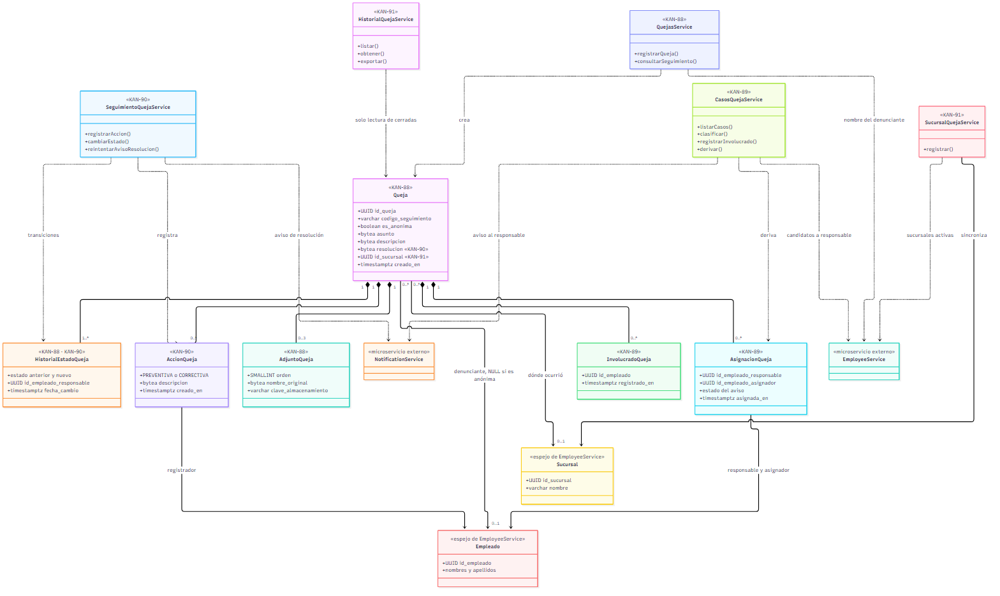
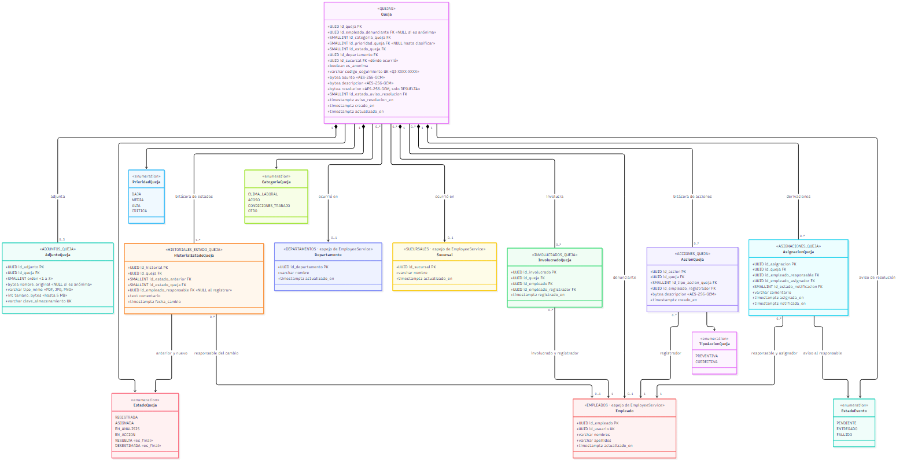
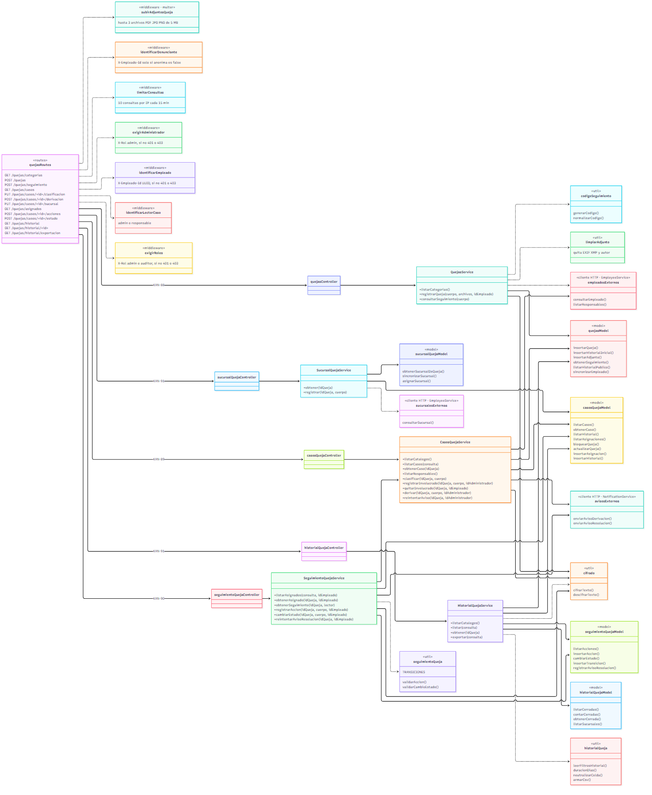
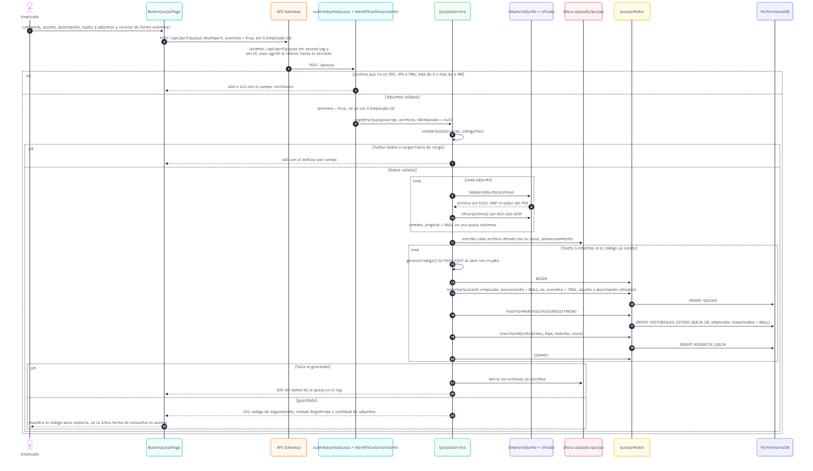
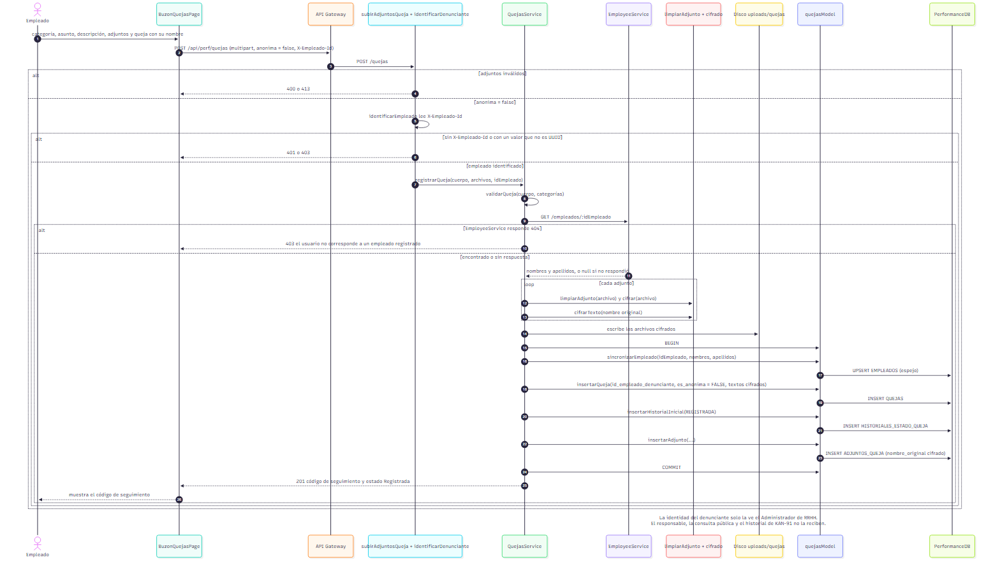
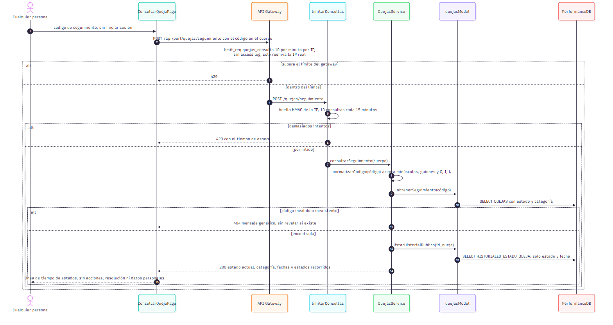
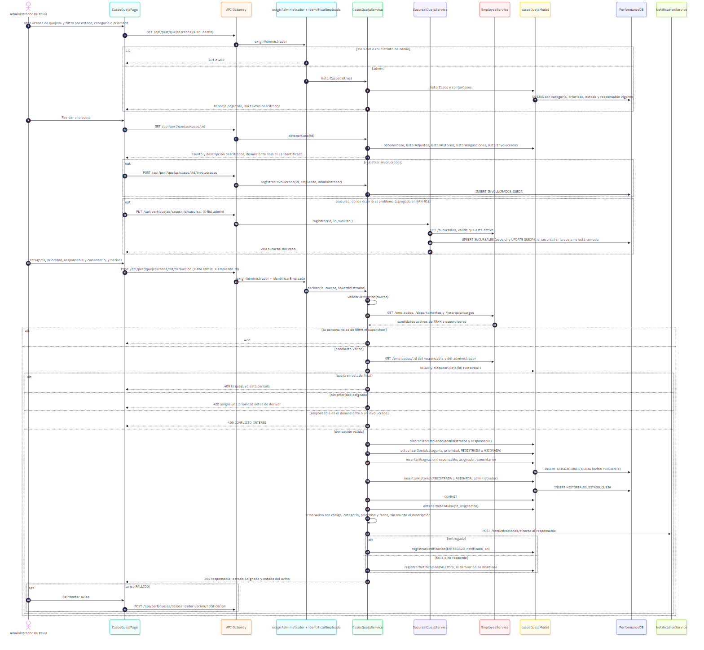
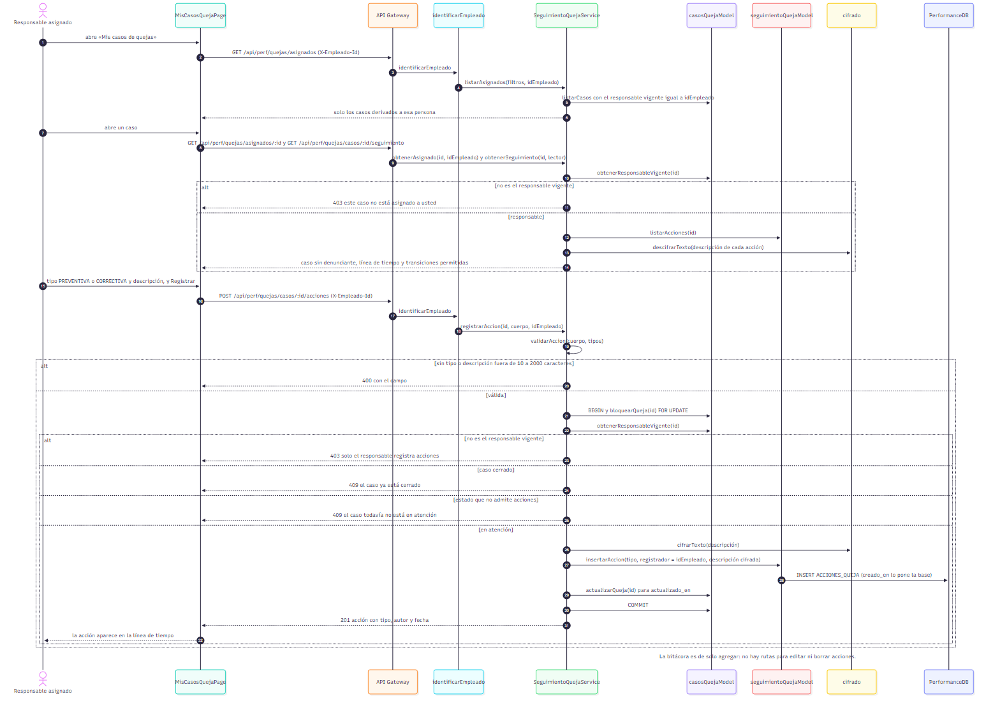
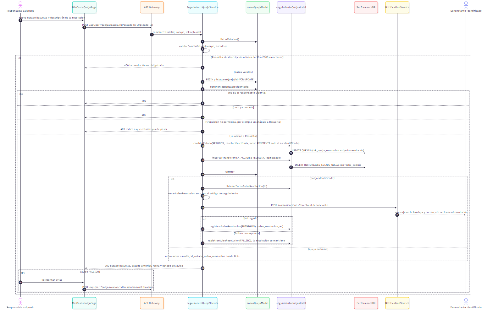
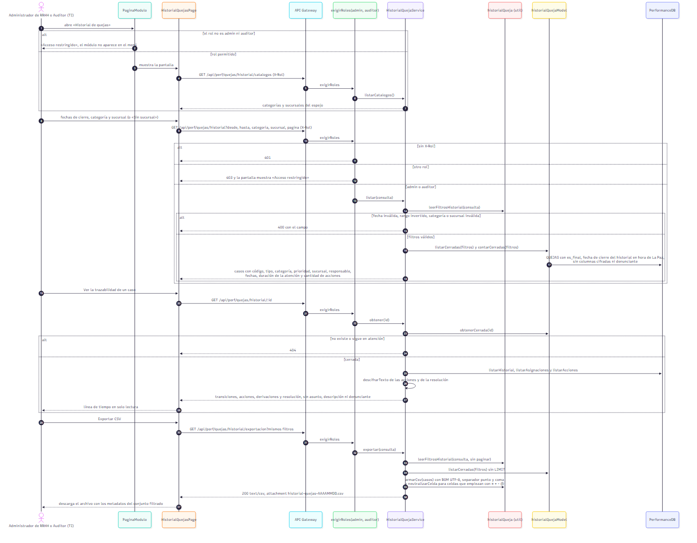

# Épica 12 · Buzón de quejas internas y bienestar laboral

Documentación UML de la épica 12 del Sistema de RR.HH. del ERP de supermercado (**KAN-405**). Incluye una **vista general** con el diagrama de clases de toda la épica y una **vista detallada** con el modelo de dominio, las capas del servicio y un diagrama de secuencia por cada flujo.

Todo vive en **PerformanceService** (PerformanceDB). Los diagramas salen del código del repositorio: los nombres de tablas, rutas, módulos y funciones son los reales.

Cada diagrama está como **código fuente** (`.mmd`, [Mermaid](https://mermaid.js.org)) y como imagen **PNG** (y **SVG**, vectorial). Para cambiar un diagrama se edita su `.mmd` y se regeneran las imágenes con [`generar-diagramas.sh`](generar-diagramas.sh).

## Contenido

1. [Historias de la épica](#historias-de-la-épica)
2. [Vista general](#1-vista-general)
3. [Diagramas de clases detallados](#2-diagramas-de-clases-detallados)
4. [Diagramas de secuencia por flujo](#3-diagramas-de-secuencia-por-flujo)
5. [Reglas de privacidad que muestran los diagramas](#4-reglas-de-privacidad-que-muestran-los-diagramas)
6. [Trazabilidad con el código](#5-trazabilidad-con-el-código)
7. [Cómo regenerar las imágenes](#6-cómo-regenerar-las-imágenes)

## Historias de la épica

| Historia | Requerimiento | Qué resuelve |
|---|---|---|
| **KAN-88** | RF-68 · Registro de quejas | Buzón con opción anónima, hasta 3 adjuntos sin metadatos, textos cifrados con AES-256-GCM y consulta pública del estado por código de seguimiento |
| **KAN-89** | RF-69 · Clasificación y derivación | Bandeja del Administrador de RRHH, prioridad, involucrados, derivación a RRHH o a un supervisor con control de conflicto de interés y aviso al responsable |
| **KAN-90** | RF-70 · Atención del caso | Bitácora cifrada de acciones preventivas y correctivas, transiciones de estado validadas, resolución obligatoria y aviso al denunciante identificado |
| **KAN-91** | RF-71 · Historial y trazabilidad | Historial de quejas cerradas para el Administrador de RRHH y el Auditor (TI), filtros por fecha de cierre, categoría y sucursal, exportación CSV y bitácora en solo lectura |

## 1. Vista general

### 1.1 Diagrama de clases de la épica

Las entidades de la épica con sus atributos clave y los servicios que las usan, marcados con la historia que los introdujo. `Empleado` y `Sucursal` son tablas espejo de EmployeeService: guardan el mismo UUID y el nombre para mostrar, sin claves foráneas entre bases de datos.



## 2. Diagramas de clases detallados

### 2.1 Modelo de dominio

Las tablas de la épica con todos sus atributos, tal como están en `db/init.sql`, y los catálogos (en `db/catalogos.sql`) como enumeraciones. Los campos `bytea` marcados con AES-256-GCM guardan `iv + authTag + texto cifrado`.



### 2.2 Capas del servicio

Cómo se reparte la lógica en PerformanceService: rutas de `quejasRoutes.js`, middlewares de identificación y permisos, controladores, servicios, modelos, utilidades y clientes HTTP hacia EmployeeService y NotificationService.



## 3. Diagramas de secuencia por flujo

| # | Flujo | Historia | Diagrama |
|---|---|---|---|
| 1 | Registro de una queja anónima | KAN-88 | [sec-01](detallados/sec-01-kan88-registro-anonimo.png) |
| 2 | Registro de una queja identificada | KAN-88 | [sec-02](detallados/sec-02-kan88-registro-identificado.png) |
| 3 | Consulta pública por código de seguimiento | KAN-88 | [sec-03](detallados/sec-03-kan88-consulta-codigo.png) |
| 4 | Clasificación y derivación con aviso al responsable | KAN-89 | [sec-04](detallados/sec-04-kan89-clasificacion-derivacion.png) |
| 5 | Registro de una acción preventiva o correctiva | KAN-90 | [sec-05](detallados/sec-05-kan90-registro-accion.png) |
| 6 | Resolución del caso con aviso al denunciante | KAN-90 | [sec-06](detallados/sec-06-kan90-resolucion.png) |
| 7 | Consulta y exportación del historial con validación de rol | KAN-91 | [sec-07](detallados/sec-07-kan91-historial-exportacion.png) |

### 3.1 Registro de una queja anónima (KAN-88)

El gateway no reenvía IP, user-agent ni referer y no deja logs. El servicio no lee `X-Empleado-Id`, quita los metadatos de los adjuntos, no guarda su nombre original y escribe `id_empleado_denunciante = NULL`.



### 3.2 Registro de una queja identificada (KAN-88)

Igual que el anónimo, pero identifica al empleado, consulta su nombre en EmployeeService y lo guarda en la tabla espejo `EMPLEADOS`.



### 3.3 Consulta pública por código de seguimiento (KAN-88)

Doble límite contra la fuerza bruta (gateway y servicio). Solo devuelve los estados y sus fechas.



### 3.4 Clasificación y derivación con aviso al responsable (KAN-89)

Incluye el bloque opcional de la sucursal del caso, que KAN-91 agregó para poder filtrar el historial.



### 3.5 Registro de una acción (KAN-90)



### 3.6 Resolución con aviso al denunciante (KAN-90)



### 3.7 Consulta y exportación del historial (KAN-91)



## 4. Reglas de privacidad que muestran los diagramas

- **Anonimato:** una queja anónima no guarda ningún dato de quien la presenta (`chk_queja_anonimato`). El primer registro del historial tampoco tiene autor.
- **Identidad del denunciante:** en una queja identificada solo la ve el Administrador de RRHH en «Casos de quejas». El responsable, la consulta pública, el historial y su exportación muestran solo si fue anónima o identificada.
- **Cifrado:** asunto, descripción, nombre de los adjuntos, acciones y resolución se guardan cifrados. Se descifran solo en los detalles (caso del administrador, caso del responsable y trazabilidad del historial), nunca en las bandejas, el listado del historial ni el CSV.
- **Avisos:** el aviso al responsable lleva código, categoría, prioridad y fecha. El aviso al denunciante lleva solo el código. Ninguno lleva el contenido de la queja.
- **Sucursal:** `QUEJAS.id_sucursal` indica dónde ocurrió el problema y la registra RRHH. No se deriva de quien presentó la queja.
- **Historial (KAN-91):** «queja cerrada» es una queja en un estado con `es_final` (hoy `RESUELTA`). La fecha de cierre es la de la última fila de ese estado en `HISTORIALES_ESTADO_QUEJA`. Los casos sin sucursal aparecen sin filtro de sucursal o con «Sin sucursal».
- **Permisos (KAN-91):** el historial, su detalle y la exportación exigen `X-Rol` `admin` o `auditor` (`exigirRoles`). Sin rol se responde 401 y con otro rol, 403. El frontend además oculta el módulo a los demás roles.

## 5. Trazabilidad con el código

| Elemento | Ubicación |
|---|---|
| Tablas y catálogos | `db/init.sql`, `db/catalogos.sql`, `db/aclaracion.md` |
| Rutas | `src/routes/quejasRoutes.js` |
| Registro y consulta por código | `src/services/quejasService.js`, `src/models/quejasModel.js` |
| Clasificación y derivación | `src/services/casosQuejaService.js`, `src/models/casosQuejaModel.js`, `src/utils/casosQueja.js` |
| Acciones y estados | `src/services/seguimientoQuejaService.js`, `src/models/seguimientoQuejaModel.js`, `src/utils/seguimientoQueja.js` |
| Historial y exportación | `src/services/historialQuejaService.js`, `src/models/historialQuejaModel.js`, `src/utils/historialQueja.js` |
| Sucursal del caso | `src/services/sucursalQuejaService.js`, `src/models/sucursalQuejaModel.js`, `src/services/sucursalesExternas.js` |
| Permisos | `src/middlewares/exigirAdministrador.js`, `identificarEmpleado.js`, `identificarLectorCaso.js`, `exigirRoles.js` |
| Avisos | `src/services/avisosExternos.js` → NotificationService `POST /comunicaciones/directa` |
| Gateway | `nginx/default.conf` (`/api/perf/quejas` y `/api/perf/quejas/seguimiento`) |
| Pantallas | `frontend/src/features/quejas/` (buzón y consulta), `quejas/casos/` (casos y mis casos), `quejas/historial/` (historial) |

| Método y ruta | Rol | Historia |
|---|---|---|
| `POST /quejas` | empleado o anónimo | KAN-88 |
| `POST /quejas/seguimiento` | público, con límite por IP | KAN-88 |
| `GET /quejas/casos`, `GET /quejas/casos/:id` | admin | KAN-89 |
| `PUT /quejas/casos/:id/clasificacion`, `POST /quejas/casos/:id/derivacion` | admin | KAN-89 |
| `GET /quejas/asignados`, `POST /quejas/casos/:id/acciones`, `POST /quejas/casos/:id/estado` | responsable vigente | KAN-90 |
| `GET` y `PUT /quejas/casos/:id/sucursal` | admin | KAN-91 |
| `GET /quejas/historial`, `/historial/:id`, `/historial/catalogos`, `/historial/exportacion` | admin o auditor | KAN-91 |

## 6. Cómo regenerar las imágenes

Requisitos: Node.js y un navegador Chromium. El script usa `npx @mermaid-js/mermaid-cli`, que se descarga en la caché de npm la primera vez (no se instala de forma global).

```bash
bash backend/PerformanceService/docs/epica-12/generar-diagramas.sh
```

Genera, junto a cada `.mmd`, su `.png` y su `.svg`. Para un PDF de un diagrama: `npx @mermaid-js/mermaid-cli -i archivo.mmd -o archivo.pdf`. Otra opción es pegar el `.mmd` en [mermaid.live](https://mermaid.live) y descargar la imagen.
