# Épica 2 · Selección de postulantes y reclutamiento (CV Screening)

Documentación UML de la épica 2 del Sistema de RR.HH. del ERP de supermercado. Incluye una **vista general** con un diagrama de clases y uno de secuencia para toda la épica, y una **vista detallada** con el modelo de dominio y un diagrama de secuencia por cada flujo principal. Toda la épica vive en **RecruitmentService**.

## Contenido

1. [Historias de la épica](#historias-de-la-épica)
2. [Vista general](#1-vista-general)
   - [Diagrama de clases de la épica](#11-diagrama-de-clases-de-la-épica)
   - [Diagrama de secuencia de la épica](#12-diagrama-de-secuencia-de-la-épica)
3. [Diagrama de clases detallado](#2-diagrama-de-clases-detallado)
4. [Diagramas de secuencia por flujo](#3-diagramas-de-secuencia-por-flujo)
5. [Notación](#notación)
6. [Trazabilidad con el código](#trazabilidad-con-el-código)

## Historias de la épica

| Historia | Requerimiento | Qué resuelve |
|---|---|---|
| **KAN-28** | RF-08 · Publicación de vacante con requisitos | Convocatoria creada desde un cargo del catálogo, con requisitos de formación, experiencia y habilidades; se publica solo si está completa |
| **KAN-29** | RF-09 · Registro de postulantes | Datos personales y de contacto del candidato, sin duplicar postulantes ni postulaciones a la misma vacante |
| **KAN-30** | RF-10 · Carga digital de CV | CV en PDF o DOCX de hasta 5 MB, guardado en disco local u OCI S3 y vinculado a la postulación |
| **KAN-31** | RF-11 · Extracción automática de datos del CV | Educación, años de experiencia y destrezas con un modelo de lenguaje; si falla, el reclutador carga los datos a mano |
| **KAN-32** | RF-12 · Comparación automática de CV vs. requisitos | Porcentaje de afinidad ponderado (educación, experiencia, habilidades) con desglose y marca de apto o no apto |
| **KAN-33** | RF-13 · Ranking de candidatos | Postulantes de mayor a menor afinidad, con desempate, filtros y paginación |
| **KAN-34** | RF-14 · Actualización y trazabilidad del estado | Pipeline por etapas con historial (responsable, fecha, motivo) y alta del contratado en Contabilidad y en el módulo operativo |
| **KAN-35** | RF-15 · Programación y notificación de entrevistas | Agenda de entrevistas con advertencia de solapamiento y correo al candidato por NotificationService |

## 1. Vista general

### 1.1 Diagrama de clases de la épica

Las entidades de la épica agrupadas por historia, con sus atributos clave y sus responsabilidades como operaciones. La `Postulacion` es el eje: de ella cuelgan el CV, los datos extraídos, la afinidad, el historial de etapas, el alta del contratado y las entrevistas. El `Cargo` y el `Empleado` viven en EmployeeService: RecruitmentService guarda solo su UUID.

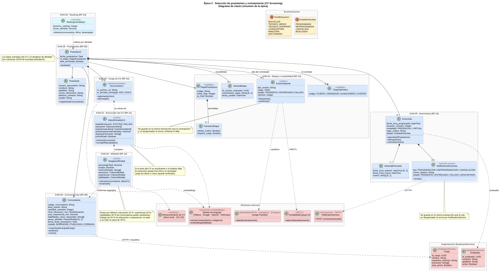

### 1.2 Diagrama de secuencia de la épica

Un recorrido de punta a punta en el orden en que avanza una selección:

1. **KAN-28** · el reclutador crea la convocatoria desde un cargo, ajusta los requisitos y la publica.
2. **KAN-29** · registra al candidato en la convocatoria.
3. **KAN-30 · KAN-31 · KAN-32** · adjunta el CV; se extraen sus datos con un modelo de lenguaje y se calcula la afinidad con los requisitos. Si la extracción falla o es incorrecta, el reclutador corrige los datos y la afinidad se recalcula.
4. **KAN-33** · consulta el ranking de la convocatoria.
5. **KAN-34** · mueve al candidato por las etapas; al contratarlo, el alta se entrega en segundo plano a Contabilidad y al módulo operativo.
6. **KAN-35** · agenda la entrevista; un despachador envía el correo al candidato y los cambios (reprogramación o cancelación) también se le avisan.

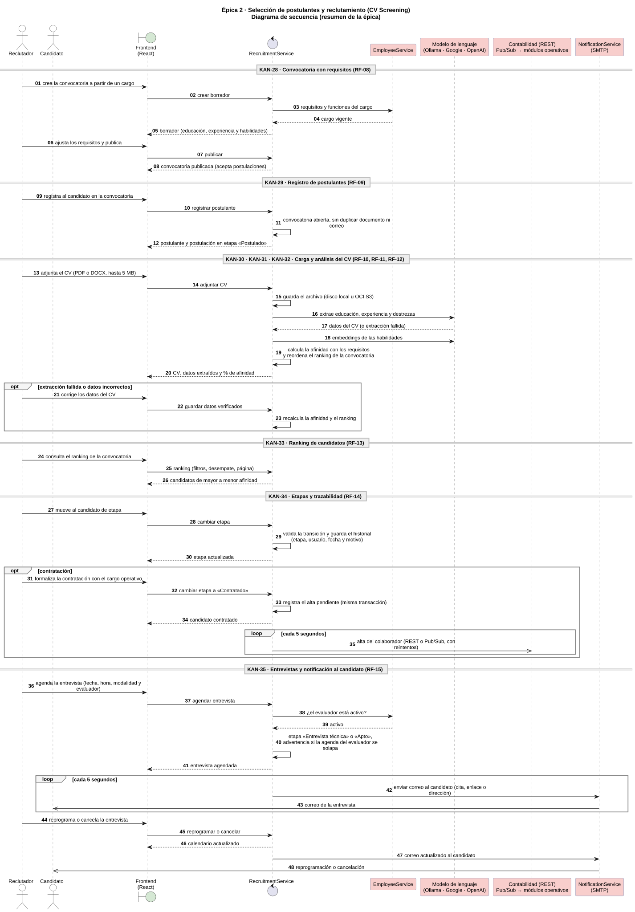

## 2. Diagrama de clases detallado

### 2.1 Modelo de dominio

Las 14 tablas de RecruitmentDB con sus atributos reales, las estructuras JSON que guarda la postulación (datos extraídos del CV y desglose de afinidad), los atributos derivados (`/estado`, `/acepta_postulaciones`, `/fecha_hora_fin`), los catálogos, las multiplicidades y las referencias a otros servicios (UUID sin clave foránea).

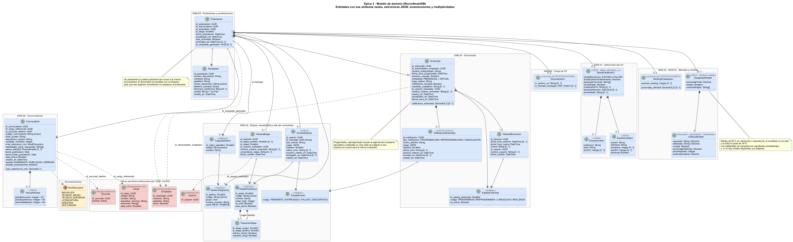

## 3. Diagramas de secuencia por flujo

Cada diagrama sigue las capas del servicio: pantalla → API Gateway → middleware → controlador → servicio → modelo → RecruitmentDB, más los sistemas externos.

### 3.1 KAN-28 · Convocatoria con requisitos

Borrador a partir del cargo del catálogo (EmployeeService), edición de requisitos con recálculo de la afinidad, publicación con validación de los campos obligatorios y cierre.

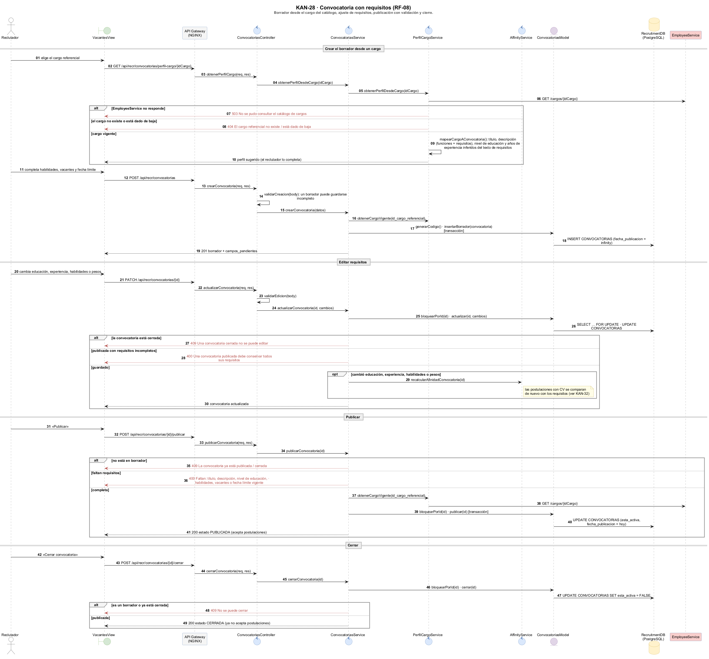

### 3.2 KAN-29 · Registro de postulantes

Convocatoria abierta, bloqueo por documento para que dos registros simultáneos no dupliquen al postulante, rechazo de correos repetidos y de postulaciones repetidas a la misma vacante.

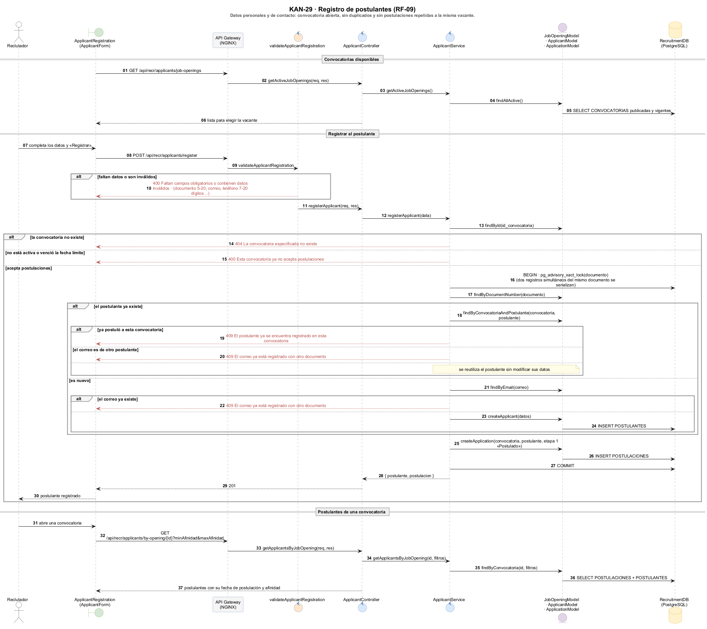

### 3.3 KAN-30 · Carga de CV

Registro del postulante y carga del CV son pasos separados: el CV se adjunta a una postulación existente. Validación de formato y tamaño, almacenamiento local o en OCI S3 y descarga o vista del documento.

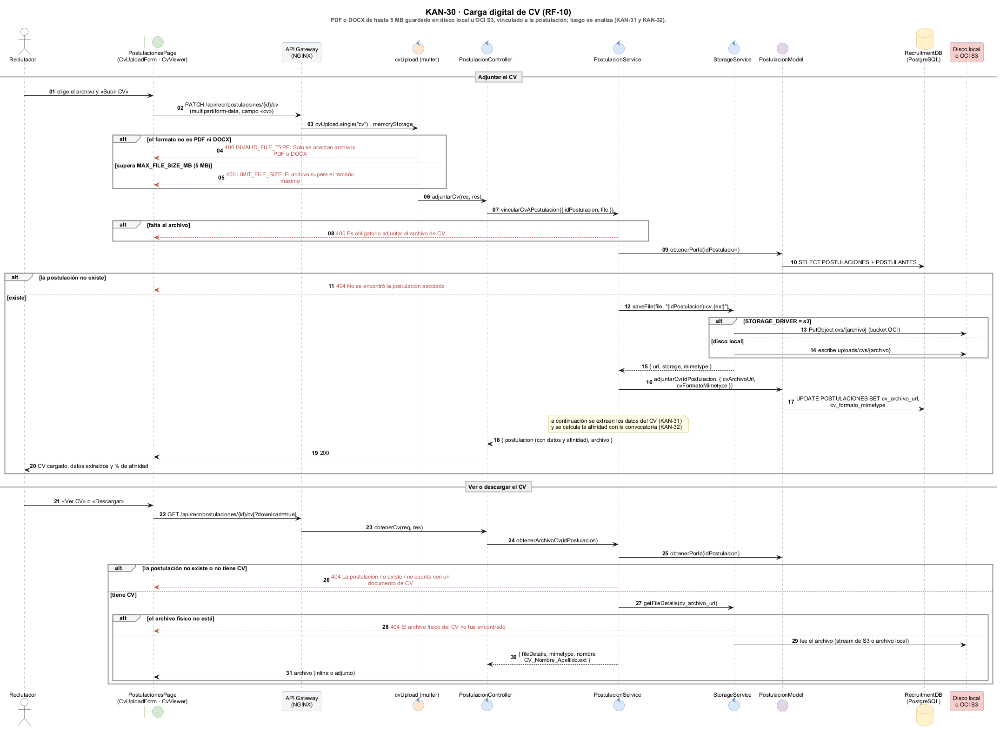

### 3.4 KAN-31 · Extracción automática del CV

Visión multimodal sobre las páginas del PDF o, si no sirve, extracción de texto (mínimo 200 caracteres) y análisis con el modelo de lenguaje, con un extractor por expresiones regulares como respaldo. Si no hay manera de leerlo, la extracción queda fallida y el reclutador corrige los datos a mano.

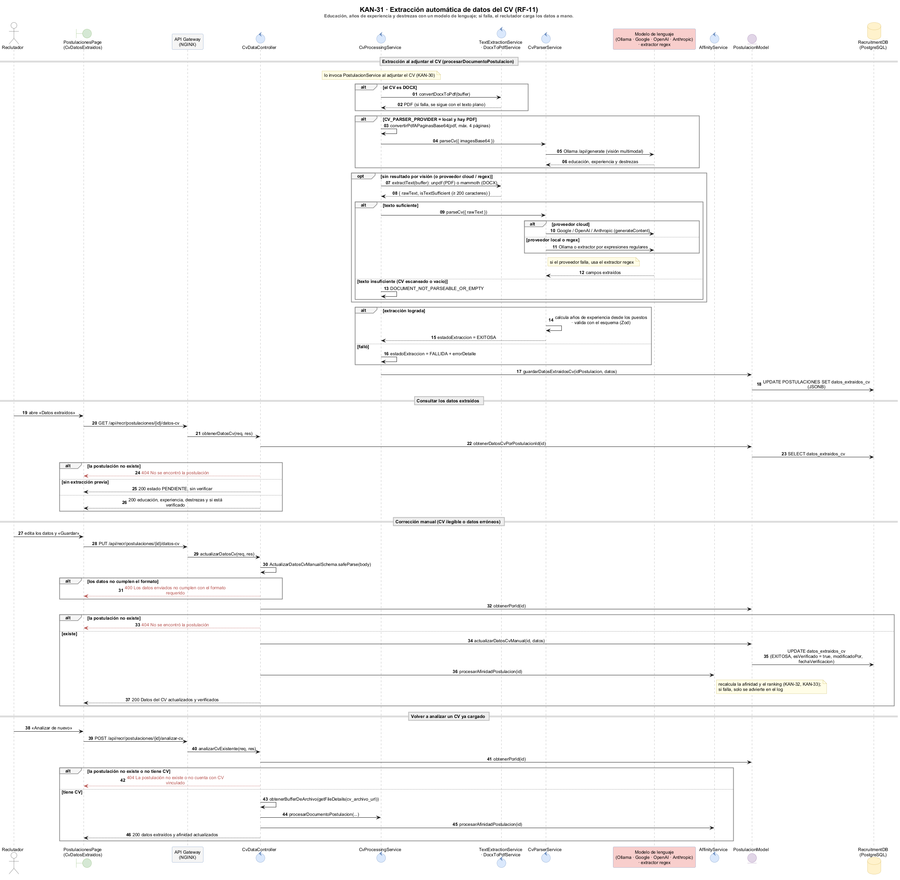

### 3.5 KAN-32 · Comparación de CV vs. requisitos

Educación, experiencia y habilidades (por significado con embeddings, o por palabras si el modelo no responde) con los pesos de la convocatoria. Debajo del 50 % del mínimo en educación o experiencia el candidato no es apto y su total no pasa de 49 %. Cada cálculo reasigna el ranking.

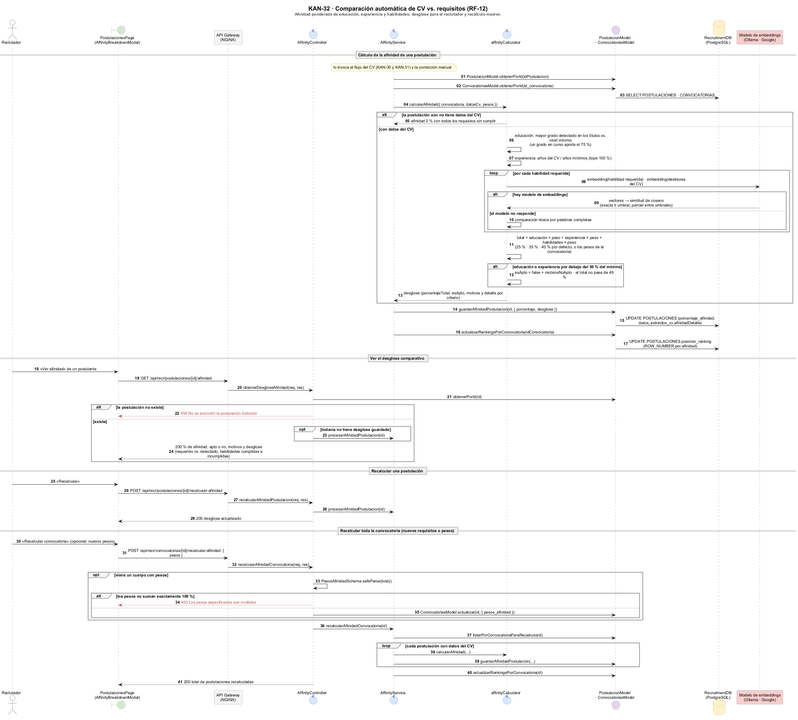

### 3.6 KAN-33 · Ranking de candidatos

Orden por afinidad con criterio de desempate (experiencia, fecha de postulación o educación), filtros por experiencia mínima, etapa y ciudad, y paginación.

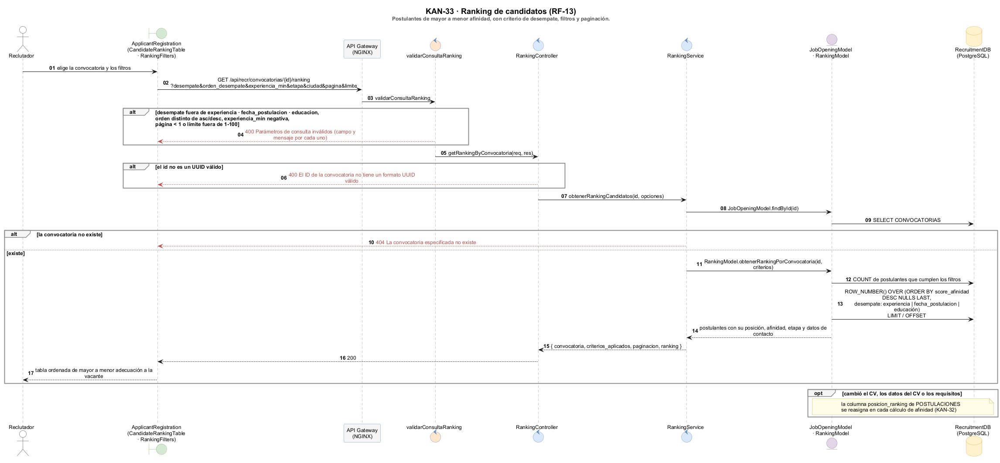

### 3.7 KAN-34 · Cambio de etapa y trazabilidad

Tablero por etapas, transiciones permitidas por catálogo, bloqueo de la postulación para que dos cambios simultáneos no partan de la misma etapa, historial con responsable y motivo, archivado al rechazar y control de vacantes al contratar.

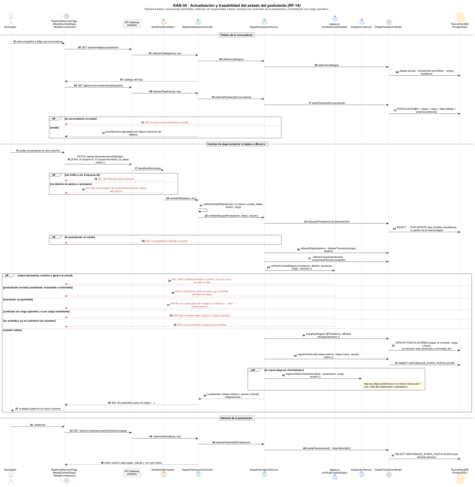

### 3.8 KAN-34 · Alta del colaborador contratado

Patrón outbox: las altas se guardan en la misma transacción que la contratación y un despachador las entrega cada 5 segundos, a Contabilidad por REST y al módulo operativo del cargo por Google Pub/Sub, con reintentos de espera creciente y reintento manual de las fallidas.

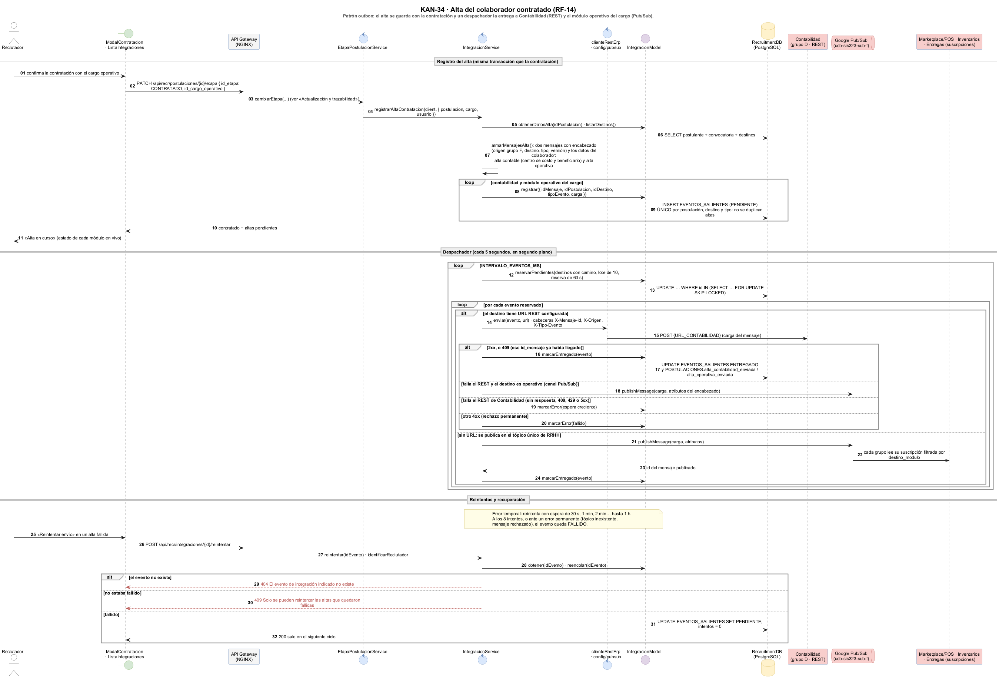

### 3.9 KAN-35 · Programación de entrevistas

Agenda del evaluador, validación del evaluador en EmployeeService, etapa del postulante, advertencia de solapamiento (el reclutador puede guardar de todas formas), reprogramación y cancelación con motivo, y registro de cada cambio.

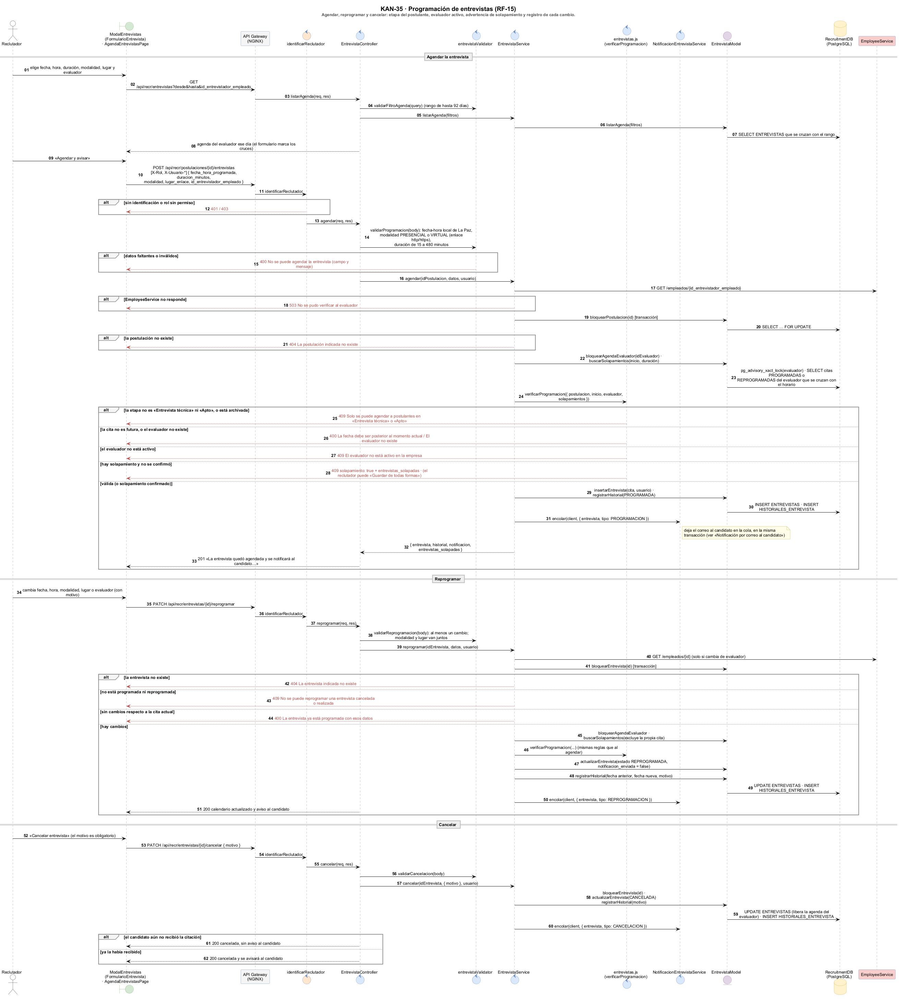

### 3.10 KAN-35 · Notificación por correo al candidato

Los avisos quedan en cola en la misma transacción que la cita; un despachador los envía por NotificationService (SMTP). Un aviso nuevo reemplaza al que no salió, una cancelación sin citación previa no se envía y los fallos temporales se reintentan.

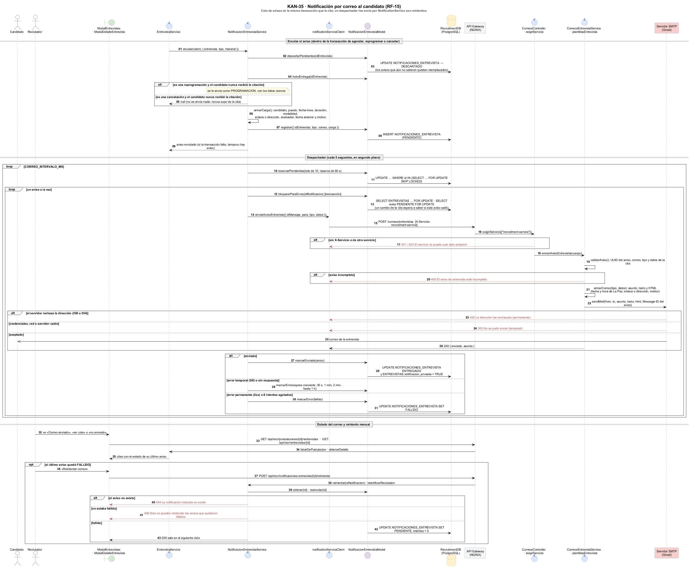

## Notación

| Elemento | Significado |
|---|---|
| ◆ línea continua | Composición: la parte no existe sin el todo |
| → línea continua | Asociación navegable |
| - - → línea punteada | Dependencia o referencia por UUID sin clave foránea («HTTP», «REST», «publica») |
| `/atributo` | Atributo derivado: se calcula, no se almacena |
| `[0..1]` | Atributo opcional |
| `«JSON»` | Estructura guardada en una columna JSON de la postulación |
| Flecha llena | Llamada síncrona |
| Flecha punteada | Respuesta |
| Flecha abierta | Mensaje asíncrono (correos y eventos) |
| Flecha roja punteada | Respuesta de error (400, 401, 403, 404, 409, 422, 503) |
| `alt` · `opt` · `loop` | Alternativas · opcional · repetición |

**Colores:** verde = pantalla · gris = API Gateway · naranja = middleware · azul = controlador o servicio · morado = modelo · amarillo = enumeración o base de datos · rojo = sistema externo.

## Trazabilidad con el código

| Historia | Rutas | Servicio | Modelo | Pantalla |
|---|---|---|---|---|
| KAN-28 | `routes/convocatorias.js` | `convocatoriasService.js`, `perfilCargoService.js` | `convocatoriasModel.js` | `features/Vacantes` |
| KAN-29 | `routes/applicantRoutes.js`, `routes/convocatoriaRoutes.js` | `applicantService.js` | `applicantModel.js`, `applicationModel.js`, `jobOpeningModel.js` | `features/recruitment/ApplicantRegistration.jsx` |
| KAN-30 | `routes/postulacionRoutes.js` | `postulacionService.js`, `storageService.js` | `postulacionModel.js` | `features/postulaciones` |
| KAN-31 | `routes/cvDataRoutes.js` | `cvProcessingService.js`, `textExtractionService.js`, `docxToPdfService.js`, `cvParserService.js`, `cvAdapters/` | `postulacionModel.js` | `features/postulaciones/components/CvDatosExtraidos.jsx` |
| KAN-32 | `routes/affinityRoutes.js` | `affinityService.js`, `utils/affinityCalculator.js` | `postulacionModel.js`, `convocatoriasModel.js` | `features/recruitment/components/AffinityBreakdownModal.jsx` |
| KAN-33 | `routes/rankingRoutes.js` | `rankingService.js` | `rankingModel.js` | `features/recruitment/CandidateRankingTable.jsx` |
| KAN-34 | `routes/etapaPostulacionRoutes.js` | `etapaPostulacionService.js`, `integracionService.js`, `clienteRestErp.js`, `config/pubsub.js`, `utils/etapas.js`, `utils/integracion.js` | `etapaPostulacionModel.js`, `integracionModel.js` | `features/recruitment/pipeline` |
| KAN-35 | `routes/entrevistaRoutes.js` | `entrevistaService.js`, `notificacionEntrevistaService.js`, `notificationServiceClient.js`; en NotificationService: `correosEntrevista.service.js`, `plantillasEntrevista.js` | `entrevistaModel.js`, `notificacionEntrevistaModel.js` | `features/recruitment/entrevistas` |

Rutas, servicios y modelos están en `backend/RecruitmentService/src/`; el correo se envía desde `backend/NotificationService/src/`; las pantallas están en `frontend/src/`. El esquema de la base está en [`db/init.sql`](../../db/init.sql) y sus aclaraciones en [`db/aclaracion.md`](../../db/aclaracion.md).

Para regenerar las imágenes: `java -jar plantuml.jar -charset UTF-8 -tsvg general/*.puml` y `-tpng detallados/*.puml`.
